<div align="center">

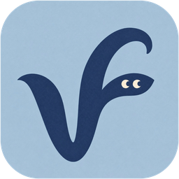

# VoxFigura

**物理声道驱动的实验语音学、发音标注、声道重建与声乐编曲工作台**

[](https://github.com/Nephelium/VoxFigura)
[](https://nephelium.github.io/VoxFigura/)
[](./LICENSE)
[](./package.json)
[](#voxfigura-core-端侧纯-onnx-模型体系)
[](#方式一windows-x64-单文件免安装桌面版)
[](#工程架构与独立组件包)

[项目定位与核心亮点](#项目定位与核心亮点) · [动态演示](#动态演示与三维联合重建) · [九大模块详解与界面预览](#九大核心模块详解与界面预览) · [语法速查与导出矩阵](#核心语法速查与科研导出矩阵) · [模型体系与评测](#voxfigura-core-端侧纯-onnx-模型体系) · [外观与 AI 助手](#外观系统与-ai-协同工作流) · [工程架构](#工程架构与独立组件包) · [快速开始与部署](#快速开始与部署指南) · [许可与致谢](#开源许可与学术致谢)

</div>

---

**VoxFigura** 是一款面向语言学与实验语音学研究、声乐教学及语音科普创作者的物理声道驱动工作台。它将原本分散在三维声道仿真器（VocalTractLab 2.4）、Praat TextGrid 标注、神经声码器、方言田野调型分析、声乐简谱编曲与非线性音视频剪辑之间的工作流程整合入同一工程文件（`.vcproj`），围绕 **48,000 Hz 整数采样**与半开区间 `[start_smp, end_smp)` 构建无漂移时间轴。

在这里，研究者既可以从实录语音出发，以 **50 Hz** 反演 **27 维声道与声门发声动力学轨迹**并实时驱动三维透视人头与声带三视图，也可以由中、英、日、粤语文本、方括号国际音标 `[IPA]`、VoQS 大括号发声标记与五种通用键盘简谱驱动**物理声管 + 神经声码器双通道合成**。

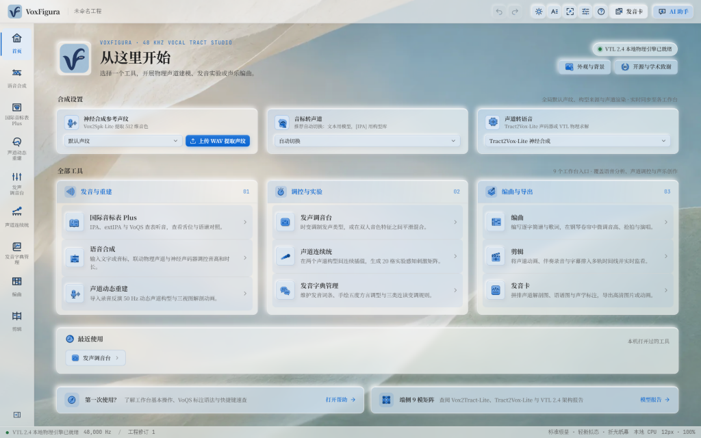

---

## 项目定位与核心亮点

传统实验语音学与声乐物理合成研究往往需要频繁跨软件倒手：在 Praat 中切分 TextGrid 与测共振峰、在独立仿真器里手动调校构音参数、在外部脚本中运行神经网络推理、再回到剪辑软件拼接声道动画与双行字幕。VoxFigura 通过统一的物理控制空间与前端模块化工程解决这一割裂：

| 维度 | 传统分散工作流 | VoxFigura 一体化工作台 |
| :--- | :--- | :--- |
| **时间轴与量纲** | 多工具各自按毫秒浮点切分，反复重采样易累积偏移 | 全链路锁定 `48,000 Hz` 整数采样与 `[start_smp, end_smp)`，气压统一使用 `Pa`（`0–1600 Pa`），越界即拒绝且绝不静默夹紧 |
| **双通道声源** | 物理声道发声机械或只能单独跑神经声码器 | **VTL 2.4（48 kHz 65 截面物理声管）** 与 **Tract2Vox-Lite（512 维声纹神经声码器）** 一键实时对听 |
| **反演与对齐** | 依赖庞大的 WavLM 底座模型与外部 MFA 管线 | 端侧 **8 项核心纯 ONNX Runtime 模型**（总计 `37.44 M` 参数 · `77.61 MiB`），零 PyTorch 依赖纯 CPU 秒级推理 |
| **发音与方言体系** | 词典、调型、连读规则和音标构型分散在独立脚本 | 集成 **655 项 IPA/extIPA/VoQS**、10 套汉语注音、粤语/英语/日语词典、赵氏五度 PCHIP 双画布与三类非递归连读变调 |
| **科研到出版闭环** | 实验图表需截图拼接，视频动画与字幕对齐繁琐 | 跨区数据一键流转，内置**发音卡工坊**（PNG/MP4/GIF）与**非线性剪辑台**（`V0–V3` + `A1–A12` + 双行卡拉 OK 字幕） |

---

## 动态演示与三维联合重建

### 跨语言神经声道连续统实机演示（普通话「算」`[swən]` → 英语 `swan` `[swɑn]`）

下方动图由实机录屏直接转制：在「声道连续统」中以真实录音为端点 A/B 构建 5 格生理连续统，鼠标点击任意格即可实时预览 2D 矢状面轮廓、`A+B` 舌位叠影、`F1–F2` 元音空间轨迹迁移与关键构音参数变化表，并可直接试听或导出感知实验刺激包。

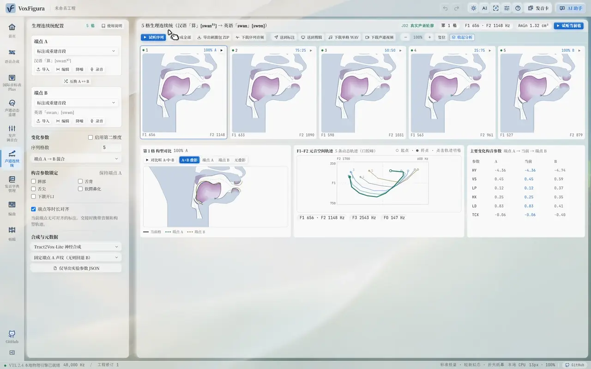

> 完整有声 MP4 演示视频（1600×1000 H.264 + AAC）：[点击查看或下载 continuum-neural-demo.mp4](./docs/media/continuum-neural-demo.mp4)

### 实时三维透视人头—声道联合重建与声门三视图（暗色主题实机）

依托浏览器本地 **MediaPipe Face Landmarker（468 点面部网格）** 与 **Three.js**，可在不上传任何摄像头画面的前提下完成面部姿态跟踪与透视人头变形，并与端侧 50 Hz 实时反演的内部三维声道、声门俯视喉镜与 Cover–Body 冠状面黏膜波同屏联动（支持 `3/4 透视`、`侧面声道`、`正面特征`、`聚焦声带` 四视角及实时切换嘎裂、气声、假声等发声类型）。

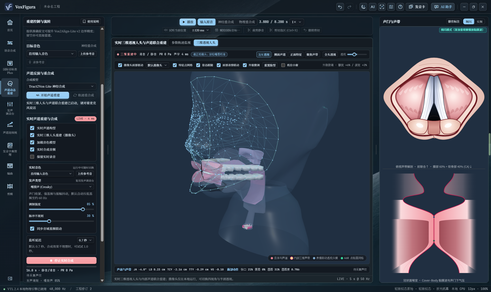

---

## 九大核心模块详解与界面预览

VoxFigura 由**三大能力集群、九大公共工作区**协同构成，任意工作区的音频、TextGrid、50 Hz 轨迹与构型状态均可跨区直传或汇入发音卡工坊。

| 能力集群 | 模块 | 核心能力摘要 |
| :--- | :--- | :--- |
| **01 发音与重建** | **[语音合成与标注](#1-语音合成与实时声学四联分析)** | 中英日粤混排文本、`[IPA]`、`{VoQS}` 与 `.TextGrid` 编译；32 维窄标协同构音；65 截面 `A(x)` / `H(f)` / 唇形 / 元音空间四联图；5 层联动时间轴与无损同步剪切 |
| **01 发音与重建** | **[国际音标表 Plus](#2-国际音标表-plus655-项完整体系与实录库)** | 655 项 IPA / extIPA / VoQS 符号；308 项实录索引（276 份实录 + 267 份人工精修 TextGrid）；余弦升窗目标帧微调；单音/全库 ZIP（含声带视频）导出 |
| **01 发音与重建** | **[声道动态重建](#3-声道动态重建与三视图解剖联动)** | 端侧 50 Hz 27 维联合反演与双语强制对齐；9 轨完整 27 维参数巡检；矢状面/喉镜/冠状面三视图；MediaPipe 3D 透视人头与按需离线 SenseVoice-Small 转写 |
| **02 调控与实验** | **[发声调音台](#4-发声调音台时变调制与双人多器官迁移)** | 13 项正式 VoQS 预设时变调制与防爆音双门控；双人 9 轨器官/韵律/512 维音色 SLERP 混合；12 项发声质量声学指标对比与 CSV 导出 |
| **02 调控与实验** | **[声道连续统](#5-声道连续统感知实验刺激矩阵)** | 单轴（2–51 格）与双轴（2–16 × 2–8 格）阻音保护生理连续统；5 组构音锁定；`A+B` 叠影与 `F1–F2` 轨迹；PsychoPy/E-Prime 刺激包 ZIP 一键导出 |
| **02 调控与实验** | **[发音字典管理](#6-发音字典管理与方言调型工作室)** | 个人 > 内置 > 方言三层优先级；10 套汉语注音、粤语 Rime+Unihan、CMUdict、日语 `ja-accent-v1`；赵氏五度 PCHIP + Hz 双画布与三类非递归连读变调 |
| **03 编曲与导出** | **[声乐编曲台](#7-声乐编曲台五种简谱钢琴卷帘与辅音抢拍)** | JE 谱、Sparks NMN、jianpu-ly、jianpu-player、番茄简谱双向同步；《...》单字包裹；辅音抢拍；数字波导乐器与 MIDI/VSQX/SVP 互通 |
| **03 编曲与导出** | **[非线性剪辑台](#8-非线性剪辑台多层合成运镜节拍卡点与成片)** | `V0–V3`（各最多 8 子轨）与 `A1–A12`（含 `A3` 伴奏）；8 调色 × 6 运镜 × 8 缓动 × 9 转场；本地低频节拍识别卡点；1080p MP4/WebM & SRT/ASS |
| **03 编曲与导出** | **[发音卡工坊](#9-发音卡工坊嵌套分栏排版与多格式动图视频)** | 16 个跨区模块；递归分栏树与五区拖拽吸附；6 色板 × 8 风格 × 9 字体；浏览器端 PNG（剪贴板直贴）与代理 FFmpeg 编码 MP4/GIF |

---

### 1. 语音合成与实时声学四联分析

面向精细发音教学与可控物理语音合成的主工作台：
- **空间分区与快捷交互**：顶栏提供「打开文件」直载与按需滑出的「语料目录」抽屉；上半区三栏集成全高「音素替换」板（元音/辅音/附加符/收藏，按住 `Ctrl` 单击仅复制不改轨）、2D/3D「声道剖面」（内建按需滑出的 19 维「精调参数」侧栏与标准 IPA 一键「复位」）以及默认四图全展开的「声学分析」。
- **四联实时声学求解**：实时绘制 **65 截面面积函数 `A(x)`**（支持拖动扫描任意截面位置与自动追踪最窄收窄点 `Amin`）、**传递函数 `H(f)`**（区分口腔峰 `F`、口鼻耦合峰 `P` 与反共振零点 `Z`，支持 `5 / 8 kHz` 切换）、**96 点横截面 & 正面唇形**（可直拖舌侧缘 `TS1–TS3` 与 `lip_width`）以及 **F1–F2 声学元音图**（原音 Burg 与构型 `H(f)` 双来源、对数/线性坐标、10 秒轨迹尾迹）。
- **48 kHz 通栏五层时间轴**：同步展开音节/TextGrid、音素、构型关键帧菱形（弹窗支持 420–1200 ms 局部试听）、VoQS 发声类型（5 通道快速编辑 + 近全屏 1×–6× 放大编辑器）以及 3 阶临界阻尼 qTA 基频与 `0–1600 Pa` 声门下压手绘包络。载入真实录音后支持「原音 / DPDFNet 降噪 / 编辑音频 / 重合成」四路切换、内联「声道重建并对齐」及原子级同步剪切。


---

### 2. 国际音标表 Plus（655 项完整体系与实录库）

- **全量符号与构型体系**：收录标准 IPA `381` 项、ICPLA 2025 临床扩展音标 extIPA `209` 项与 VoQS 音质符号 `65` 项共 **655 项**条目，配套 `PTBIPAPlus` / `Doulos SIL` 字体防附加符错位，支持符号/中英文名/别名/`U+` 码位跨表检索与悬停释义浮卡。
- **308 项实录语谱对照与目标帧精修**：内置 `276` 份有效本地实录与 `267` 份人工精修 TextGrid、16 点元音四边形、F1–F3 原音/声道共振峰对比表及 `20 ms` Hann 窗 `0–6 kHz` 语谱图。支持在「编辑方案构型 / 录音反演静态 / 动态构型」间切换，对具备 50 Hz 轨迹的实录可使用**余弦升窗增量叠加**微调目标帧并重合成。
- **安全派生与资料导出**：默认方案只读保护，一键派生自定义构型方案并支持麦克风无损录制个人示范音频（存入 IndexedDB）；支持将单音构型、附加符号或 VoQS 声门锚点直接写入主标注时间轴，以及导出单条或全库科研资料 ZIP（含原音 WAV、TextGrid、重建音 WAV、50 Hz 轨迹 JSON 与可选声带频闪 MP4）。

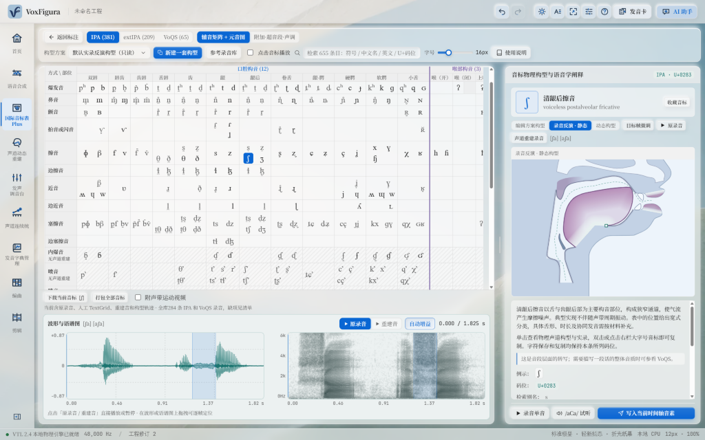

---

### 3. 声道动态重建与三视图解剖联动

- **离线实录反演与强制对齐**：导入 `WAV / MP3 / FLAC / OGG / M4A` 或现场录音，在纯 CPU 环境下由 `Vox2Tract-Lite`（`Vox2TractAlign v4`）单次前向完成 50 Hz 27 维声道/声门反演与中英强制对齐（亦可导入外部 `.TextGrid` 锁定人工边界），中栏同步渲染 `0–8 kHz` 语谱图（1×–12× 缩放与 1 ms / 10 ms 边界微调）及 **9 轨完整 27 维物理参数曲线**（声道 5 轨 17 维 + 声门 4 轨 10 维），右栏同步联动正中矢状面、声门喉镜俯视与 Cover–Body 冠状面三视图（支持频闪 / 实频模式）。
- **无损剪切、稳态赋值与按需转写**：支持「裁剪静音」「剪切选区 (`Ctrl+X`)」「撤销剪切 (`Ctrl+Z` 最多 8 步)」，可将播放头线性插值 19 维构型直接赋给国际音标构型库；录音转写支持手动填写、自配 DeepSeek API，或在界面按需一键下载本地 **`SenseVoice-Small`（int8 ONNX）** 至用户持久缓存离线识别。
- **实时麦克风合成与一键流转**：支持 `0.7–1.0 s` 滑窗延迟下边说话边实时驱动三维透视人头与发声转换音频，运行中零中断热切换参考音色与发声预设，并可一键将结果流转至标注页、调音台、编曲台（保留真人 19 维动态咬字改唱旋律）、剪辑台或连续统端点。

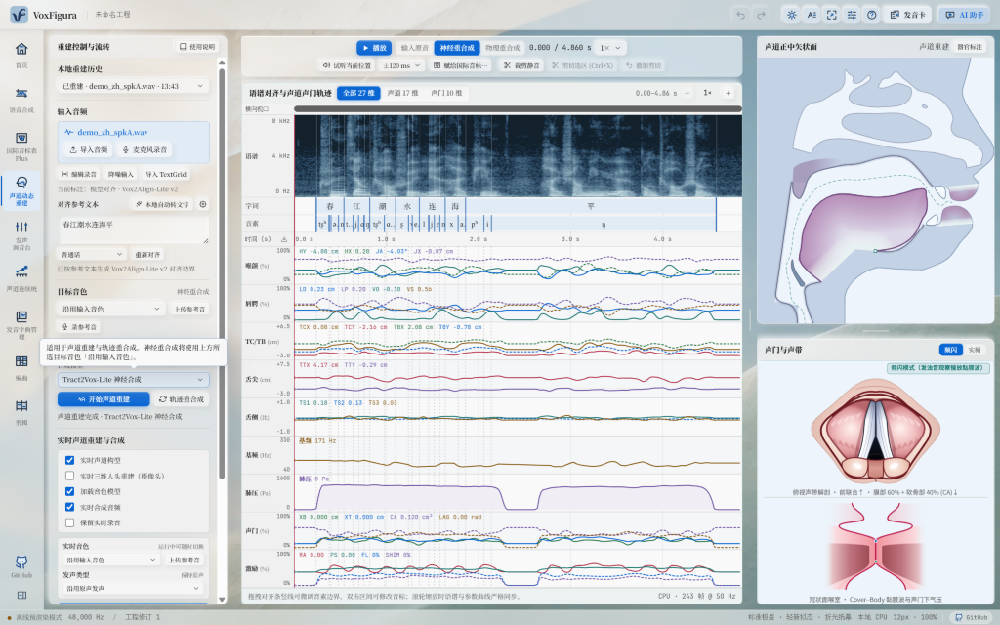

---

### 4. 发声调音台（时变调制与双人多器官迁移）

- **单人时变发声调制**：内置 **13 项正式 VoQS 预设**（常态 `V`、气声 `V̤`、紧声 `V͈`、嘎裂声 `V̰`、假声 `F`、耳语声 `Ṿ`、耳语 `W`、清化、嘎裂 `C`、耳语嘎裂 `V̰̣`、喉位升降 `L̝ / L̞` 与同声道双声源双音调嗓音 `V‼`）、3 项实验复合假声与「复刻当前录音为新预设」。采用 `0–80 ms`（默认 `25 ms`）高斯防爆音平滑与 `voiced_gate / speech_gate` 双门控，保护句内清辅音与静音不被灌入周期振动。
- **双人多器官属性移植**：支持免标注构音 DTW、模型对齐或 TextGrid 共享锚点，在左栏按 **9 条轨道**（声门 8 维、`F0+PR`、时长韵律、整套声道 17 维、唇部、软腭鼻化、喉位、舌颌、512 维说话人音色 SLERP）独立绘线并附幽灵参考线，对舌颌与喉位默认启用相对中位偏移（Delta）防止个体解剖差异引起穿模。
- **三路无缝轮切与 12 项声学验证**：支持按 `B` 键在原声、0% 重建基线与调音成品间实时无缝轮切对听，展开底部面板可查看窄/宽带语谱叠印、谱差 ΔdB 与经 Iseli-Alwan 共振峰校正的 **12 项发声声学指标**（`H1*−H2*`、`H1*−A1*/A2*/A3*`、Hillenbrand CPP、Boersma HNR、谱倾斜等）并导出 UTF-8 CSV。

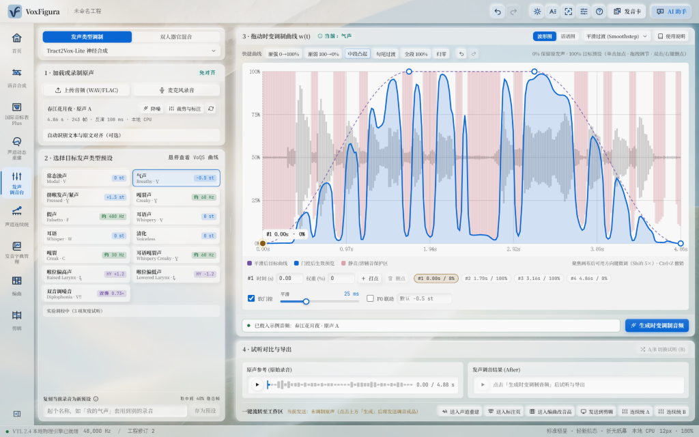

---

### 5. 声道连续统（感知实验刺激矩阵）

- **单双轴正交刺激矩阵**：支持以预设实验端点、40+ 自由音素、声道重建帧或带标注/降噪的真实录音作为端点 A/B，构建单轴 `2–51` 格或双轴 `2–16 × 2–8` 格实验矩阵；可组合混合比、`F0`、VoQS 发声类型、时长、`PR` 肺压与 17 维 VTL 构音参数。
- **阻音保护与单变量锁定**：单帧静态混合按对数面积与主导闭塞保护处理跨方法/跨部位阻塞音，避免中间格成阻脱落；提供 5 组构音器官锁定（唇部、舌背、舌尖、软腭鼻化、下颌）与「端点等时长对齐」开关。
- **联合分析与实验包导出**：下方三栏面板提供 `A+B / A / B / 无叠影` 虚线对比、标准语音学坐标 `F1–F2` 元音空间轨迹与前 6 项主要变化参数表；一键导出包含全部 `.wav`、`manifest.json` 与 `acoustic_table.csv`（UTF-8 BOM）的 **ZIP 感知刺激包**、序列拼接 WAV 及 WebM 声道动画视频。


---

### 6. 发音字典管理与方言调型工作室

- **三层字典优先级与多语底座**：四栏界面统筹管理「个人字典（最高优先级，与合成和编曲共用）」「内置多语词典（10 套汉语注音、英语 CMUdict、日语假名与 MFA 词典）」与「方言字典」，支持 UTF-8 CSV/TSV 词表列映射导入、JSON 整包（`vocalcut.dialect/1`，含关联 19 维构型套装）交换、多音节胶囊连编及带进度取消的同音节批量替换。
- **双画布手绘调型与采录拟合**：上画布采用保单调 **PCHIP** 三点插值编辑赵氏五度调值（1–5 度），下画布按说话人参考调域（石锋 T 值对数标度）自动换算并在宽音域 `> 0 Hz` 上精修基频；支持在「采录」页现场录音或导入音频，由 `SwiftF0` 提取基频并自动汇总 5%–95% 参考调域。
- **确定性非递归连读变调与入声**：按 `lexical`（词项特例）→ `word_pattern`（整词广用式）→ `pair`（邻接双字）单次扫描改写确保永不死循环，附带独立例词沙盒；支持勾选入声不除阻 `[◌̚]` 自动收短时程并闭合声道截面积。

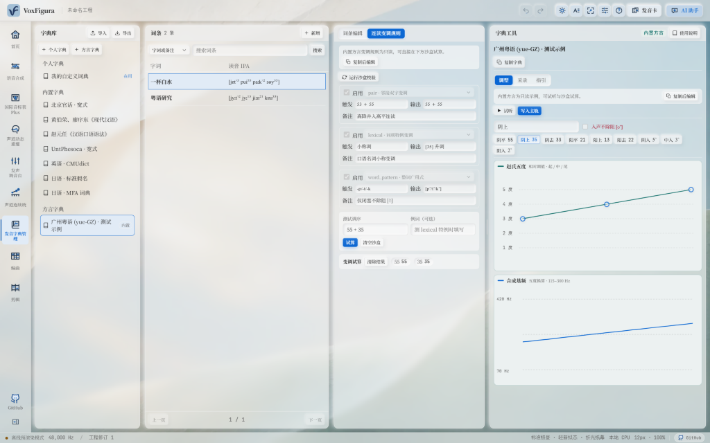

---

### 7. 声乐编曲台（五种简谱、钢琴卷帘与辅音抢拍）

- **五种主流简谱单一真源双向同步**：原生支持 **JE 谱**、**Sparks NMN**、**jianpu-ly**、**jianpu-player** 与 **番茄简谱 (`.jps`)**，统一使用无冲突书名号 `《...》`（及带字内联写法 `汉《[3]/ [2]/》`）实现逐字音高对位，实时与钢琴卷帘双向同步，兼容 `ppp–fff` 力度记号按每级 `±120 Pa` 映射声门下压。
- **辅音抢拍与物理乐器合奏**：受开源物理声道歌唱合成器 CHIMERA 启发并进一步按辅音分类细化：开启「辅音抢拍」后，塞音、擦音、塞擦音等阻音字头提前落于拍点之前，让主元音韵腹精准踩在 48 kHz 整数拍点，鼻音与近音则自然拍点起音。伴奏支持 **Salamander Grand Piano v3** 采样与 **STK 数字波导乐器**（洞箫、竹笛、二胡、小提琴、古筝、琵琶、吉他等）。
- **真人咬字改唱与工程互通**：支持将「声道动态重建」提取的真人 19 维动态咬字轨迹送入编曲台由简谱/卷帘接管旋律改唱；完整支持标准多轨 `.mid`（自动识别 UTF-8/GB18030/Shift-JIS 歌词）、VOCALOID `.vsqx`、Synthesizer V `.svp` 双向导入导出及 Praat `.TextGrid` / `.PitchTier` 导出。

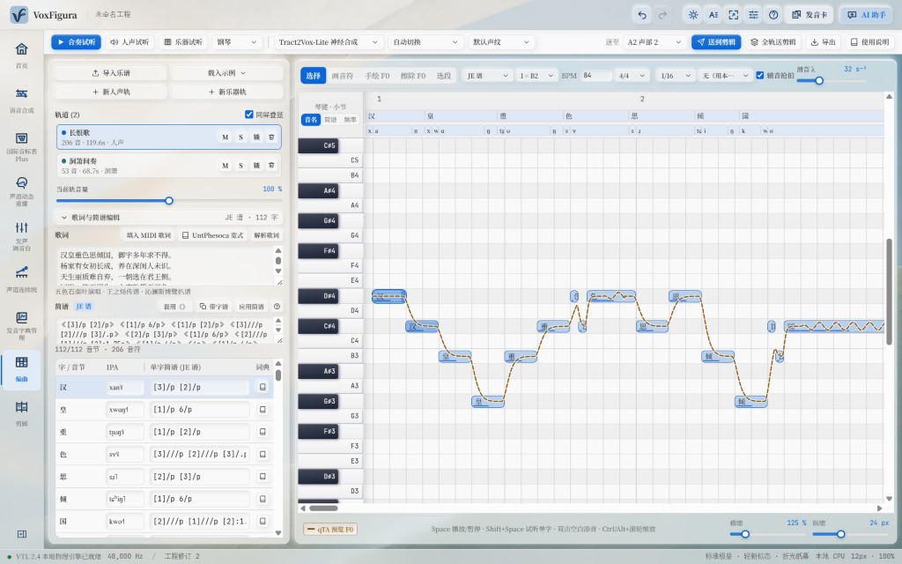

---

### 8. 非线性剪辑台（多层合成、运镜节拍卡点与成片）

- **多子轨音画同轴编排**：统一在 `48,000 Hz` 时间线上管理 `V0` 影棚舞台（8 套调色 + 透视地面 + 6 种全球运镜 + 手持漂移）、`V1` 2D/3D 实时声道解剖（支持多声部同屏自动分栏与 6 种画风）、`V2` 角色立绘贴图、`V3` 卡拉 OK 柔边随读双行字幕（汉字 + 0.52× 字号 IPA）与 `A1–A12`（含 `A3` 伴奏轨）混音轨，支持「同源联动」与「按文字切分」。
- **纯本地电影特效与节拍卡点**：内置 Newton–Raphson 三次贝塞尔 8 档缓动求解器、9 种 Canvas 2D 入出场转场、暗角/胶片颗粒/高光晕染后处理与 3 种蒙太奇片尾；「识别节拍」通过 `45–160 Hz` 低频能量包络与最小二乘回归纯前端提取 BPM 与强拍网格，支持磁吸卡点与脉冲缩放/频闪黑帧/落拍震屏特效。
- **同核成片导出**：1280×720 监看舞台与 `1920×1080` MP4（H.264 30/60 fps）/ WebM 导出共用同一渲染核，并支持 `48 kHz` 序列总混音（WAV/FLAC/MP3/M4A）及多轨 `.srt` / `.ass` 字幕导出。


---

### 9. 发音卡工坊（嵌套分栏排版与多格式动图视频）

- **跨全工作台 16 模块元素库**：一键聚合声道剖面、声门与声带、横截面与唇形、`A(x)`、`H(f)`、声学元音图、构音参数表、波形语谱图、IPA 参考卡、合成时间轴、重建轨迹、调音台包络、连续统网格、方言五度、编曲简谱与剪辑轨道，并自动标注「实时联动 / 实录就绪 / 示范回退」状态徽章。
- **递归分栏树与五区吸附**：拖拽模块至目标槽位四条 24% 边缘区自动拆出嵌套子栏，拖入中央 52% 区域互换或填入「留白空槽」（导出时隐藏虚线框保留所见即所得留白），内置 40 步独立撤销栈与个人常用方案浏览器持久化。
- **三格式高质量导出**：提供 6 套卡片配色 × 8 种风格 × 9 款字体与 `360–3840 px` 自定义分辨率。**PNG 静态卡**在浏览器毫秒级离屏渲染并支持一键复制进剪贴板；**MP4**（24/30 fps，可选 48 kHz AAC 音轨，偶像素对齐）与 **GIF**（12/15/20 fps 两遍调色板优化）经本地代理分批写入帧流由 FFmpeg 封装（450 帧 / 15 s 上限），支持样片预览免重编直接落盘。

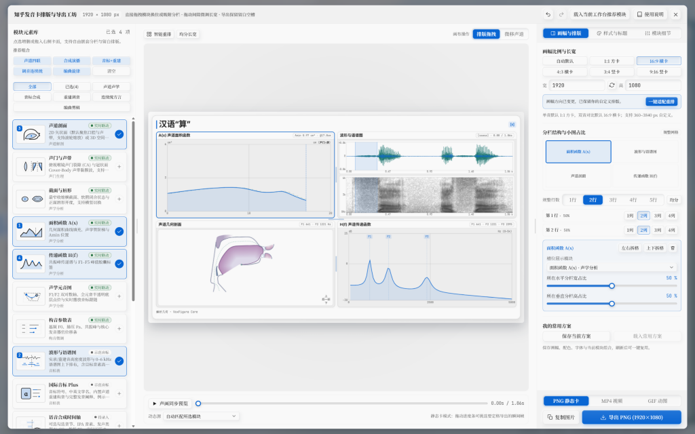

---

## 核心语法速查与科研导出矩阵

<details>
<summary><strong>展开查看：混排文本、<code>[IPA]</code> 停顿、<code>{VoQS}</code> 嵌套与五种简谱语法速查</strong></summary>

### 1. 语音合成混排与 `[IPA]` / `{VoQS}` 语法

```text
# 一句话混排中/英/日 + 内联 [IPA] + 声调 + VoQS 栈式嵌套
今天天气真好。What a gorgeous day! 今日はいい天気ですね。 ['nɔməl 'vɔɪs. {F "falsetto" F}. {W 'wɪspəɹi W}]

# [IPA] 括号内停顿与连读规则
- 常规空格           -> 175 ms 短停顿（phraseEnd=false，保持 Text2Prosody-Lite 连续句调）
- 词尾或独立 . / ·   -> 350 ms 长停顿（phraseEnd=true，触发句尾韵律收束）
- 词内紧贴 . / ‿     -> 0 ms 音节断点或无停顿连读（如 [ˈnɔ.məl]、[ˈfɑːr‿əˈweɪ]）

# VoQS 标量度与多层嵌套（Ball, Esling & Dickson 2018）
- {1V̤ 轻度气声 1V̤}  /  {2V̤ 中度(默认) 2V̤}  /  {3V̤ 100% 气声 3V̤}
- 嵌套喉高与发声态：{L̝ 1V͈ ta˥˥ {2V̰ ta˨˩ 2V̰} 1V͈ L̝}
- 花括号内嵌英语原词需加英文双引号：{F "falsetto" F}
```

### 2. 编曲台五种简谱《...》单字包裹语法对比

| 记谱法 | 单字包裹与八度/时值典型写法 | 原生特性保留 |
| :--- | :--- | :--- |
| **JE 谱（默认）** | `《[3]/ [2]/》` · `(5)` 低八度 · `[1]` 高八度 · `[[1]]` 倍高 | 保留 `/` 减半、`.` 附点、`-` 延拍、`:N` 精确拍，支持 `汉《[3]/ [2]/》` 带字内联 |
| **Sparks NMN** | `《(3' 2')》` · `6,` 低八度 · `1'` 高八度 | 后置 `'` / `,` 升降八度，保留 `(...)` 减时分组与 `{<...>}` 小节属性 |
| **jianpu-ly** | `《q3' q2'》` · `s1` · `d2` · `3[ q1 q2 q3 ]` | `q/s/d/h` 时值前缀，支持 `~` 延音线、三连音与 `R{...}` 反复块 |
| **jianpu-player** | `《('3 '2)_》` · `.6` · `[1 3 5]` | 前置 `'` / `.` 八度，`(1 2)_` 共用减时，`[]` 和弦与 `{}` 多声部 |
| **番茄简谱 (`.jps`)** | `Q: 《3'/ 2'/》 5- &ff` | 后置 `'` / `,` 八度与 `/` `-` 时值，支持 `&p` / `&ff` 力度并自动跳过排版配置 |

</details>

<details>
<summary><strong>展开查看：全工作区科研与创作导入 / 导出产物矩阵</strong></summary>

| 工作区 | 支持导入格式 | 支持导出格式与科研载荷 |
| :--- | :--- | :--- |
| **语音合成** | `WAV / MP3 / FLAC / OGG / M4A`、`.TextGrid`、`.vcproj` | `.vcproj`、合奏/单句 `WAV / MP3`、Praat `.TextGrid`、`.PitchTier`、`50 Hz` 全帧 / 音段等分 / 单帧 CSV |
| **国际音标表 Plus** | 麦克风个人示范录音（IndexedDB） | 单音与全库科研资料 **ZIP**（人工对齐原音 `WAV`、`.TextGrid`、重建音 `WAV`、50 Hz 轨迹 `JSON`、`manifest.json`、可选声带频闪 `MP4`） |
| **声道动态重建** | 各类常见音频、`.TextGrid`、麦克风实时流 | 校正后 `.TextGrid`、稳态帧线性插值写入可编辑 IPA 构型方案、一键送入下游 5 大工作区 |
| **发声调音台** | 0.04–15 s 干声、`.TextGrid` | 无损 `WAV`（神经 16 kHz / 物理 48 kHz）、**12 项发声质量指标 UTF-8 BOM CSV**、同步裁剪 `.TextGrid` |
| **声道连续统** | 预设、自由音素、重建帧、录音（含标注裁剪） | **感知刺激包 ZIP**（`wav/*.wav` + `manifest.json` + `acoustic_table.csv`）、间隔 0.22 s 拼接 `WAV`、单格 `WAV`、WebM 声道视频、参数 `JSON` |
| **发音字典管理** | UTF-8 `CSV / TSV / TXT` 列映射、词典 `JSON` | 个人字典 / 方言字典 `JSON`（`vocalcut.dialect/1`，含 19 维构型套装） |
| **声乐编曲台** | `.mid / .midi`、VOCALOID `.vsqx`、SynthV `.svp` | `.mid`、`.vsqx`、`.svp`、混音或分轨 `WAV / MP3`、单轨干声、`.TextGrid`、`.PitchTier`、`.vcproj` |
| **非线性剪辑** | 音视频、图片、`.srt / .ass`、`.TextGrid`、`.vcproj / .ptb-duet` | `1920×1080 MP4`（H.264 30/60 fps）、`WebM`、`48 kHz` 总混音（`WAV / FLAC / MP3 / M4A`）、多轨 `.srt / .ass` 双行字幕 |
| **发音卡工坊** | 跨工作区 16 模块实时快照与 7 路动态源 | 360–3840 px 离屏 `PNG`（支持直贴剪贴板）、`MP4`（H.264 + AAC，≤ 450 帧 / 15 s）、两遍调色板 `GIF` |

</details>

---

## VoxFigura Core 端侧纯 ONNX 模型体系

工作台内置完整的**模型训练与技术报告**页面，全链路推理锁定纯 ONNX Runtime 本地 CPU 运行（零 PyTorch 运行时依赖），支持卡片热插拔装卸、目录批量装载与外置换模。默认启用 **8 项核心 Batch-2 模型**（合计 **37.44 M 参数 · 77.61 MiB**）；原独立 `Vox2Align-Lite v2` 已并入共享主干的 `Vox2TractAlign v4`，槽位保留以兼容用户针对其他语种或方言自行训练并挂载的对齐模型。

| 槽位 | 当前 Batch-2 模型 | 架构家族 | 参数量 | 体积 (ONNX) | CPU 3s 实测 | 职责与核心实测指标 |
| :--- | :--- | :--- | ---: | ---: | ---: | :--- |
| `Vox2Tract-Lite` | **Vox2TractAlign v4** | Conformer + BiLSTM + ConvNeXt + BiGRU | 9.40 M | 18.15 MiB | 24.3 ms | 16 kHz 单次前向联合 50 Hz 27 维反演 + 中英对齐；`T17 PCC 0.9108` · 中/英 ≤20 ms `93.0% / 94.9%` · `Mask F1 0.989` |
| `Tract2Vox-Lite` | **Tract2Vox-Large v2.1**（可选 3.73 M **Lite v3**） | 纯 CNN Glottis-NSF v4 + HiFi-GAN | 14.39 M | 27.56 MiB | 238.4 ms | 27 维轨迹 + 512 维声纹驱动，float64 连续相位覆盖 20–1200 Hz；`L24 0.8926` · `L6 0.7910`（Lite v3 50 句 ASR 错率 `7.18%`） |
| `Vox2Spk-Lite` | **Vox2Spk-v2.1** | ECAPA-TDNN (SE-Res2 + ASP) | 4.60 M | 8.82 MiB | 4.3 ms | 关系矩阵蒸馏与非对称负对排斥强化区分度，512 维单位球面声纹；常规 `Cos 0.9422` · 女声 `Gap 0.3531` · 165 Hz 换声 `Cos 0.8013` |
| `IPA2Tract-Lite` | **IPA2Tract-Lite v4** | 零初始化残差 Conformer + BiGRU | 4.23 M | 8.18 MiB | 10.1 ms | 32 维窄标 IPA + 121 维条件驱动连续协同构音（配套 293 键构型库）；降误差 `43.4%`（宽域 `50.7%`）· `EMA LD 0.7013` · 零泄漏 `0.0` |
| `Text2Prosody-Lite` | **Text2Prosody-Lite v4** | Conformer + 残差 BiGRU | 1.98 M | 3.88 MiB | 1.5 ms | 普通话、英语、中英混排与任意手写 `[IPA]`（`LANG_IPA=3`）预测；中/英/IPA 时长 MAE `22.6 / 17.3 / 21.4 ms` · `F0 PCC 0.779` |
| `Tract2Area-Proxy` | **Tract2Area-Proxy** | 残差 MLP | 0.23 M | 0.88 MiB | 0.4 ms | 17 维声道映射 6 区最小截面积物理守卫，6 维关键区面积 MAE `0.0478 cm²` |
| `DPDFNet` | **DPDFNet2 48 kHz HR** | Dual-Path RNN | 2.58 M | 10.01 MiB | 18.0 ms | 实录语料前端 48 kHz 流式语音增强与宽带底噪抑制 |
| `SwiftF0` | **SwiftF0 0.3.0** | 轻量 CNN | 0.03 M | 0.13 MiB | 4.2 ms | 超轻量低延迟实测基频轨迹提取（`46.875–2093.75 Hz`）与清浊音判别 |
| `Vox2Align-Lite v2` | *已合并 · 可选方言扩展槽* | Conformer + BiGRU | 4.33 M | 8.37 MiB | 13.5 ms | 默认免装载；挂载自定义方言/小语种对齐模型后自动接管对齐链路（65 音素 + 415 音节 CTC） |

### 矢量神经网络结构图与 Batch-2 实测基准

内置 5 张交互式矢量结构图与逐维 PCC、50 句离线 Whisper Large-v3-Turbo ASR 可懂度门禁、Text2Prosody 五域精度及 USC-TIMIT 真人 EMA 电磁构音仪盲测雷达图。

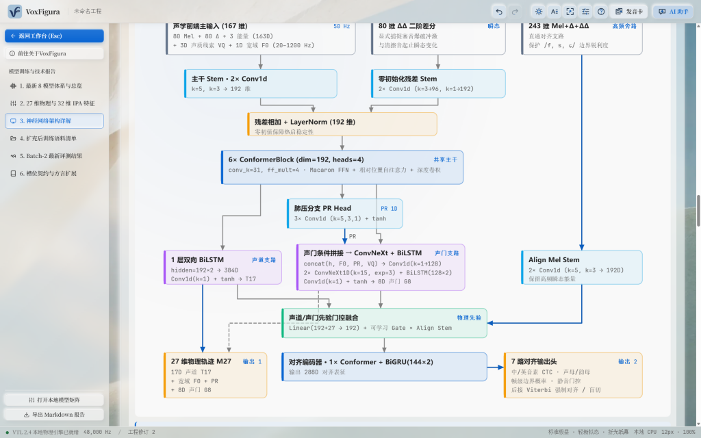

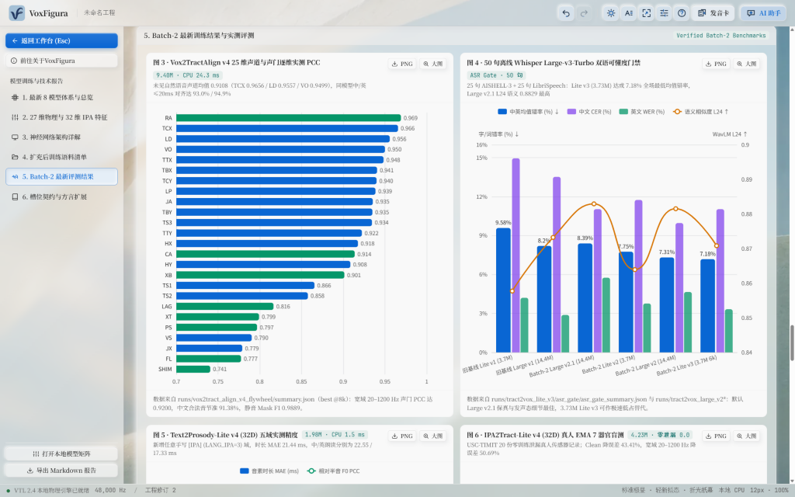


<details>
<summary><strong>展开查看：M27 27 维物理控制空间定义与时间网格契约</strong></summary>

- **17 维独立声道参数（下标 `0..16`）**：`HX`（喉舌骨前后）、`HY`（喉舌骨高度 `-6.0..-3.5 cm`）、`JX` / `JA`（下颌前伸与开口度 `-7..0°`）、`LP` / `LD`（唇突度与唇间距离 `-2..4 cm`）、`VS` / `VO`（软腭形态与鼻咽口开度 `-0.1..1.5`）、`TCX` / `TCY`（舌体前后高低）、`TTX` / `TTY`（舌尖前后高低）、`TBX` / `TBY`（舌叶前后高低）、`TS1` / `TS2` / `TS3`（三段舌侧缘高度）。JD2 的 `TRX` / `TRY` 舌根坐标由 VTL 与引擎自动求解以保证解剖自洽。
- **10 维声源与发声动力学参数（下标 `17..26`）**：`F0`（基频，神经合成支持 `> 0 Hz` 任意正有限值，VTL 2.4 保留 `40–600 Hz` 硬件声门边界）、`PR`（声门下肺压，工作台统一 `0–1600 Pa`，引擎边界换算 `dPa = Pa × 10`）、`XB` / `XT`（声带下缘/上缘静止位移）、`CA`（后软骨裂隙面积）、`LAG`（上下缘黏膜波相位滞后）、`RA`（相对声带振幅，`≤ 0` 对应清音/耳语）、`PS`（声门脉冲形状）、`FL`（周期基频抖动 `0–100%`）、`SHIM`（周期振幅微扰 `0–100%`）。
- **帧率对齐**：分析与神经控制统一 `50 Hz`（20 ms 帧移，帧中心 `(k + 0.5) / 50` s）；物理声管渲染步长 `200 Hz`（5 ms/帧 = `240` 采样 @ 48 kHz）；音频输出采样率锁定 `48,000 Hz`。

</details>

### 科研可信度六条口径红线

1. 控制基频（`F0_ctl`）与实测输出音频基频分开标注，互不混用。
2. 声管传递函数 `H(f)` 极点频率与输出音频 LPC / Burg 实测共振峰分开标注。
3. 声道动态重建轨迹属于满足解剖边界的模型候选解，不等同于 EMA / rtMRI 真实生理舌位。
4. 60 fps 视觉插值动画帧与 50 Hz / 200 Hz 原生求解控制帧严格区分。
5. VTL 2.4 物理管段合成音频与 `Tract2Vox-Lite` 神经声码器音频始终保留独立来源标识。
6. 局部区间试听会重新初始化声管残余状态，不等同于整句连续协同定稿渲染。

---

## 外观系统与 AI 协同工作流

### 8 套设计风格 × 12 种壁纸底纹 × 明暗双主题

工作台内置完全基于 CSS Token 的多皮肤系统，可在 **轻新拟态（默认）、轻黏土拟态、液态磨砂玻璃、极简仪器、Material 3、瑞士网格、包豪斯几何、轻新粗野** 8 种表面风格与 **5 种静谧底纹 + 7 组日夜间艺术壁纸**间即时切换，支持自定义品牌图标、7 款中文字体 / 7 款西文字体、三通道叠印配色与「我的默认搭配」方案保存（Tauri 桌面窗口图标会随主题配色动态同步）。

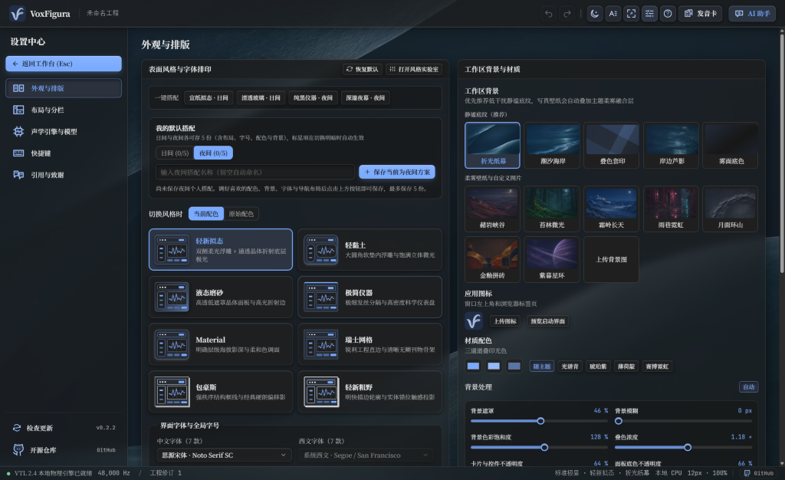

### 内置 BYOK AI 助手

- 点击右上角「AI 助手」（快捷键 `Alt + /`）可填入自备 API Key（BYOK，纯本地配置与透明代理，密钥绝不写入仓库或日志），通过结构化工具调用与 **RFC 6902** 正逆补丁命令总线直接协助修改工程音素、调整时间轴、`compile_score` 自动简谱对位编曲以及操作剪辑轨道，每步变更均完整纳入工作台单步撤销栈。

---

## 工程架构与独立组件包

工程采用 **Headless-First（零 UI 耦合）** 分层架构，核心声学算法、多语 G2P、2D/3D 声道视口均可脱离前端框架独立复用：

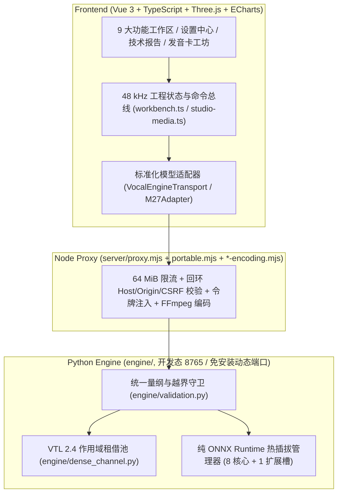

<details>
<summary><strong>展开查看：仓库目录结构与四大核心独立包说明</strong></summary>

```text
VoxFigura/
├── src/                         # Vue 3 + TypeScript 工作台主界面与状态管理
│   ├── components/              # 科研模块、编曲剪辑、发音卡工坊、AI 助手、技术报告矢量图
│   ├── data/                    # 32D/27D 契约、模型训练报告、111 条 GB/T 7714 文献致谢
│   ├── editions/                # 构建时版本隔离 (@vocalcut/edition: public / hackathon)
│   ├── styles/                  # CSS Token 真源、8 套皮肤、明暗主题与壁纸系统
│   └── views/                   # 首页、关于、使用说明、技术报告与设置中心
├── packages/
│   ├── core-ts/                 # @vocalcut/core：48 kHz 整数采样、qTA、抢拍、VoQS、TextGrid、RFC 6902
│   ├── g2p-ts/                  # @vocalcut/g2p：10 套汉语注音、CMUdict、日语声调、粤拼、5 种简谱 DSL
│   ├── vocal-tract-view/        # 零框架耦合 2D/3D 声道几何视口包 (mountVocalTract + demo.html)
│   └── model-adapters/          # @vocalcut/model-adapters：VocalEngineTransport 与 M27Adapter
├── server/                      # Node 本地代理 (鉴权、超时分级、发音卡/剪辑 FFmpeg 导出、免安装入口)
├── engine/                      # Python 本地物理与 ONNX 推理服务 (VTL 2.4 桥接 + 8+1 ONNX 热插拔)
├── src-tauri/                   # Tauri 2 (WebView2) Windows x64 单文件免安装桌面启动壳
├── public/                      # 静态资源 (PTBIPAPlus/Doulos SIL 字体、JD2 资产、词典分片、MediaPipe WASM)
├── scripts/                     # 引擎启动、词典构建与 Windows 免安装包组装/验收脚本
└── docs/                        # 架构规范、编码规范、打包规范、复现指南、媒体与界面截图
```

</details>

更多工程与复现文档请参阅：
- 系统架构规范：[docs/ARCHITECTURE.md](./docs/ARCHITECTURE.md)
- 编码与接口规范：[docs/CODING_STANDARDS.md](./docs/CODING_STANDARDS.md) · [docs/MODEL_INTERFACE_SPEC.md](./docs/MODEL_INTERFACE_SPEC.md)
- 全栈技术与开源复现指南：[docs/OPEN_SOURCE_REPRODUCIBILITY_GUIDE.md](./docs/OPEN_SOURCE_REPRODUCIBILITY_GUIDE.md)
- Windows 单文件免安装打包规范：[docs/PACKAGING_WINDOWS.md](./docs/PACKAGING_WINDOWS.md)
- 开源基线复用与创新披露：[DISCLOSURE.md](./DISCLOSURE.md) · [THIRD_PARTY.md](./THIRD_PARTY.md)

---

## 快速开始与部署指南

### 方式一：Windows x64 单文件免安装桌面版

项目内置基于 **Tauri 2（WebView2）+ 嵌入式 Python 3.11 + Node + 7zr LZMA2** 的单文件免安装打包流。用户双击交付的单个 `.exe` 即可直接以独立桌面窗口启动（自动展开至 `%LOCALAPPDATA%/VoxFigura/Portable`、隐藏后端控制台终端、任务栏图标随主题实时同步、关闭窗口自动清理本地代理与引擎进程），内置 VTL 2.4、8 项核心 Batch-2 ONNX 模型、完整参考录音库与 FFmpeg 音视频编码，支持在界面按需一键下载 `SenseVoice-Small` 离线转写模型。

从源码构建单文件免安装版（需具备 Rust / MSVC 工具链及 `scripts/portable/inputs.lock.json` 锁定输入）：

```bash
npm run portable:public
```

### 方式二：从源码本地全栈开发运行

**环境要求**：
- **Node.js** `>= 20`（推荐 22 LTS 或 24）
- **Python** `3.11`（仅运行本地物理求解与 ONNX 引擎需要，核心依赖 `numpy`、`scipy`、`onnxruntime`、`pillow`）
- **可选原生/模型组件**：依据仓库开源边界，`.onnx` 权重、VTL `.dll` 原生库与个人参考录音不直接提交至 Git 源码库，可放置于 `engine/model_bundle/` 与 `engine/vtl_native/native/`，或启动后在「设置中心 → 声学引擎与模型」通过「从文件夹装载 / 换模」热挂载。

```bash
# 1. 克隆仓库并安装前端依赖
git clone https://github.com/Nephelium/VoxFigura.git
cd VoxFigura
npm install

# 2. 启动 Python 本地物理与 ONNX 推理引擎（端口 8765）
npm run engine

# 3. 另开终端启动公开版 Node 本地代理（端口 3001）
npm run server

# 4. 另开终端启动公开版前端开发服务器（默认 http://127.0.0.1:5173/）
npm run dev
```

如果仅需体验纯前端界面（国际音标表 Plus、2D/3D 声道几何交互、多语文本转 IPA、词典管理、摄像头 MediaPipe 3D 追踪、编曲数字波导试听、技术报告与发音卡 PNG 导出），跳过第 2、3 步直接执行 `npm run dev` 即可打开工作台。

### 常用构建与验证命令

```bash
# TypeScript 全量类型检查与 Vitest 单元测试
npm run typecheck
npm test

# 构建公开版静态产物（输出至 dist-public/ 并自动运行版本隔离检查）
npm run build

# Python 引擎单元测试
python -B -m unittest discover -s engine/tests
```

### 方式三：在线部署方案对比

VoxFigura 的前端（Vue 3 + Three.js + ECharts + MediaPipe WASM）与后端推理引擎天然解耦，项目已内置 `.github/workflows/pages.yml` 与 `VITE_BASE_URL` 子路径适配：

| 部署方案 | 可在线使用的功能 | 受限功能 | 适用定位与说明 |
| :--- | :--- | :--- | :--- |
| **GitHub Pages 纯静态部署** | 首页、8 套主题皮肤、国际音标表 Plus（655 项符号与构型）、2D/3D 声道几何实时交互、中英日粤文本转 IPA 与方言词典管理、摄像头 MediaPipe 三维头模追踪、发音卡高清 PNG 导出、编曲数字波导试听、使用说明与技术报告 | 无法运行 VTL 2.4 C++ 声管合成、无法运行 Python 端 8 个 ONNX 模型（反演/对齐/神经声码器/调音台/降噪）、无法调用服务端 FFmpeg 导出 MP4/GIF | 零成本静态展示与教学互动站（已通过 [在线预览](https://nephelium.github.io/VoxFigura/) 自动构建部署） |
| **Hugging Face Spaces (Docker) / Linux 云主机** | 完整前端 + Linux 版 VTL 2.4 物理引擎 + 8 项纯 CPU ONNX 模型推理 + FFmpeg 导出 | 并发受服务器 CPU 核数限制，在线录音需经网络传输 | 适合需要打开网页即可直接出声、反演与合成的在线教学演示环境 |
| **GitHub Releases Windows 免安装包（主力推荐）** | 100% 全功能：VTL 2.4 + 8 核 Batch-2 ONNX + 离线转写按需下载 + 音视频导出，数据完全留在本地 | 仅支持 Windows x64（Tauri 2 + WebView2） | 最契合实验语音学隐私保护与零环境配置需求 |

---

## 同源生态：PhoneticToolbox v3

**PhoneticToolbox（语音学工具箱）** 是由同一作者开发的桌面实验语音学平台（Vue 3 + PyQt6 / Qt WebEngine，GPL-3.0-or-later），集成录音采集、EGG 喉电图分析、Klatt 合成、批量参数提取、MFA 自动对齐、论文精读与中国方言地图等 19 个高频工具。VoxFigura 沿用了其中的国际音标表 Plus 体系、多语注音方案、2D/3D 声道组件与 `PTBIPAPlus` 字体。

- 官方网站：https://www.phonetictoolbox.com/
- 开源仓库：https://github.com/Nephelium/PhoneticToolbox

---

## 开源许可与学术致谢

- **主工程与核心独立包**：采用 [GPL-3.0-or-later](./LICENSE) 开源许可。
- **专用音标与界面字体**：`PTBIPAPlus`、`Doulos SIL`、`Noto Sans/Serif SC`、`Inter`、`Lora`、`JetBrains Mono` 均遵循 SIL OFL 1.1 随原许可文本分发。
- **上游研究与开源致谢**：本项目依托 **VocalTractLab 2.4**（Peter Birkholz 等）、**PhoneticToolbox v3**（井立文）、Ball / Esling / Dickson (2018) **VoQS** 体系、Prom-on et al. (2009) **qTA** 模型、Praat / Parselmouth、CHIMERA、SwiftF0、DPDFNet2、MediaPipe、SenseVoice-Small、Three.js、Apache ECharts、Salamander Grand Piano v3、STK、CMUdict、Open JTalk / NAIST-JDIC、Rime Cantonese 与 Unicode Unihan 等开源软件与公开语料构建。工作台内置 **111 条** 可检索、可一键复制的 GB/T 7714 学术文献与开源致谢清单，完整第三方许可边界见 [THIRD_PARTY.md](./THIRD_PARTY.md) 与 [DISCLOSURE.md](./DISCLOSURE.md)。

### 引用建议

如果你在教学、论文或实验中使用了 VoxFigura，可按以下格式引用：

```bibtex
@software{jing2026voxfigura,
  author  = {Jing, Liwen},
  title   = {VoxFigura: A Physical Vocal-Tract-Driven Workbench for Experimental Phonetics, Articulation Inversion, and Vocal Synthesis},
  year    = {2026},
  url     = {https://github.com/Nephelium/VoxFigura},
  license = {GPL-3.0-or-later}
}
```
