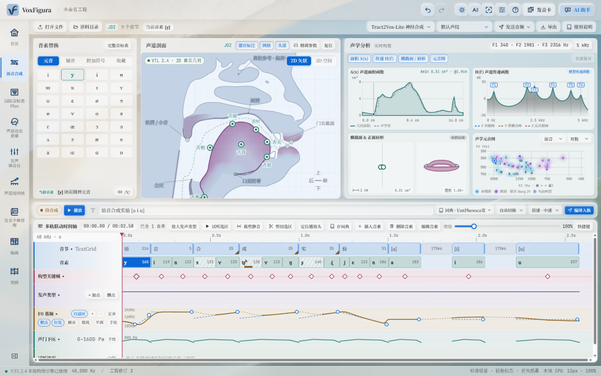
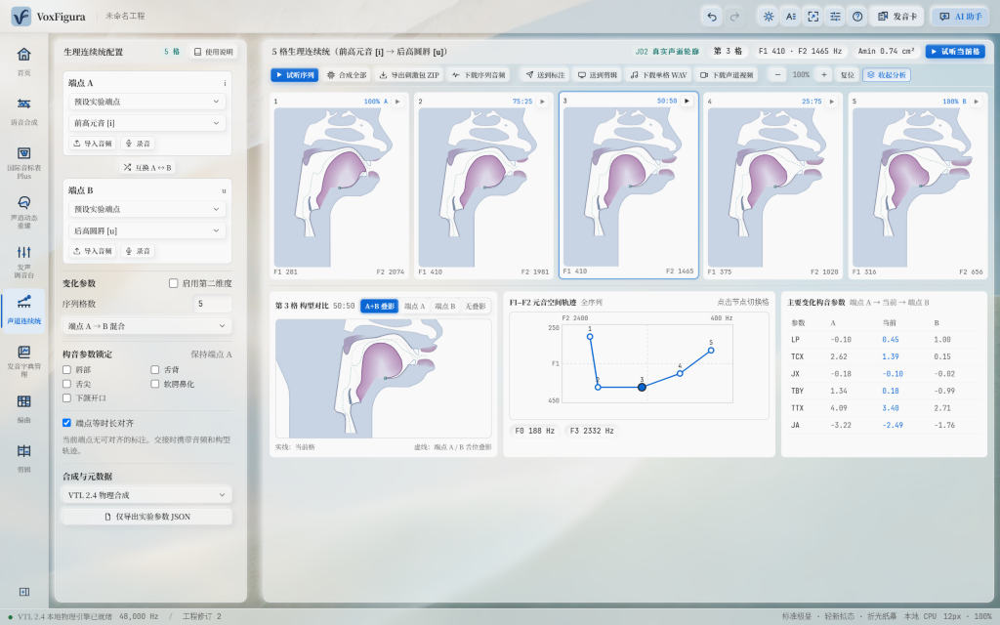
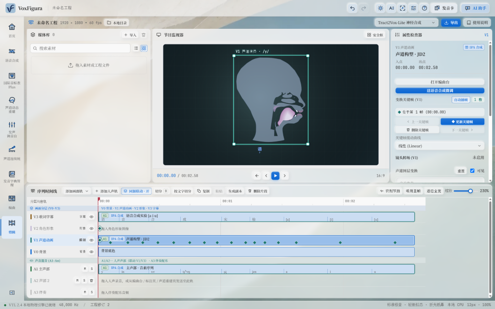
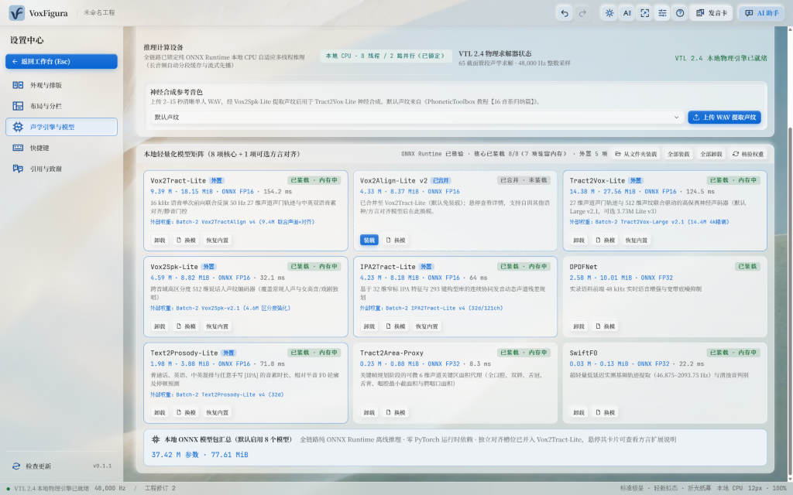

<div align="center">


# VoxFigura

**物理声道驱动的实验语音学、发音标注、声道重建与声乐编曲工作台**

[](https://github.com/Nephelium/VoxFigura)
[](https://nephelium.github.io/VoxFigura/)
[](./LICENSE)
[](./package.json)
[](#voxfigura-core-端侧纯-onnx-模型体系)
[](#工程架构与独立组件包)

[核心能力](#核心能力版图) · [界面预览](#工作台界面预览) · [模型体系与评测](#voxfigura-core-端侧纯-onnx-模型体系) · [工程架构](#工程架构与独立组件包) · [快速开始](#快速开始) · [在线部署说明](#在线部署可行性与推荐方案) · [许可与致谢](#开源许可与学术致谢)

</div>

---

**VoxFigura** 是一款面向语言学与实验语音学研究、声乐教学及语音科普创作者的物理声道驱动工作台。它将原本分散在三维声道仿真器（VocalTractLab 2.4）、Praat TextGrid 标注、神经声码器与非线性音视频剪辑之间的工作流程整合入同一工程文件（`.vcproj`）内，既可从实录语音以 50 Hz 反演 27 维声道与发声动力学轨迹，也可由中英日文本、国际音标 `[IPA]` 与键盘简谱驱动物理及神经双通道合成。


---

## 核心能力版图

VoxFigura 以 48,000 Hz 整数采样与半开区间 `[start_smp, end_smp)` 为统一时间轴基准，由三大能力集群、九大公共模块协同构成：

| 能力集群 | 模块 | 核心功能 |
| :--- | :--- | :--- |
| **01 发音与重建** | **语音合成** | 中英日混排文本、`[IPA]` 与 Praat TextGrid 编译；32 维窄标 IPA 协同构音（293 键构型库）、无标调 `[IPA]` 韵律预测与参考音色中位基频自动匹配；联调 3 阶临界阻尼 qTA 基频、VoQS 发声锚点，实时绘制 65 截面面积函数 `A(x)`、传递函数 `H(f)`、纵截面与元音空间图 |
| **01 发音与重建** | **国际音标表 Plus** | 655 项 IPA / extIPA / VoQS 符号（含 Unicode 码位、中英释义与来源链接）、2D/3D 声道静态与动态构型预览、参考录音对照及可派生个人构型方案 |
| **01 发音与重建** | **声道动态重建** | 端侧 50 Hz 27 维联合声道反演与双语强制对齐；同步矢状面、喉镜俯视与 Cover–Body 冠状面三视图；支持摄像头 MediaPipe 三维透视人头—声道联合重建及按需离线 SenseVoice-Small (ONNX) 转写 |
| **02 调控与实验** | **发声调音台** | 基于 20–1200 Hz 宽域声门—声道—声纹解耦表征，支持单人时变发声类型曲线调制（常态、气声、紧嗓、嘎裂、假声、耳语、双音调嗓音等）与双人多器官属性迁移 |
| **02 调控与实验** | **声道连续统** | 单轴/双轴阻音保护生理连续统矩阵制作，实时呈现 `A+B` 叠影与 `F1–F2` 元音空间轨迹，支持一键合成刺激包、WAV 序列与声道动画 |
| **02 调控与实验** | **发音字典管理** | 高于内置词典优先级的个人词条、10 套汉语注音标准（含 UntPhesoca 宽/严式）、CMUdict 英语词典、离线日语东京高低音调词典（`ja-accent-v1`）、手绘五度方言调型与三类非递归连读变调规则 |
| **03 编曲与导出** | **声乐编曲台** | 通用键盘简谱 / JE 谱、强弱力度肺压映射、钢琴卷帘微调、辅音抢拍（韵核精准踩拍）、数字波导伴奏与改音高保留咬字演唱 |
| **03 编曲与导出** | **非线性剪辑** | `V0–V3` 多子轨画面图层（背景、声道动画、角色立绘、双行高亮字幕）与 `A1–A12` 人声 / 伴奏混音轨同轴编辑，支持成片视频导出 |
| **03 编曲与导出** | **发音卡工坊** | 响应式自由分栏拖拽排版声学图表与声道解剖图，浏览器本地生成高清 PNG 或经本地代理导出 MP4/GIF 动卡 |

---

## 工作台界面预览

### 1. 语音合成与实时声学四联分析

支持汉字、英语、日语及方括号国际音标 `[...]` 混排编译（方括号内空格触发短停顿，圆点触发长停顿）。上方并排联动音素替换板、2D/3D JD2 声道剖面与 `A(x)` / `H(f)` / 横截面唇形 / 元音空间四联图，下方同步展开音节、音素、构型关键帧、VoQS 发声类型、3 阶 qTA 基频与声门下压多轨时间轴。



### 2. 国际音标表 Plus（655 项完整体系）

覆盖 IPA、extIPA 与 VoQS 全部 655 项符号，点击任意音标即可同步查看中英语音学释义、Unicode 码位、声道构型剖面及波形语谱图对照，并可直接写入当前时间轴音素。


### 3. 声道动态重建与三视图解剖联动

导入实录音频或实时麦克风输入，即可在纯 CPU 环境下反演 50 Hz 27 维物理轨迹，右侧同步联动正中矢状面、声门喉镜俯视图与 Cover–Body 冠状面声带图谱，并支持 MediaPipe 摄像头三维透视人头—声道联合重建。


### 4. 发声调音台（时变发声态调制与双人器官混合）

内置常态、气声、挤喉/紧嗓、嘎裂声、假声、耳语声、喉位升降与双音调嗓音等预设，支持在波形/语谱图背景上自由绘制时变权重曲线并设置静音与清辅音软门控保护区，或切换至双人多器官属性迁移。


### 5. 声道连续统（感知实验刺激矩阵）

在任意两个声道构型端点（预设或实录反演）之间生成生理连续统序列，同步显示逐格真实 JD2 声道轮廓、端点叠影对照、`F1–F2` 轨迹曲线与主要构音参数变化表，便于快速制备感知实验刺激材料。



### 6. 声乐编曲台（简谱、钢琴卷帘与 qTA 歌唱基频）

将多轨人声与洞箫/钢琴等数字波导伴奏轨同屏编排，支持歌词自动注音、单字简谱对照、辅音抢拍（让主元音精准踩拍）与 3 阶临界阻尼 qTA 歌唱滑音预览。


### 7. 非线性剪辑台（多轨声道动画与双行字幕成片）

与语音合成及编曲工程同源联动，在 `V0–V3` 画面层与 `A1–A3` 音频层中直接编排 JD2 声道动画、汉字 + IPA 逐字高亮字幕、关键帧缓动与镜头转场，一键导出演示视频。



---

## VoxFigura Core 端侧纯 ONNX 模型体系

工作台内置完整的**模型训练与技术报告**页面，全链路推理锁定纯 ONNX Runtime 本地 CPU 运行（零 PyTorch 运行时依赖），支持卡片热插拔装卸与外置换模。默认启用 **8 项核心模型**（总计 **37.44 M 参数 · 77.61 MiB**），原独立 `Vox2Align-Lite v2` 已并入共享主干的 `Vox2TractAlign v4`，槽位仍保留以兼容用户针对特定方言或小语种自行训练的对齐模型。

| 槽位 | 当前 Batch-2 模型 | 架构家族 | 参数量 | 体积 (ONNX) | 职责定位 |
| :--- | :--- | :--- | ---: | ---: | :--- |
| `Vox2Tract-Lite` | **Vox2TractAlign v4** | Conformer + BiLSTM + ConvNeXt + BiGRU | 9.39 M | 18.15 MiB | 50 Hz 27 维声道/声门联合反演 + 中英双语强制对齐与静音门控（CPU 3s 仅 24.3 ms） |
| `Tract2Vox-Lite` | **Tract2Vox-Large v2.1**（可选 3.73 M **Lite v3**） | 纯 CNN Glottis-NSF v4 + HiFi-GAN | 14.38 M | 27.56 MiB | 27 维控制流 + 512 维声纹联合驱动神经声码器，float64 连续相位覆盖 20–1200 Hz |
| `Vox2Spk-Lite` | **Vox2Spk-v2.1** | ECAPA-TDNN (SE-Res2 + ASP) | 4.59 M | 8.82 MiB | 关系矩阵蒸馏与非对称负对排斥强化区分度，提取 512 维单位球面声纹嵌入 |
| `IPA2Tract-Lite` | **IPA2Tract-Lite v4** | 零初始化残差 Conformer + BiGRU | 4.23 M | 8.18 MiB | 32 维窄标 IPA + 121 维条件驱动连续协同构音规划（配套 293 键构型库） |
| `Text2Prosody-Lite` | **Text2Prosody-Lite v4** | Conformer + 残差 BiGRU | 1.98 M | 3.88 MiB | 普通话、英语、中英混排与任意无标调 `[IPA]`（`LANG_IPA=3`）时长/停顿/相对半音 F0 预测 |
| `Tract2Area-Proxy` | **Tract2Area-Proxy** | 残差 MLP | 0.23 M | 0.88 MiB | 17 维声道实时映射 6 区最小截面积，守卫闭塞成阻与声道防穿模 |
| `DPDFNet` | **DPDFNet2 48 kHz HR** | Dual-Path RNN | 2.58 M | 10.01 MiB | 实录语料前端 48 kHz 语音增强与宽带底噪抑制 |
| `SwiftF0` | **SwiftF0 0.3.0** | 轻量 CNN | 0.03 M | 0.13 MiB | 超轻量低延迟实测基频轨迹提取与清浊音判别 |
| `Vox2Align-Lite v2` | *已合并 · 可选方言扩展槽* | Conformer + BiGRU | 4.33 M | 8.37 MiB | 默认免装载；挂载自定义方言/小语种对齐模型后自动接管对齐链路 |

### 矢量神经网络结构图与 Batch-2 实测基准

内置 5 张交互式矢量结构图（`Vox2TractAlign v4`、`Tract2Vox`、`Vox2Spk-v2.1`、`IPA2Tract-Lite v4`、`Text2Prosody-Lite v4`）与逐维 PCC、50 句离线 Whisper ASR 清晰度门禁、Text2Prosody 五域精度及 USC-TIMIT 真人 EMA 盲测雷达图。




### 科研可信度六条口径红线

1. 控制基频（`F0_ctl`）与实测输出音频基频分开标注，互不混用。
2. 声管传递函数 `H(f)` 极点频率与输出音频 LPC 实测共振峰分开标注。
3. 声道动态重建轨迹属于满足解剖边界的模型候选解，不等同于真实生理舌位。
4. 60 fps 视觉插值动画帧与 50 Hz / 200 Hz 原生求解控制帧严格区分。
5. VTL 2.4 物理管段合成音频与 `Tract2Vox-Lite` 神经声码器音频保留独立来源标识。
6. 局部区间试听会重新初始化声管状态，不等同于整句连续协同定稿渲染。

---

## 工程架构与独立组件包

工程采用 **Headless-First（零 UI 耦合）** 分层架构，核心声学算法、多语 G2P、2D/3D 声道视口均可脱离前端框架独立复用：

```text
VoxFigura/
├── src/                         # Vue 3 + TypeScript 工作台主界面与状态管理
│   ├── components/              # 科研模块、编曲剪辑、发音卡工坊、技术报告矢量图与图表
│   ├── data/                    # 32D/27D 契约、模型训练报告、111 条 GB/T 7714 文献致谢
│   ├── editions/                # 构建时版本隔离 (@vocalcut/edition: public / friends / hackathon)
│   └── views/                   # 首页、关于、使用说明、技术报告与设置中心
├── packages/
│   ├── core-ts/                 # 纯函数声学与编曲内核 (48 kHz 整数采样、qTA、VoQS、TextGrid、RFC 6902)
│   ├── g2p-ts/                  # 多语文本转 IPA 与简谱解析 (10 套汉语注音、CMUdict、日语声调)
│   ├── vocal-tract-view/        # 零框架耦合 2D/3D 声道几何视口包 (mountVocalTract + demo.html)
│   └── model-adapters/          # 前后端推理接口适配与量纲守卫
├── server/                      # Node 本地代理 (鉴权、路由超时、发音卡/剪辑 FFmpeg 导出、免安装入口)
├── engine/                      # Python 本地物理与 ONNX 推理服务 (VTL 2.4 桥接 + 8 核 ONNX 管理器)
├── src-tauri/                   # Tauri 2 (WebView2) Windows 单文件免安装桌面启动壳
├── public/                      # 静态资源 (音标/界面字体、JD2 几何资产、词典分片、MediaPipe WASM)
├── scripts/                     # 引擎启动、词典构建与 Windows 免安装包组装/验收脚本
└── docs/                        # 架构规范、打包规范、复现指南与界面截图
```

更多工程文档请参阅：
- 系统架构规范：[docs/ARCHITECTURE.md](./docs/ARCHITECTURE.md)
- 全栈技术与开源复现指南：[docs/OPEN_SOURCE_REPRODUCIBILITY_GUIDE.md](./docs/OPEN_SOURCE_REPRODUCIBILITY_GUIDE.md)
- Windows 单文件免安装打包规范：[docs/PACKAGING_WINDOWS.md](./docs/PACKAGING_WINDOWS.md)
- 开源基线复用与创新披露：[DISCLOSURE.md](./DISCLOSURE.md)
- 第三方依赖与许可清单：[THIRD_PARTY.md](./THIRD_PARTY.md)

---

## 快速开始

### 环境要求

- **Node.js** `>= 20`（推荐 22 LTS 或 24）
- **Python** `3.11`（仅运行本地物理求解与 ONNX 引擎需要，依赖 `numpy`、`scipy`、`onnxruntime`、`pillow` 等）
- **可选组件**：本地原生 `VocalTractLabApi` 动态库与 ONNX 模型权重（依据仓库合规边界，`.onnx` 权重、`.dll` 原生库与个人参考录音不直接提交至 Git 源码库，需放置在 `engine/model_bundle/` 与 `engine/vtl_native/native/`，或启动后在「设置中心 → 声学引擎与模型」通过「从文件夹装载 / 换模」热挂载）

### 本地开发运行

```bash
# 1. 克隆仓库并安装前端依赖
git clone https://github.com/Nephelium/VoxFigura.git
cd VoxFigura
npm install

# 2. 启动 Python 本地物理与 ONNX 推理引擎（端口 8765）
npm run engine

# 3. 另开终端启动公开版 Node 本地代理（端口 3001）
npm run server

# 4. 另开终端启动公开版前端开发服务器（默认 http://127.0.0.1:5173/）
npm run dev
```

如果仅需体验纯前端界面（国际音标表 Plus、2D/3D 声道几何交互、文本转 IPA、摄像头 MediaPipe 追踪、技术报告与发音卡 PNG 导出），跳过第 2、3 步直接执行 `npm run dev` 即可打开工作台。

### 常用构建与验证命令

```bash
# TypeScript 类型检查与 Vitest 单元测试
npm run typecheck
npm test

# 构建公开版静态产物（输出至 dist-public/）
npm run build

# Python 引擎单元测试
python -B -m unittest discover -s engine/tests

# 构建 Windows x64 单文件 Tauri 2 免安装包（需额外具备 Rust/MSVC 工具链与锁定输入）
npm run portable:public
```

---

## 在线部署可行性与推荐方案

VoxFigura 的前端（Vue 3 + Three.js + ECharts + MediaPipe WASM）与后端推理引擎（VTL 2.4 原生 C++ 动态库 + 8 项本地 ONNX 模型 + FFmpeg 音视频编码）天然解耦，因此**是否适合直接部署在 GitHub 上，取决于希望在线开放的能力范围**：

| 部署方案 | 可在线使用的功能 | 受限功能 | 适用定位与说明 |
| :--- | :--- | :--- | :--- |
| **GitHub Pages 纯静态部署** | 首页、8 套主题皮肤、国际音标表 Plus（655 项符号与构型）、2D/3D 声道几何实时交互、中英日文本转 IPA 与词典管理、摄像头 MediaPipe 三维头模追踪、发音卡高清 PNG 导出、编曲数字波导试听、使用说明与技术报告 | 无法运行 VTL 2.4 C++ 声管合成、无法运行 Python 端 8 个 ONNX 模型（反演/对齐/神经声码器/调音台/降噪）、无法调用服务端 FFmpeg 导出 MP4/GIF | 零成本静态展示与教学互动站。注：当前 `public/` 共 63.3 MB（单文件最大 10.5 MB），符合 GitHub Pages 容量限制；若部署在子路径 `/VoxFigura/` 下，需先将前端约 42 处根绝对资源路径统一改为 `import.meta.env.BASE_URL` 并在 `vite.config.ts` 配置 `base` |
| **Hugging Face Spaces (Docker) / Linux 云主机** | 完整前端 + Linux 版 VTL 2.4 物理引擎 + 8 项纯 CPU ONNX 模型推理 + FFmpeg 导出 | 并发受服务器 CPU 核数限制，在线录音需经网络传输 | 如果希望访客打开网页就能直接出声、反演、调音与合成，推荐将 `dist-public`、`server/index.mjs` 与 `engine/server.py` 打包为单个 CPU Docker 容器部署 |
| **GitHub Releases 发行 Windows 免安装包（主力推荐）** | 100% 全功能：VTL 2.4 + 8 核 Batch-2 ONNX + 离线转写按需下载 + 音视频导出，数据完全留在本地 | 仅需用户下载单个免安装 EXE | 项目已内置完整的 Tauri 2 + 嵌入式 Python/Node 单文件打包链（`npm run portable:public`），最契合实验语音学隐私与零配置需求 |

---

## 同源生态：PhoneticToolbox v3

**PhoneticToolbox（语音学工具箱）** 是由作者开发的桌面实验语音学平台（Vue 3 + PyQt6 / Qt WebEngine，GPL-3.0-or-later），集成录音采集、EGG 喉电图分析、Klatt 合成、批量参数提取、MFA 自动对齐、论文精读与中国方言地图等 19 个高频工具。VoxFigura 沿用了其中的国际音标表 Plus 体系、多语注音方案、2D/3D 声道组件与 `PTBIPAPlus` 字体。

- 官方网站：https://www.phonetictoolbox.com/
- 开源仓库：https://github.com/Nephelium/PhoneticToolbox

---

## 开源许可与学术致谢

- **主工程与核心独立包**：采用 [GPL-3.0-or-later](./LICENSE) 开源许可。
- **专用音标与界面字体**：`PTBIPAPlus`、`Doulos SIL`、`Noto Sans/Serif SC`、`Inter`、`Lora`、`JetBrains Mono` 均遵循 SIL OFL 1.1 随原许可文本分发。
- **上游研究与开源致谢**：本项目依托 **VocalTractLab 2.4**（Peter Birkholz 等）、**PhoneticToolbox v3**（井立文）、Ball / Esling / Dickson (2018) **VoQS** 体系、Prom-on et al. (2009) **qTA** 模型、Praat / Parselmouth、SwiftF0、DPDFNet2、MediaPipe、SenseVoice-Small、Three.js、Apache ECharts、CMUdict、Open JTalk / NAIST-JDIC 等开源软件与公开语料构建。工作台内置 **111 条** 可检索、可一键复制的 GB/T 7714 学术文献与开源致谢清单，完整第三方许可边界见 [THIRD_PARTY.md](./THIRD_PARTY.md) 与 [DISCLOSURE.md](./DISCLOSURE.md)。

### 引用建议

如果你在教学、论文或实验中使用了 VoxFigura，可按以下格式引用：

```bibtex
@software{jing2026voxfigura,
  author = {Jing, Liwen},
  title  = {VoxFigura: A Physical Vocal-Tract-Driven Workbench for Experimental Phonetics, Articulation Inversion, and Vocal Synthesis},
  year   = {2026},
  url    = {https://github.com/Nephelium/VoxFigura},
  license = {GPL-3.0-or-later}
}
```
