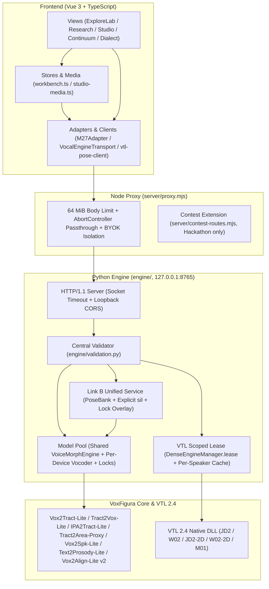

# VoxFigura 系统架构规范

> 文档版本：1.1 · 2026-11-24
> 适用范围：全仓前后端模块、Node 代理、Python 推理引擎与独立包

## 1. 分层架构总览

## 2. VoxFigura Core 官方模型清单与运行参数

全仓统一使用下列官方命名，废弃历史阶段代号：

| 官方名称 | 职责与定位 | 引擎模块与 ONNX 权重路径（相对于 `engine/model_bundle/`） | 采样率 / 控制帧率 | 运行设备 |
| --- | --- | --- | --- | --- |
| `Vox2Tract-Lite` | 语音反演 27 维声道与发声态轨迹 | `onnx_inference.py` + `models/Vox2Tract-Lite/vox2tract_lite.onnx` | 输入 16 kHz / 输出 50 Hz（hop 320） | ORT CPU / CUDA |
| `Vox2Align-Lite v2` | 双语原文引导对齐与静音门控（共享反演主干） | `onnx_inference.py` + `models/Vox2Align-Lite/vox2align_lite_v2.onnx` | 输入 16 kHz / 50 Hz 帧与音素边界 | ORT CPU / CUDA |
| `Tract2Vox-Lite` | 27 维声道轨迹 + 512 维音色向量神经赋声 | `m27_bridge.py` + `models/Tract2Vox-Lite/tract2vox_lite.onnx` | 控制 50 Hz / 生成 16 kHz（密轨路径升至 48 kHz） | ORT CPU / CUDA |
| `Vox2Spk-Lite` | 语音提取 512 维 L2 归一化音色向量 | `onnx_inference.py` + `models/Vox2Spk-Lite/vox2spk_lite.onnx` | 输入 16 kHz / 80-Mel CMN | ORT CPU / CUDA |
| `IPA2Tract-Lite` | 音标关键帧协同动腔残差轨迹规划 | `keyframe_lite.py` + `models/IPA2Tract-Lite/ipa2tract_lite.onnx` | 输入 111 维条件 @ 50 Hz / 输出 26 维 | ORT CPU / CUDA |
| `Tract2Area-Proxy` | 17 维声道预测 6 区截面积物理守卫 | `keyframe_lite.py` + `models/IPA2Tract-Lite/tract2area_proxy.onnx` | 50 Hz 逐帧 | ORT CPU / CUDA |
| `Text2Prosody-Lite` | 中英混排文本时长、相对半音 F0 与停顿预测 | `prosody_bridge.py` + `models/Text2Prosody-Lite/text2prosody_lite.onnx` | 输出音素帧与 F0 knots（50–550 Hz） | ORT CPU / CUDA |
| `DPDFNet` | 48 kHz 分声道实时降噪（ONNX） | `dpdf_audio.py` + `ptb/resources/neural/dpdfnet2_48khz_hr.onnx` | 保持 48 kHz | ORT CPU |
| `SwiftF0` | 50 Hz 基频提取（方言与反演前端，ONNX） | `swift_pitch.py` + `ptb/resources/neural/swift-f0-0.3.0.onnx` | 输入 16 kHz / 输出 50 Hz | ORT CPU |

> 全部 9 个本地模型均由 `engine/model_registry_runtime.py`（`LocalModelManager`）基于纯 ONNX Runtime（零 PyTorch 运行时依赖）管理，支持按需热插拔装载/卸载及外置 `.onnx` 文件夹/单文件校验替换；原始 `.pt` 权重暂作离线备份保留。旗舰大模型参考：`Vox2Tract-Large`、`Vox2Tract-PR`、`Tract2Feat-Proxy`、`Tract2Vox-Large` 位于上游训练目录（只读参考，不随本仓库本地推理权重包运行）。

## 3. 五条核心工作流数据流

1. **链路 A · 录音声道重建与重合成**：
   前端录音/导入音频 → `M27Adapter.reconstruct` → `/api/m27/reconstruct` → `Vox2Tract-Lite` + `Vox2Align-Lite v2`（>9.6 s 按静音分块，F0 取 40–600 Hz）→ `50 Hz` M27（`Pa` 单位）+ 矢状面动画 + VTL 2.4（48 kHz）+ `Tract2Vox-Lite`（16 kHz）。
2. **链路 B · 文字与标注协同构音合成**：
   前端歌词/TextGrid → `Text2Prosody-Lite`（保留显式 `sil` 与 F0 knots）+ `@vocalcut/g2p` → `buildAnnotationSynthesis`（`200 Hz` 控制轨、显式静音、构型目标与手动锁定）→ `/api/vtl/synthesize` → `keyframe_lite.apply_annotation_trajectory`（`PoseBank` 相位目标、所选 IPA 构型的主发音器官约束）→ `IPA2Tract-Lite` → VTL 2.4（48 kHz）或 `Tract2Vox-Lite`（48 kHz）。
3. **链路 C · 单构型、连续统与持音试听**：
   IPA / extIPA / VoQS 构型 → `resolveVtlPose` → `/api/vtl/pose`（VTL `lease`）；连续统网格 → `/api/vtl/batch-contours` + `/api/vtl/synthesize` 或 `/api/m27/resynthesize`；参赛版持音试听 → `/api/m27/hold-preview`（16 kHz 补齐高通与斜坡）。
4. **链路 D · 编曲简谱与舞台成片**：
   歌词 + 通用文本简谱 → `parseNumberedScore`（`@vocalcut/core`）→ `compileArrangement`（48 kHz 整数采样与辅音抢拍）→ `synthesizeRange`（带 `AbortController` 单飞取消）→ 舞台合成视频导出。
5. **链路 E · 方言提取、降噪与双人声音迁移**：
   方言音频 → `SwiftF0` → 词条变调；降噪 → `DPDFNet`；双人迁移 → `VoiceMorphBridge`（复用 `M27Bridge` 共享的 `VoiceMorphEngine`）。

## 4. 版本入口与构建隔离

- 公开版入口：`src/editions/public.ts`（`npm run dev` 5173 + `npm run server` 3001 → `dist-public/`）。默认进入首页，提供通用发音卡排版和导出。`vite.config.ts` 屏蔽 `src/editions/hackathon/**`，构建检查验证卡片入口、动卡导出及赛事品牌隔离。
- 参赛版入口：`src/editions/hackathon/index.ts`（`npm run dev:hackathon` 5174 + `npm run server:hackathon` 3002 → `dist-hackathon/`），单独挂载知乎内容路由与刘看山素材。
- 群友版入口：`src/editions/friends.ts`（`npm run dev:friends` 5175 + `npm run server:friends` 3003 → `dist-friends/`）。默认进入首页，发音卡保留本地知乎作者署名。参赛版默认进入知乎探索，独立提供知乎内容、伴读仓库接口和赛事素材。
- 三版共用 `src/components/phonetic-card/` 的卡片组件。PNG 由浏览器生成，MP4 与 GIF 由代理调用 FFmpeg。公开版的卡片示例使用 `public/prewarm/` 资源。
- 自定义工作区背景和应用图标按应用地址保存在浏览器 IndexedDB，上次选中项由本地偏好恢复。切回预设背景或默认图标后，已保存图片仍可在设置中选取。
- 公共代码（`src/` 其余目录、`packages/`、`server/index.mjs`、`server/proxy.mjs`）严禁直接导入 `src/editions/hackathon/`，统一经 `@vocalcut/edition` 别名解析。

## 5. 目录与运行缓存边界

- `.cache/` **仅存放运行时按需缓存**：`.cache/ipa-neural-lite/`、`.cache/ipa-library-materials/`、`.cache/voice-morph/`、`.cache/ipa-references/` 与引擎日志。禁止在 `.cache/` 长期堆积历史构建备份或临时脚本；已通过审核的静态文档放入 `docs/`，设计文档归档于 `docs/specs/`。
- 外部基线目录 `D:\PhoneticToolbox\PhoneticToolbox_v3` 与 `F:\TensorTract3_Train` 为**绝对只读引用源**，任何脚本与服务禁止向其写入文件或字节码（Python 一律以 `-B` 启动）。
