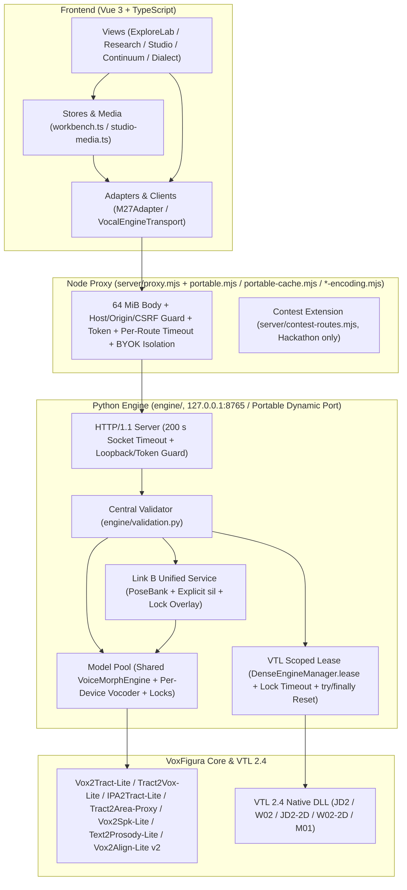

# VoxFigura 系统架构规范

> 文档版本：1.2 · 2026-11-26
> 适用范围：全仓前后端模块、Node 代理（含免安装入口）、Python 推理引擎与独立包
> **品牌与内部代号边界**：面向用户的界面与正式文档统一使用 **VoxFigura**；`VocalCut` 仅作为内部工程代号保留于包别名（`@vocalcut/*`）、事件名（`vocalcut:*`）、环境变量（`VOCALCUT_*`）与代理服务名（`vocalcut-node-proxy`）。

## 1. 分层架构总览

## 2. VoxFigura Core 官方模型清单与运行参数

全仓统一使用下列官方命名，废弃历史阶段代号：

| 官方名称 | 职责与定位 | 引擎模块与 ONNX 权重路径（相对于 `engine/model_bundle/`） | 采样率 / 控制帧率 | 运行设备 |
| --- | --- | --- | --- | --- |
| `Vox2Tract-Lite` | 语音反演 27 维声道与发声态轨迹 | `onnx_inference.py` + `models/Vox2Tract-Lite/vox2tract_lite.onnx` | 输入 16 kHz / 输出 50 Hz（hop 320） | ORT CPU / CUDA |
| `Vox2Align-Lite v2` | 双语原文引导对齐与静音门控（共享反演主干） | `onnx_inference.py` + `models/Vox2Align-Lite/vox2align_lite_v2.onnx` | 输入 16 kHz / 50 Hz 帧与音素边界 | ORT CPU / CUDA |
| `Tract2Vox-Lite` | 27 维声道轨迹 + 512 维音色向量神经赋声 | `m27_bridge.py` + `models/Tract2Vox-Lite/tract2vox_lite.onnx` | 控制 50 Hz / 生成 16 kHz（密轨路径升至 48 kHz） | ORT CPU / CUDA |
| `Vox2Spk-Lite` | 语音提取 512 维 L2 归一化音色向量 | `onnx_inference.py` + `models/Vox2Spk-Lite/vox2spk_lite.onnx` | 输入 16 kHz / 80-Mel CMN | ORT CPU / CUDA |
| `IPA2Tract-Lite` | 音标关键帧协同动腔残差轨迹规划 | `keyframe_lite.py` + `models/IPA2Tract-Lite/ipa2tract_lite.onnx` | 输入 111 维条件 @ 50 Hz / 输出 26 维 | ORT CPU / CUDA |
| `Tract2Area-Proxy` | 17 维声道预测 6 区截面积物理守卫 | `keyframe_lite.py` + `models/IPA2Tract-Lite/tract2area_proxy.onnx` | 50 Hz 逐帧 | ORT CPU / CUDA |
| `Text2Prosody-Lite` | 中英混排文本时长、相对半音 F0 与停顿预测 | `prosody_bridge.py` + `models/Text2Prosody-Lite/text2prosody_lite.onnx` | 输出音素帧与 F0 knots（50–550 Hz） | ORT CPU / CUDA |
| `DPDFNet` | 48 kHz 分声道实时降噪（ONNX） | `dpdf_audio.py` + `ptb/resources/neural/dpdfnet2_48khz_hr.onnx` | 保持 48 kHz | ORT CPU |
| `SwiftF0` | 50 Hz 基频提取（方言与反演前端，ONNX） | `swift_pitch.py` + `ptb/resources/neural/swift-f0-0.3.0.onnx` | 输入 16 kHz / 输出 50 Hz | ORT CPU |

> 全部 9 个本地模型均由 `engine/model_registry_runtime.py`（`LocalModelManager`）基于纯 ONNX Runtime（零 PyTorch 运行时依赖）管理，支持按需热插拔装载/卸载及外置 `.onnx` 文件夹/单文件校验替换；原始 `.pt` 权重暂作离线备份保留。旗舰大模型参考：`Vox2Tract-Large`、`Vox2Tract-PR`、`Tract2Feat-Proxy`、`Tract2Vox-Large` 位于上游训练目录（只读参考，不随本仓库本地推理权重包运行）。

## 2.5 核心内核语义与模型适配器边界

1. **6 档发声态双语义约定（`packages/core-ts/src/phonation.ts`）**：
   - **分段保持（`heldPhonationAt` / `heldPhonationAtChecked`）**：用于工作台播放头与标注时间轴；每个锚点在半开区间 `[anchor_i.t_smp, anchor_{i+1}.t_smp)` 内保持不变，首个锚点之前默认取 `modal`。
   - **10 维直连线性插值（`evaluatePhonationAnchorsAt` / `evaluatePhonationTrackDense`）**：用于密集连续发声态轨迹；相邻锚点在 10 维 M27 声门空间直接线性插值（预排序 + 二分查找），不经过中间离散档位；首个锚点之前取首锚点，末锚点之后取末锚点。
   - **物理边界说明**：`creaky` 锚点 `f0_hz: 58` 仅对应 VoQS/M27 原生参考重心；核心与神经合成链路支持任意正有限基频（`> 0 Hz`），仅 VTL 2.4 C++ 物理声门保留原生 `40..600 Hz` 硬件边界；`blend` 越界一律拒绝为 `out_of_range`，禁止静默夹紧或回落。
2. **统一越界校验与调度/撤销语义（`packages/core-ts/` & `src/stores/workbench.ts`）**：
   - `packages/core-ts/src/types.ts` 提供统一越界工具 `checkRange(value, limit, field, unit?, hint?)`；`TRACT_PARAM_LIMITS`（含 `TRX: [-4, 2]`、`TRY: [-6, 0]`）与 `engine/validation.py`、`workbench.ts` 经跨语言单测断言 19 维逐维一致。
   - `scheduler.ts` 累计简谱休止符时值（`rest_before_beats` / `is_rest_after`）、冲突路径倒推韵尾防重叠、入口强制校验塞音刚性下限（闭塞 ≥ 10 ms、释放 ≥ 1 ms，`scaleStopTimingMs` 对 `< 11 ms` 返回 `rigid_floor`）；`qta.ts` Pin 采用严格半开区间 `[start_smp, end_smp)` 并一次性预排序。
   - `CommandBus` 与 `workbench.ts` 的 `revision` 在 undo/redo 后均严格单调递增，避免 ABA 冲突；`workbench.ts` 撤销快照剥离 `AudioBuffer` 改为有界缓存引用 ID，`artic.set_pose` 严格区分绝对 `params` 与相对 `delta`。
3. **模型适配器统一出口与实时抗混叠边界（`packages/model-adapters/`）**：
   - 前端 `src/` 对 `/api/vtl/*`（12 处）与 `/api/m27/*`（8 处）的全部调用已 100% 收敛至 `defaultVtlTransport`（`VocalEngineTransport`：`fetchMetaRaw` / `requestPoseRaw` / `requestBatchContours` / `requestSynthesizeRaw` / `requestSynthesizeStream` / `requestLivePull`）与 `defaultM27Adapter`（`M27Adapter`：`reconstructRaw` / `prepareRealtimeSpeaker` / `realtimeStep` / `holdPreview` / `transcribe` / `asrInstall`），并由 `tests/review-2026-11-26-fixes.test.ts` 守卫禁止 `src/` 直接 `fetch('/api/(m27|vtl)/')`。
   - 实时声道重建重采样使用跨块有状态 47-tap Blackman 多相 FIR 抗混叠重采样器（`src/components/research/m27-realtime.ts` `AntiAliasingResampler`，截止 ~7.2 kHz）。
   - 声门下压在前端与适配器层统一以 `Pa`（`0..1600 Pa`）传递（包括 `/api/models/voice-morph` 返回的 `source9_phys_pa` / `source_params.pr_pa`），仅在 Python `engine/` 与原生边界执行 `dPa = Pa * 10` 换算。

## 3. 五条核心工作流数据流

1. **链路 A · 录音声道重建与重合成**：
   前端录音/导入音频 → `M27Adapter.reconstruct` → `/api/m27/reconstruct` → `Vox2Tract-Lite` + `Vox2Align-Lite v2`（>9.6 s 按静音分块，SwiftF0 取 46.875–2093.75 Hz）→ `50 Hz` M27（`Pa` 单位）+ 矢状面动画 + VTL 2.4（48 kHz）+ `Tract2Vox-Lite`（16 kHz）。
2. **链路 B · 文字与标注协同构音合成**：
   前端歌词/TextGrid → `Text2Prosody-Lite`（保留显式 `sil` 与 F0 knots）+ `@vocalcut/g2p` → `buildAnnotationSynthesis`（`200 Hz` 控制轨、显式静音、构型目标与手动锁定）→ `/api/vtl/synthesize` → `keyframe_lite.apply_annotation_trajectory`（`PoseBank` 相位目标、所选 IPA 构型的主发音器官约束）→ `IPA2Tract-Lite` → VTL 2.4（48 kHz）或 `Tract2Vox-Lite`（48 kHz）。
3. **链路 C · 单构型、连续统与持音试听**：
   IPA / extIPA / VoQS 构型 → `resolveVtlPose` → `/api/vtl/pose`（VTL `lease`）；连续统网格 → `/api/vtl/batch-contours` + `/api/vtl/synthesize` 或 `/api/m27/resynthesize`；参赛版持音试听 → `/api/m27/hold-preview`（16 kHz 补齐高通与斜坡）。
4. **链路 D · 编曲简谱与舞台成片**：
   歌词 + 通用文本简谱 → `parseNumberedScore`（`@vocalcut/core`）→ `compileArrangement`（48 kHz 整数采样与辅音抢拍）→ `synthesizeRange`（带 `AbortController` 单飞取消）→ 舞台合成视频导出。
5. **链路 E · 方言提取、降噪与双人声音迁移**：
   方言音频 → `SwiftF0` → 词条变调；降噪 → `DPDFNet`；双人迁移 → `VoiceMorphBridge`（复用 `M27Bridge` 共享的 `VoiceMorphEngine`）。

## 4. 版本入口、免安装服务与构建隔离

- 开源版入口：`src/editions/public.ts`（`npm run dev` 5173 + `npm run server` 3001 → `dist-public/`）。默认进入首页，整合原群友版特性，保留本地作者卡片署名与通用科研导出（`check-edition.mjs` 显式白名单仅允许 `./hackathon/branded-card`，并在缺失本地私有录音时自动回退预热样本以保障 GitHub Actions CI 构建）。
- 参赛版入口：`src/editions/hackathon/index.ts`（`npm run dev:hackathon` 5174 + `npm run server:hackathon` 3002 → `dist-hackathon/`），单独挂载知乎内容路由（`server/contest-routes.mjs`）与刘看山素材。
- **免安装桌面版入口（`server/portable.mjs` + `server/portable-cache.mjs`）**：由 Tauri 2 原生壳（`src-tauri/`）隐藏控制台拉起；按 `bundle-manifest.json` 监听固定回环端口（开源版 `26751`，兼顾历史 `friends` 缓存端口 `26752`）并同时托管静态网页与 `/api/*` 代理；自动以 `ENGINE_PORT=0`、`VOCALCUT_CPU_ONLY=1`、`VOCALCUT_DISABLE_LOCAL_ASR=1`、`VOCALCUT_ENGINE_TOKEN`、`VOCALCUT_ENGINE_PARENT_PIPE=1` 启动包内嵌入式 Python 引擎。发音卡与剪辑媒体编码分别由 `server/card-encoding.mjs`、`server/studio-encoding.mjs` 提供。`server/portable-cache.mjs` 仅在便携态开放 `/api/portable/cache*`（非便携态返回 404），执行白名单清理、`.voxfigura-cache-root` 专属子目录保护与 `.lock` 持锁检测。
- 两版共用 `src/components/phonetic-card/` 的卡片组件。PNG 由浏览器生成，MP4 与 GIF 由代理调用 FFmpeg；开源版在本地含演示音频时优先使用演示音频，云端构建或未随仓附带时回退 `public/prewarm/` 资源。
- 自定义工作区背景和应用图标按应用地址保存在浏览器 IndexedDB，上次选中项由本地偏好恢复。切回预设背景或默认图标后，已保存图片仍可在设置中选取。
- 公共代码（`src/` 其余目录、`packages/`、`server/index.mjs`、`server/proxy.mjs`、`server/portable.mjs`）严禁直接导入 `src/editions/hackathon/`，统一经 `@vocalcut/edition` 别名解析。

## 5. 目录与运行缓存边界

- `.cache/` **仅存放运行时按需缓存**：`.cache/ipa-neural-lite/`、`.cache/ipa-library-materials/`、`.cache/voice-morph/`、`.cache/ipa-references/`、`.cache/voqs-native/`、开发态临时引擎令牌 `.cache/local-engine.token` 与引擎日志。禁止在 `.cache/` 长期堆积历史构建备份或临时脚本；已通过审核的静态文档放入 `docs/`，设计文档归档于 `docs/specs/`。
- 外部基线目录 `D:\PhoneticToolbox\PhoneticToolbox_v3` 与 `F:\TensorTract3_Train` 为**绝对只读引用源**，任何脚本与服务禁止向其写入文件或字节码（Python 一律以 `-B` 启动）。

## 6. 环境变量总表

| 环境变量 | 适用模块 | 默认值 | 说明 |
| --- | --- | --- | --- |
| `PORT` | `server/{index,hackathon}.mjs` | `3001` / `3002` | 开发态 Node 代理监听端口（免安装版固定开源版 `26751`） |
| `HOST` | `server/proxy.mjs` | `127.0.0.1` | 代理监听地址；非回环绑定须同时设置 `VOCALCUT_ALLOW_NON_LOOPBACK=1` |
| `VOCALCUT_ALLOW_NON_LOOPBACK` | `server/proxy.mjs` | 未设置（禁用） | 设为 `1` 允许代理绑定非回环地址 |
| `VOCALCUT_PROXY_URL` | `vite.config.ts` | 按版本对应 `3001/3002` | 前端开发服务器 `/api` 反向代理目标 |
| `TENSORTRACT_API_URL` | `server/proxy.mjs` | `http://127.0.0.1:8765` | 代理转发本地 Python 推理引擎的基础地址 |
| `ENGINE_HOST` / `ENGINE_PORT` | `engine/server.py`、`server/portable.mjs` | `127.0.0.1` / `8765` | Python 引擎监听地址与端口；免安装版设为 `0` 分配动态端口 |
| `VOCALCUT_PYTHON` | `scripts/start-engine.mjs` | 未设置 | 最高优先级指定 `npm run engine` 所用 Python 解释器路径 |
| `VOCALCUT_ENGINE_TOKEN` | `scripts/start-engine.mjs`、`server/proxy.mjs`、`engine/server.py` | 开发态自动生成 | 引擎内部鉴权令牌（经 `X-VoxFigura-Engine-Token` 传递）；开发态未设置时自动写入 `.cache/local-engine.token`（`0o600`，退出自动清理） |
| `VOCALCUT_ENGINE_LOCK_TIMEOUT_S` | `engine/dense_channel.py` | `30.0` | 按说话人获取 VTL 引擎锁的最大等待秒数，超时返回 HTTP `503` `engine_busy` |
| `VOCALCUT_ENGINE_PARENT_PIPE` | `server/portable.mjs`、`engine/server.py` | 未设置（便携态 `1`） | 启用后监听父进程 stdin 管道，父进程关闭时自动终止引擎 |
| `VOCALCUT_CPU_ONLY` | `server/portable.mjs`、`engine/` | 未设置（便携态 `1`） | 强制纯 CPU ONNX Runtime 推理 |
| `VOCALCUT_ENABLE_LOCAL_ASR` / `VOCALCUT_DISABLE_LOCAL_ASR` | `engine/server.py`、`server/portable.mjs` | 默认关闭 | 仅研发态显式设 `VOCALCUT_ENABLE_LOCAL_ASR=1` 且未设 `VOCALCUT_DISABLE_LOCAL_ASR=1` 时启用本地 Whisper；便携版强制 `VOCALCUT_DISABLE_LOCAL_ASR=1` |
| `VOCALCUT_ASR_DOWNLOAD_HOST` / `VOCALCUT_ASR_MODEL_DIR` | `engine/asr_models.py`、`speech_to_text.py` | 自动选源 / `.cache/asr/` | 仅开发态本地 ASR 启用时指定镜像源或本地 CTranslate2 权重目录 |
| `VOCALCUT_FFMPEG` | `server/{portable,card-encoding,studio-encoding}.mjs`、`engine/` | 系统 `ffmpeg` | 指定锁定的 FFmpeg 可执行文件路径 |
| `VOCALCUT_PORTABLE` / `VOCALCUT_PORTABLE_ROOT` / `VOCALCUT_PORTABLE_ACTIVE` / `VOCALCUT_LAUNCHER_CONFIG` | `src-tauri/`、`server/portable.mjs`、`server/portable-cache.mjs` | 便携态自动注入 | 标识便携模式、用户缓存根目录、活动版本目录与启动器配置文件路径 |
| `VOXFIGURA_UPDATE_URL` | `server/proxy.mjs` | 官方 HTTPS `latest.json` | 覆盖更新检查清单 URL（仅接受白名单域名的 HTTPS 地址） |
| `ZHIHU_ACCESS_SECRET` / `ZHIHU_RANDOM_BLOCKED_AUTHORS` / `VOCALCUT_ZHIHU_CLI` | `server/contest-routes.mjs`（仅参赛版） | `.env.local` 加载 | 参赛版知乎接口凭据与过滤配置（严禁写入日志、公开版或群友版） |
