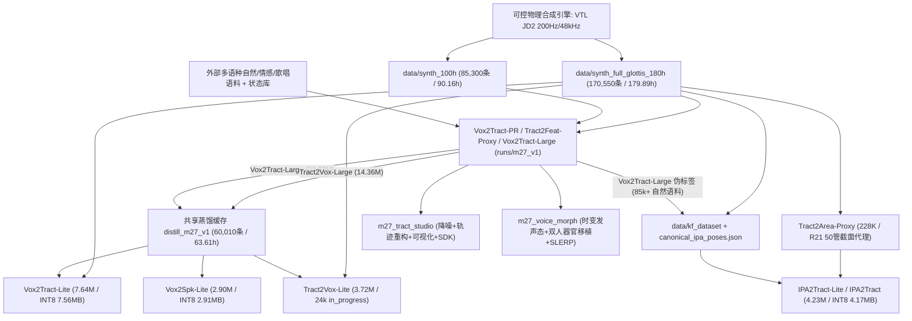
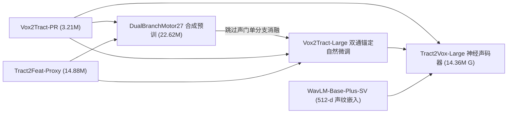

# VoxFigura 全栈技术与开源复现指南

> 覆盖 **VoxFigura · IPA · Glottis · Vocal Tract** 整库开源架构与 **VoxFigura Core** 全系自研模型：**Vox2Tract**（声道反演 `-Large/-Lite/-PR`）、**Tract2Vox**（真人声道声码器 `-Large/-Lite`）、**IPA2Tract**（协同动腔规划 `-Lite`）、**Vox2Spk**（轻量音色编码器 `-Lite`）、训练代理 **Tract2Feat-Proxy / Tract2Area-Proxy** 与一代 22 维历史基线，以及完整数据工程、可打包应用模块和研发全程踩坑实录。官方命名规范总览参阅 [CODING_STANDARDS.md §1](./CODING_STANDARDS.md)。

---

## 第 1 章 项目总览与完整模型家族

### 1.1 系统演进主线

**VoxFigura · IPA · Glottis · Vocal Tract**（核心模型家族 **VoxFigura Core**）是一个面向全栈开源的语音生理构音、发声态反演与可控合成平台，覆盖声学到物理构音运动反演、可控物理声道合成、多说话人声门感知神经重合成、音标关键帧协同规划以及双人多器官时变移植交互工坊。物理引擎底座依托 VocalTractLab 2.3 R21 的 JD2 解剖模型（65 截面声道管与 Geometric glottis 2025 声门模型），并在一代 22 维闭环方案中致谢并参考了 ESSV 2026 的合成锚定思路；全项目在此基础上独立扩展至以下四个演进代际与两大可打包应用工坊：

1. **第一代 M22 基线体系（Legacy）**：采用 22 维控制契约（17 维独立声道 + 3 维核心声门参数 + 肺压 `PR` 0 到 8000 dPa + 基频 `F0` 60 到 450 Hz）与单层 WavLM 第 24 层感知反馈，完成 90 小时合成语料与 300 小时流式自然语料闭环验证（**Vox2Tract-M22-Legacy** `MotorEncoder`），并蒸馏出首版 7.02M 参数浏览器端反演器（**Vox2Tract-M22-Lite-Legacy** `BrowserLightInverter`）。
2. **第二代 M27 全原生双分支大模型体系（`runs/m27_v1/`）**：将物理控制扩展至完整 JD2 27 维全发声态契约（新增上声门缘 `XT`、后裂隙 `CA`、上下相位滞后 `LAG`、脉冲形状 `PS`、周期抖动 `FL` 与幅度微扰 `SHIM`），肺压扩展至 0 到 16000 dPa、基频扩展至 40 到 600 Hz，引入显式 3 维音质前端 `VoiceQualityFrontend50Hz`、双层声学代理 **Tract2Feat-Proxy** (`AcousticDecoder27`)、肺压子编码器 **Vox2Tract-PR** (`PressureEncoder27`)、声道/声门解耦双分支大模型 **Vox2Tract-Large**（旧称 Stage 4，历史；`DualBranchMotor27`），并通过带 180 小时合成物理真值锚定的自然与表现性语料两段微调，最终以 14.36M 参数的多说话人 `GlottisAwareSourceModule` 神经声码器 **Tract2Vox-Large**（旧称 Stage 5，历史；`ConditionalHiFiGenerator27` / `nsf_glottis_v3`）闭环。
3. **零 WavLM 端侧轻量三件套（`-Lite` Trio）**：彻底摆脱 1.2 GB `wavlm-large` 与 380 MB `wavlm-base-plus-sv` 运行时依赖，分别蒸馏 7.64M 反演器 **Vox2Tract-Lite** (`BrowserLightM27Inverter`)、2.90M ECAPA-TDNN 声纹编码器 **Vox2Spk-Lite** (`BrowserLightSpeakerEncoder`) 与 3.72M 紧凑版神经声码器 **Tract2Vox-Lite** (`ConditionalHiFiGenerator27` `ch=256`)，形成可运行于 CPU 与浏览器的零底座端到端闭环（其中 **Tract2Vox-Lite** 在本指南原始记录节点处于 `24,000 / 65,000` 步，本仓现已接入正式导出 ONNX 权重）。
4. **协同动腔规划小模型 IPA2Tract-Lite**（简称 **IPA2Tract**，旧称 `KF2Tract27`（历史））：以纯 NumPy / C 级零阶保持 IIR 异步三阶目标逼近模型（qTA）无滞后物理轨迹为骨架，叠加 4.23M 参数的零初始化双残差网络 `KeyframeTractModel27` 与冻结 50 管截面积代理 **Tract2Area-Proxy** (`TubeAreaProxy27`)，实现 111 维条件到 50 Hz 物理声道轨迹的轻量协同预测，并通过 USC-TIMIT 真实人类 EMA 电磁构音仪传感器检验。
5. **可独立打包模块（`m27_tract_studio/` 与 `m27_voice_morph/`）**：将前端降噪、**Vox2Tract-Large** 轨迹重构、正中矢状面与解剖声带渲染、时变发声态调制与基于 **Tract2Vox-Large** 的双人多器官对齐移植封装为标准 `pip` 可安装 Python 包、CORS REST 服务及共享 CSS 令牌的一键换肤 Web 组件。



### 1.2 全家族已训练模型总表（Model Zoo）

> 说明：`参数量` 按 `requires_grad` 可训练参数量统计，括号内给出含无梯度缓冲区（如 BatchNorm `num_batches_tracked` 或固定滤波器组）的 `state_dict` 总元素数；**推理导出体积** 指上游训练仓库 `models/` 下的干净权重文件大小（不含训练优化器状态），本仓分发对应的校验清单位于 [`engine/model_bundle/models/manifest.json`](../engine/model_bundle/models/manifest.json)。

| 官方模型名 | 历史训练阶段 / 目录键 | 网络结构与别名 | 导出路径 (`models/...`) | 参数量 (`trainable` / `state_dict`) | 推理导出体积 | 训练步数与状态 | 核心实测指标 |
| :--- | :--- | :--- | :--- | :--- | :--- | :--- | :--- |
| **Vox2Tract-Large** | `motor_natural` | `DualBranchMotor27` / `Vox2TractLarge` | `models/Vox2Tract-Large/vox2tract_large.pt` | `22,620,651` / `22,635,131` | `86.50 MB` (`fp32`) | 32,000 步 / best @26,500 (`verified`) | `best_val = 0.02778`, `tract17_pcc = 0.8200`, `glottis8_pcc = 0.9040`, R21 试听 `L24 = 0.8707`, `L6 = 0.7735` |
| **Vox2Tract-PR** | `pr_encoder` | `PressureEncoder27` / `Vox2TractPR` | `models/Vox2Tract-Large/vox2tract_pr.pt` | `3,211,418` / `3,213,084` | `12.28 MB` (`fp32`) | 30,000 步 / best @26,500 (`verified`) | `best_val = 0.009636`, `pr_pcc = 0.9811` |
| **Tract2Feat-Proxy** | `acoustic_decoder` | `AcousticDecoder27` / `Tract2FeatProxy` | `models/Vox2Tract-Large/tract2feat_proxy.pt` | `14,882,304` / `14,890,504` | `56.88 MB` (`fp32`) | 50,000 步 / best @43,500 (`verified`) | `best_val = 0.018199`, `Cos24 = 0.8809`, `Cos6 = 0.8408` |
| *合成预训过程节点* | `motor_synth` / `motor_glottis` | `DualBranchMotor27` (合成预训 / 负收益消融) | 归档 `runs/m27_v1/` | `22,620,651` / `22,635,131` | `259.46` / `139.68 MB` (含 Opt) | 45,000 (`verified`) / 3,550 (`stopped`) | 合成预训 `tract17 = 0.6326, glottis8 = 0.8809`; 专训声门 `val_l_glottis` 反升未启用 |
| *无锚定消融对照* | `motor_natural_unanchored_bak` | 无 Pass 2 锚定消融存档 | 归档 `runs/m27_v1/` | `22,620,651` / `22,635,131` | `259.46 MB` (含 Opt) | 5,700 步 (`archived`) | 物理漂移：`tract17 0.6299 -> 0.4076`, `glottis8 0.8905 -> 0.5435` |
| **Tract2Vox-Large** | `neural_synth` (`v3`) | `ConditionalHiFiGenerator27` / `Tract2VoxLarge` (`nsf_glottis_v3`) | `models/Tract2Vox-Large/tract2vox_large.pt` | `14,360,195` (G) + 22.61M (D) | `54.87 MB` (`fp32_generator`) | 32,000 步 / best @29,000 (`verified`) | `mel_l1 = 0.71762, L24 = 0.8895, L6 = 0.7918, Spk = 0.8855, val_score = 0.03534`; 试听 `L24 = 0.8620, L6 = 0.7571, Spk = 0.8758` |
| **Tract2Vox-Large-v1 / v2** | 归档版声码器 | 纯 HiFi-GAN (`v1`) / 7 谐波 NSF (`v2`) | 归档 `runs/m27_v1/` | `14.92M` (`v1`) / `14.31M` (`v2`) | `429.9` / `423.0 MB` (含 D/Opt) | 6k (`v1`) / 10k (`v2`) (`archived`) | `v1 val_score = 0.43484` -> `v2 val_score = 0.33570` |
| **Vox2Tract-Lite** | `browser_m27_stage4` | `BrowserLightM27Inverter` / `Vox2TractLite` | `models/Vox2Tract-Lite/vox2tract_lite_{fp16,int8}.pt` | `7,642,458` / `7,691,444` | **`14.75 MB`** (`fp16`) / **`7.56 MB`** (`int8`) | 55,000 步 (`verified`) | 未见自然 `T17 = 0.9102 / G8 = 0.8420 / PR = 0.8798`; 8 句 R21 `L24 = 0.8235` (INT8 `0.8204`), CPU `80.2 ms` (`RTF 0.0289`) |
| **Vox2Spk-Lite** | `browser_spk_enc` | `BrowserLightSpeakerEncoder` / `Vox2SpkLite` | `models/Vox2Spk-Lite/vox2spk_lite_{fp16,int8}.pt` | `2,901,440` / `2,953,314` | **`5.68 MB`** (`fp16`) / **`2.91 MB`** (`int8`) | 30,000 步 (`verified`) | `val_teacher_cos = 0.9172` (INT8 `0.9171`), `gap = 0.3546`, CPU 3s `12.29 ms` |
| **Tract2Vox-Lite** | `browser_m27_stage5` | `ConditionalHiFiGenerator27` / `Tract2VoxLite` (`ch=256`) | `models/Tract2Vox-Lite/tract2vox_lite_wip_step15000_{fp16,int8}.pt` | `3,719,666` (`weight_norm` 移除后，训练态 `3,725,347`) | **`7.16 MB`** (`fp16_wip`) / **`3.66 MB`** (`int8_wip`) | 24,000 / 65,000 步 / best @15,000 (`in_progress`) | @15k `mel = 0.72505, L24 = 0.8602, L6 = 0.7659, Spk = 0.8783, lite_e2e_spk = 0.8695, val_score = 0.06520` |
| **IPA2Tract-Lite** (`IPA2Tract`) | `k2_natural` | `KeyframeTractModel27` / `IPA2TractLite` / `IPA2Tract` | `models/IPA2Tract-Lite/ipa2tract_lite_{fp16,int8}.pt` + `canonical_ipa_poses.json` | `4,228,826` / `4,231,928` | **`8.12 MB`** (`fp16`) / **`4.17 MB`** (`int8`) | K1 15k -> K2v1 14k -> K2v2 16k (`verified`) | `best_val = 0.24201`, 脏上下文泄漏 `0.0`, EMA `LD = 0.6956 / TTX = 0.6743`, CPU 5s `64.38 ms` |
| **Tract2Area-Proxy** | `tube_proxy` | `TubeAreaProxy27` / `Tract2AreaProxy` | `models/IPA2Tract-Lite/tract2area_proxy.pt` | `228,486` / `228,486` | `0.88 MB` (`fp32`) | 25 epochs / 300k 帧 (`verified`) | `best_val_mae_cm2 = 0.04776 cm^2` |
| **Vox2Tract-M22-Legacy** | 一代 M22 (`motor_natural` 等) | `MotorEncoder` + 一代 PR/Decoder | 归档 `runs/` | `9,009,244` (Motor) | `103.35 MB` (含 Opt) | S3 60k -> S4 26k (`archived`) | S3 `best_val = 10.42167`, 流式消费 242,556 条 / 1,000,043 s |
| **Vox2Tract-M22-Lite-Legacy** | 一代轻量 (`browser_light_full_v1_pw`) | `BrowserLightInverter` (+L24 感知蒸馏) | 归档 `runs/` | `7,023,957` / `7,070,413` | `13.55 MB` (`fp16`) | 45,000 步 (`archived`) | `m20_pcc = 0.9354, pr_pcc = 0.7670, L24 = 0.7976`, CPU `111.2 ms` (`RTF 0.0301`) |

---

## 第 2 章 软硬件环境、外部底座与时间网格契约

### 2.1 已验证计算环境

所有训练、蒸馏与评估均在以下已验证软硬件环境中完成（`src/tt3/constants.py` 与 `.venv` 实测）：

| 组件 | 已验证配置 | 说明 |
| :--- | :--- | :--- |
| 操作系统与外壳 | Windows + PowerShell 5.1 / Python subprocess | 使用 `scripts/run_logged.py` 或 `cmd.exe /c "... 2>&1"` 规避 stderr 终止问题 |
| Python 与深度学习框架 | Python `3.11.9`, PyTorch `2.7.1+cu128` (CUDA `12.8`) | 启用 `torch.backends.cuda.matmul.allow_tf32 = True` 与 `cudnn.allow_tf32 = True` |
| GPU 硬件 | `NVIDIA GeForce RTX 5090 Laptop GPU` (24 GB VRAM) | `Vox2Tract-PR` / `Tract2Feat-Proxy` / `Vox2Tract-Large` 与 `-Lite` 反演/声纹模型均用 `bf16`；教师声码器 `Tract2Vox-Large` 的 G/D/Mel 使用全 FP32 以保证 GAN 稳定；`Tract2Vox-Lite` 使用 `bf16`（唯独 `GlottisAwareSourceModule` 内相位累加 `cumsum` 强制保持 `float64`） |
| 外部只读依赖 | 主工程物理声道与神经 F0 资源（只读引用，不修改） | 包含原生 VocalTractLab JD2 (`native` DLL)、`JD2_STARTERS` 与 `swift-f0-0.3.0.onnx` |

### 2.2 外部冻结基础模型

1. **`microsoft/wavlm-large`**（通过 HuggingFace `HF_HOME` 缓存加载）：24 层 Transformer 加首层 CNN 投影共输出 25 层隐状态（每层维度 1024，帧率 50 Hz）。M27 体系将第 24 层（`outputs.last_hidden_state`，注意工程避坑点）作为主要音段/构音表征目标，将经无参 LayerNorm 后缩放到标准差约 0.25 的第 6 层作为音质与发声态表征目标。
2. **`microsoft/wavlm-base-plus-sv`**（`WavLMForXVector`）：输出 L2 归一化 512 维说话人嵌入向量，用于 `Tract2Vox-Large` 训练与 `Vox2Spk-Lite`（`BrowserLightSpeakerEncoder`）蒸馏监督。
3. **`SwiftF0 0.3.0 ONNX`**：提取 50 Hz 基频轨迹与带声掩码，M22 阶段范围 `[60, 450] Hz`，M27 阶段扩展至 `[40, 600] Hz`。
4. **VocalTractLab 2.3 R21 / JD2**：65 截面声道几何（输出或代理检测采用准备后的 50 管截面 `areas` 与鼻咽口参数 `extras[1]`）与 Geometric glottis 2025 声门模型，控制输入步长为 200 Hz（5 ms/帧），物理输出音频采样率为 48,000 Hz。

### 2.3 严格时间网格与帧对齐契约

为了确保分析模型（50 Hz WavLM 与 50 Hz STFT）、神经声码器（`Tract2Vox-Large / -Lite` 320 倍上采样 `8 * 5 * 4 * 2`）以及物理声道引擎（200 Hz 5 ms 步长）之间不存在任何半帧偏移，全部模块统一执行以下对齐契约（源自 `src/tt3/models.py`、`src/tt3/distill_models.py`、`src/tt3/m27_models.py`）：

- **采样率与步长**：分析侧统一 `16,000 Hz`，帧移 `WAVLM_HOP_SAMPLES = 320`（严格 20 ms / 50 Hz），单条有效音频裁剪并截断为 $L = T \times 320$ 样点。物理声道渲染侧输入先按帧心 $(k + 0.5) / 50$ 到 $(k + 0.5) / 200$ 升频至 200 Hz（每 5 ms 步进 `240` 个 48 kHz 样点），最终由 VTL 生成 48,000 Hz 波形。
- **输入波形归一化 (`normalize_waveform_for_wavlm`)**：仅在有效样本区段计算零均值单位方差（当样本标准差 $\sigma \le 10^{-4}$ 时置缩放因子为 1 防止放大纯静音底噪），padding 区保持 0。
- **WavLM 感受野对称对齐**：送入 `WavLMModel` 或可微 `extract_wavlm_l6_differentiable` 前，在波形左右各对称补零 40 样点（总计补 `80` 样点），使 CNN 特征提取器的输出帧长严格对齐 $T$ 帧，随后裁剪或零填充至 `target_frames = T`。
- **零 WavLM 轻量前端中心对齐 (`PureLogMel50Hz` / `VoiceQualityFrontend50Hz`)**：采用 `n_fft = 1024`、`win_length = 640`、`hop_length = 320`、`center = False` 配合手动反射填充 `pad_left = (1024 - 320) // 2 = 352`、`pad_right = 352`，使每帧 STFT 中心严格落在 `(k + 0.5) * 320` 样点上，实现与 WavLM 第 0 到 24 层帧心的 1:1 时间锁定。

---

## 第 3 章 物理控制空间与张量契约（M27 / M22 / KF26）

### 3.1 M27 27 维全原生契约

`src/tt3/glottis27_generator.py` 与 `src/tt3/m27_contract.py` 定义了第二代全系统的唯一标准物理与归一化契约（Schema `m27_native_v1`）。JD2 原始声道共 19 维，其中自动计算的舌根坐标 `TRX`（下标 14）与 `TRY`（下标 15）在控制流中被剔除，由 VTL `validated()` 与引擎自动求解，剩余 17 维独立声道参数与 10 维声源发声态参数组成 `M27_NAMES`。

对于基频 `F0`（第 17 维），采用对数线性映射到 $[-1, 1]$：

$$
f_{\text{norm}} = \frac{2 (\ln F_0 - \ln F_{0,\min})}{\ln F_{0,\max} - \ln F_{0,\min}} - 1
$$

对于其余 26 维参数（第 0 到 16 维声道与第 18 到 26 维肺压/声门），采用线性最小-最大映射到 $[-1, 1]$：

$$
x_{\text{norm}} = \frac{2 (x - x_{\min})}{x_{\max} - x_{\min}} - 1
$$

下表给出 `M27_MIN` 与 `M27_MAX` 的完整逐维定义（直接验证自 JD2 引擎与契约源码）：

| 下标 | 缩写 (`M27_NAMES`) | M27 物理下界 | M27 物理上界 | M22 旧版范围参考 | 所属分支与生理/声学意义 |
| :--- | :--- | :--- | :--- | :--- | :--- |
| 0 | `HX` | `0.0` | `1.0` | `0.0 ~ 1.0` | 喉舌骨水平位置（tract 17） |
| 1 | `HY` | `-6.0` | `-3.5` | `-6.0 ~ -3.5` | 喉舌骨垂直高度（cm） |
| 2 | `JX` | `-0.5` | `0.0` | `-0.5 ~ 0.0` | 下颌前伸位移（cm） |
| 3 | `JA` | `-7.0` | `0.0` | `-7.0 ~ 0.0` | 下颌开口角度（度，负值为张口） |
| 4 | `LP` | `-1.0` | `1.0` | `-1.0 ~ 1.0` | 唇突度/圆唇（-1 展唇，+1 突出） |
| 5 | `LD` | `-2.0` | `4.0` | `-0.5 ~ 2.5` | 上下唇垂直距离（紧闭成阻为负） |
| 6 | `VS` | `0.0` | `1.0` | `0.0 ~ 1.0` | 软腭/悬雍垂形状控制 |
| 7 | `VO` | `-0.1` | `1.5` | `-0.1 ~ 1.0` | 鼻咽门开度（> 0 产生鼻化/鼻音） |
| 8 | `TCX` | `-3.0` | `4.0` | `-2.5 ~ 3.5` | 舌体中心 X（前后位置） |
| 9 | `TCY` | `-3.0` | `1.0` | `-3.0 ~ 0.8` | 舌体中心 Y（高低位置） |
| 10 | `TTX` | `1.5` | `7.5` | `1.5 ~ 6.0` | 舌尖 X（前后成阻位置） |
| 11 | `TTY` | `-3.0` | `2.5` | `-3.0 ~ 2.5` | 舌尖 Y（齿龈/卷舌升降） |
| 12 | `TBX` | `-3.0` | `6.5` | `-2.0 ~ 5.0` | 舌叶（Tongue Blade）X |
| 13 | `TBY` | `-3.0` | `5.0` | `-3.0 ~ 4.5` | 舌叶 Y |
| 14 | `TS1` | `0.0` | `1.0` | `0.0 ~ 1.0` | 舌侧缘高度 1（控制边音/中央通道） |
| 15 | `TS2` | `0.0` | `1.0` | `0.0 ~ 1.0` | 舌侧缘高度 2 |
| 16 | `TS3` | `-1.0` | `1.0` | `-1.0 ~ 1.0` | 舌侧缘高度 3 |
| 17 | `F0` | `40.0` Hz | `600.0` Hz | `60 ~ 450` Hz | 基频（推理与自然语音由 SwiftF0 给定，不在 Motor 中预测） |
| 18 | `PR` | `0.0` dPa | `16000.0` dPa | `0 ~ 8000` dPa | 声门下肺压（Stage 1 `PressureEncoder27` 预测） |
| 19 | `XB` | `-0.05` cm | `0.30` cm | `0.0 ~ 0.26` | 声带下缘静止位移（紧嗓负值，气声正值） |
| 20 | `XT` | `-0.05` cm | `0.30` cm | 固定等于 `XB` | 声带上缘静止位移（控制聚合/发散角） |
| 21 | `CA` | `-0.25` cm^2 | `0.25` cm^2 | `0.0 ~ 0.12` | 后软骨部裂隙面积（气声漏气与耳语主导参数） |
| 22 | `LAG` | `0.0` rad | `3.1415` rad | 固定 `1.222044` | 上下缘黏膜波相位滞后（假声偏小，紧嗓/嘎裂偏大） |
| 23 | `RA` | `-1.0` | `1.0` | `0.0 ~ 1.0` | 相对声带振幅（<= 0 对应纯耳语/清音湍流无周期振动） |
| 24 | `PS` | `-1.0` | `1.0` | 固定 `0.5` | 声门脉冲形状与开商特征（气声偏负，挤压偏正） |
| 25 | `FL` | `0.0` | `100.0` | 固定 `0.0` | 基频周期性抖动/颤动幅度（Flutter/Jitter） |
| 26 | `SHIM` | `0.0` | `100.0` | 固定 `0.0` | 周期振幅微扰（Shimmer，嘎裂声高达 50 到 100） |

为防止静态帧与补齐帧出现 `log(0)`，工程定义了安全物理静音垫行 `DEFAULT_M27_PAD_ROW`（`F0 = 120 Hz`, `PR = 0.0`, `XB = XT = 0.12`, `CA = 0.05`, `LAG = 1.222044`, `RA = 0.0`, `PS = 0.5`）。

### 3.2 旧版 M22 到 M27 的无损升格与选择性掩码

一代 `synth_100h` 语料（M22）包含 17 维声道和 `XB/CA/RA/PR/F0`，而其余 5 维声门参数固定为常数（`XT = XB`, `LAG = 1.222044`, `PS = 0.5`, `FL = 0`, `SHIM = 0`）。为把这 90.16 小时数据安全合入 M27 Stage 2 与 Stage 3A 训练，`promote_m22_to_m27` 将其提升至 27 维物理空间并按 `M27_MIN/MAX` 重新归一化。在 Stage 3A 参数域损失中，旧语料样本对 8 维声门分支使用严格掩码：

`LEGACY_GLOTTIS8_MASK = [0.25, 0.0, 0.25, 0.0, 0.25, 0.0, 0.0, 0.0]`

即冻结 `XT, LAG, PS, FL, SHIM` 梯度为 0，仅在 `XB, CA, RA` 上提供 0.25 权重，且送入冻结声学解码器前会对旧语料的 `glot_hat` 执行 `.detach()`，从根源上杜绝常态固定预设污染 8 维声门分化能力。

### 3.3 `IPA2Tract-Lite`（26 维）输出与 111 维条件张量契约

`IPA2Tract-Lite` 预测去除只读 `F0` 后的 26 维轨迹（`KF26` = 前 17 维声道 + 第 17 维 `PR` + 第 18 到 25 维 `XB..SHIM`）。模型在 50 Hz 网格上接收以下 111 维拼接条件张量（`src/tt3/kf_baseline.py`）：

| 切片通道 | 维度 | 内容与作用 |
| :--- | :--- | :--- |
| `0..25` | 26 | `x_base`：按掩码桥接后经器官异步三阶 qTA 零滞后物理基线（位于 `[-1, 1]`） |
| `26..51` | 26 | `g_masked = g_pose * w_mask`：当某维度未约束（`w == 0`）时严格归零，保证零信息泄漏 |
| `52..77` | 26 | `w_mask`：音段器官关键权重掩码，范围 `[0, 1]` |
| `78` | 1 | 只读 `f0_norm` |
| `79..83` | 5 | 音段相位特征 `[u_norm, dt_start_s / 0.5, dt_end_s / 0.5, log(dur / 0.1), is_sil]` |
| `84..87` | 4 | 物理事件标志 `[is_closure, is_release, is_aspiration, is_voiced_target]` |
| `88..109` | 22 | 22 维通用国际音标与附加符号调音特征 (`PHON_FEAT_DIM = 22`) |
| `110` | 1 | `has_phon`：1.0 表示附带音标调音特征，0.0 表示纯物理掩码模式（如 180h Stage K1 预热） |

---

## 第 4 章 全量数据集清单、合成机制与开源合规边界

### 4.1 可完全本地再生的物理合成与代理数据集

| 数据集路径 | 规模与分片 | 生成引擎与配比机制 | 失败率与关键统计 |
| :--- | :--- | :--- | :--- |
| `data/states/states_jd2_r21.npz` | 459 个声道构形态（435 kB） | `build_states.py`：8000 随机探索多轮凸包剥离合并 JD2 元音 + 阻塞音 + 擦音 + 边音 + 近音 | `vowels(131), closures(124), fricatives(130), laterals(67), approximants(7)` |
| `data/synth_100h/` | 853 分片，**85,300 条，90.16 小时**（10.34 GB） | `generate_synth.py`：16 进程采样 2.0 到 5.6 s 随机 CVCV/元音音节序列，M22 契约 | `attempts = 85,300`，`failed = 0`（0.00%） |
| `data/synth_mc_extra/` | 14 分片（0.17 GB） | `expand_synth_corpus.py` 初期拓展验证碎片 | 仅供历史扩展脚本测试 |
| `data/synth_full_glottis_180h/` | 3,411 分片，**170,550 条，179.89 小时**（20.94 GB） | `generate_synth_m27.py`（`workers=20, tube_hz=100, glottis=200Hz`）：临界阻尼三阶 qTA 滤波器分别驱动声道 ($\tau=15\text{ ms}$)、F0 ($\tau=20\text{ ms}$)、快速声门 ($6\text{ ms}$) 与慢速音质 ($18\text{ ms}$) | 共尝试 `174,844` 条，引擎异常处理剔除 `4,294` 条（`2.46%`）；8 发声模式全覆盖 |
| `data/kf_dataset/tube_proxy_samples.npz` | 300,000 帧 17 维声道 + 6 管面积（22.39 MB） | `train_tube_proxy.py`：65% 来自 180h 轨迹抖动 + 20% 状态库扰动 + 15% 全包围盒均匀采样 | 直接调用 R21 `prepare_tube()` 计算精确截面最小值 |

`synth_full_glottis_180h` 各发声模式精确生成分布（基于 `manifest.jsonl` 全量累加）：

- 单发声态约 70%：`modal` 32,048 条、`breathy` 19,569 条、`pressed` 15,981 条、`creaky` 19,645 条、`falsetto` 20,672 条、`whisper` 6,153 条、`explore` 全域探索 5,726 条。
- 句内多发声态渐变 (`morph`) 约 30%：共 **50,756 条**（随机抽取 2 到 3 种发声态段落边界，50% 采用 50 到 200 ms 余弦平滑过渡）。

### 4.2 外部公开第三方向语音、情感、歌唱与 EMA 语料

复现自然语料微调、多说话人声码器、浏览器蒸馏及 KF 评测时，需要由用户按原始协议自行获取外部数据集，本工程均以只读流式或索引方式访问（严禁随开源仓库再分发原音频）：

| 语料名称 | 用途模块 | 本地统计与划分（Verified） | 获取与索引方式 |
| :--- | :--- | :--- | :--- |
| **AISHELL-3** | M22 扩展 / `Vox2Tract-Large` / `Tract2Vox-Large` / Browser Cache / `IPA2Tract-Lite` | 训练集 174 说话人 **74,328 条**；测试集 44 说话人 **13,707 条**（用于验证，完全隔离） | 流式读取未压缩 `.tar` 字节偏移 (`offset` + `size`)，零解压落盘 |
| **LibriSpeech** (`train-clean-100` & `dev-clean`) | M22 / `Vox2Tract-Large` / `Tract2Vox-Large` / Browser Cache | 多人索引子集 `train`: 251 人 **3,012 条**；`val`: 40 人 **160 条**；流式全集可遍历百小时 | `Vox2Tract-Large` 流式 `tar.gz`；`Tract2Vox-Large` 可选 `--prepare-librispeech` 提取平衡子集 |
| **KeSpeech** (分卷 `aa..ai`) | M22 自然微调 & Browser v1 | 1000+ 小时级中文方言与普通话分卷归档 | 自研 `MultiPartRawStream` 跨卷内存级流式 `tar.gz` 解码，零解压 |
| **ESD** (`emotion_esd`) | `Vox2Tract-Large` / `Tract2Vox-Large` / Browser Cache / `IPA2Tract-Lite` | **35,000 条**，**29.07 小时**（16 kHz / 中英多情感） | 读取本地清单 `data/emotion_esd/manifest.jsonl` |
| **Expresso** (`emotion_expresso`) | `Vox2Tract-Large` / `Tract2Vox-Large` / Browser Cache / `IPA2Tract-Lite` | **11,615 条**，**10.93 小时**（高表现力情感说话） | 读取 `data/emotion_expresso/manifest.jsonl` |
| **GTSinger ZH/EN** | `Vox2Tract-Large` / `Tract2Vox-Large` / Browser Cache / `IPA2Tract-Lite` | 清单 **17,080 条**，**36.20 小时**（真假声/咽音/滑音等精细歌唱标注） | 读取 `data/singing_gtsinger_zhen/manifest.jsonl`（`Vox2Tract-Large`/Cache 自动过滤 $P_{95}(F_0) > 550\text{ Hz}$） |
| **M4Singer + OpenCpop** | `Vox2Tract-Large` / `Tract2Vox-Large` / Browser Cache | **23,697 条**，**34.61 小时**（干声歌唱） | 读取 `data/singing_m4_opencpop/manifest.jsonl` |
| **VocalSet** | `Vox2Tract-Large` / `Tract2Vox-Large` / Browser Cache / `IPA2Tract-Lite` | **3,613 条**，**8.79 小时**（声乐发声技巧干声） | 读取 `data/singing_vocalset/manifest.jsonl` |
| **TIMIT** | `IPA2Tract-Lite` K2 与物理成阻学习 | **6,300 条**（`train = 4,620`, `val = 1,680`），保留全部 `*cl` 闭塞段标签 | `prepare_kf_dataset.py --sources timit` 读取原始 `.PHN` |
| **USC-TIMIT EMA** | `IPA2Tract-Lite` 唯一真人物理传感验证集 | **276 条**（全部置入 `test` 切分，0 条进训练集） | 读取双语调音通道 `mat_path` 并降采样对准 50 Hz 评估 |

综合多说话人索引 `data/speaker_index_m27.json`（构建时明确设置 `include_voiceover=False` 屏蔽外部私人配音）统计：**训练集共 495 名说话人、168,313 条音频**（AISHELL-3 74,328 / LibriSpeech 3,012 / Emotion 46,615 / Singing 44,358），**验证集共 84 名说话人、13,867 条音频**（完全未见说话人）。

### 4.3 离线教师伪标签缓存与开源隐私合规边界

1. **浏览器共享教师缓存 (`data/distill_m27_v1/`)**：由 `Vox2Tract-Large` 最佳教师模型提前推理生成的共享分片库，包含 120 个训练分片（`60,010` 条 / `63.61` 小时 / `7.48 GB` int16 音频 + fp16 M27 控制轨迹 + 512 维 WavLM-SV 嵌入）以及独立未见说话人验证集 `val_unseen_cache.npz`。一代 M22 蒸馏另有 `distill_full_v1/`（60 分片 / `30,000` 条 / `34.46` 小时 / `3.94 GB`）。
2. **KF 数据池 (`data/kf_dataset/`)**：含 9 个子库（`aishell3` 16,000、`esd_libri` 9,100、`expressive` 4,000、`expresso_vocalset` 15,228、`gtsinger_phon` 23,885、`ong_iong` 11,975、`timit` 6,300、`webedit` 4,781、`usctimit_ema` 276，共 91,545 条带对齐文件索引）以及热插拔原型表 `canonical_ipa_poses.json`（72 个国际音标全球中位数标准构形）。
3. **开源合规声明**：仓库对外开源仅包含训练/推理/评估/界面源码、配置、合成脚本以及自建可控物理数据集配方与导出权重。上述公开第三方语料需复现者依据原数据集许可协议自行下载。工程内部分可选本地中文辅助子集（如早期单音节拼串增强、`ong_iong`、本地录音增广分片 `webedit`）属于可选项，外部复现可直接仅使用纯公开语料组合，或以标准公开普通话 MFA 对齐语音替代，且代码中 `include_voiceover=False` 严格确保私有录音不混入开源分发模型权重的数据配比。

---

## 第 5 章 第一代历史模型：`Vox2Tract-M22-Legacy` 与轻量版

第一代 M22 闭环验证了从可控物理引擎构建无泄漏语音反演闭环的可行性，全量参数均固化于 `configs/pilot_100h.yaml` 与 `src/tt3/models.py` / `src/tt3/losses.py`：

1. **Stage 1 · `PressureEncoder`**（3,210,842 参数）：`LayerWeightedSum(25)` -> `Conv1d(1024->192, k=1)` -> 8 层 `ConvNeXtBlock1D(192, exp=4, k=31)` -> 双向 LSTM(192) -> `tanh` 肺压 `PR`（`[-1, 1]`）。损失为 $L_{\text{PR}} = \mathcal{L}_{\text{mse}}(PR) + 2 \mathcal{L}_{\text{mse}}(\Delta PR)$。40,000 步 (`bs=32, lr=1e-4`) 达成 `best_val = 0.000257`。
2. **Stage 2 · `AcousticDecoder`**（8,413,896 参数）：22 维归一化控制流 -> 8 层 `ConformerBlock(192, 4 heads, k=31)` -> 预测 1024 维 WavLM 第 24 层隐状态。损失为掩码 L2 MSE。60,000 步 (`bs=32, lr=1e-4`) 达成 `best_val = 0.010788`。
3. **`Vox2Tract-M22-Legacy` Stage 3 · `MotorEncoder`**（9,009,244 参数）：选取 WavLM L24（T24 模式）接入 8 层 `ConformerBlock(192, 4 heads, k=31)` + BiLSTM(192) 输出 `m20`。损失采用 ESSV 2026 式(1)：

$$
\mathcal{L}_{\text{motor}} = \mathcal{L}_M + 10 \mathcal{L}_{\Delta M} + 100 \mathcal{L}_{\Delta^2 M}, \quad \mathcal{L}_{\text{S3}} = \mathcal{L}_{\text{motor}} + \gamma \mathcal{L}_{W24} \quad (\gamma = 1000)
$$

   60,000 步后验证损失 `10.42167`。
4. **`Vox2Tract-M22-Legacy` 自然语音重合成续训**：冻结解码器与肺压编码器，通过 `StreamingNaturalPool` 在线按 KeSpeech 55%、LibriSpeech 35%、单音节拼串 10% 流式采样式样（26,000 步，总计流式消费 242,556 条 / 1,000,043 s 语音），加入二阶导与幅值饱和正则 `natural_smooth_regularization`：

$$
\mathcal{L}_{\text{reg}} = 0.05 \mathcal{L}(\Delta M) + 0.25 \mathcal{L}(\Delta^2 M) + 0.05 \mathcal{L}(\text{ReLU}(|M| - 0.96))
$$

5. **`Vox2Tract-M22-Lite-Legacy`（`BrowserLightInverter`, 7.02M）**：`PureLogMel50Hz` 提取 80 维 Slaney Log-Mel + 80 维一阶差分 + 3 维增益不变物理能量/高频比 cues（共 163 维）-> Conv stem -> 6 层 Conformer(192, 4 heads, k=31) -> BiLSTM(192) -> 21 维（`m20 + PR`）。在 60 个自然伪标签分片（34.46h）与 35% 合成真值混训 45,000 步后的关键消融对比证明了**冻结解码器感知权重蒸馏的决定性作用**：
   - 无声学感知损失版本 `browser_light_full_v1`（`acoustic_weight = 0.0`）：5 句试听 `mean_m20_pcc = 0.9249`，R21 重合成 WavLM L24 余弦 `0.7642`（教师为 `0.8098`）。
   - 启用冻结解码器感知权重版本 `browser_light_full_v1_pw`（`acoustic_weight = 10.0`）：参数域损失不变而声学敏锐度显著跃升，**`mean_m20_pcc = 0.9354`、`mean_pr_pcc = 0.7670`、`student_l24_cos = 0.7976`**（几乎追平 1.2 GB 教师），纯 CPU 单句耗时仅 `111.2 ms`（`RTF = 0.0301`）。

---

## 第 6 章 核心大模型：`Vox2Tract-Large` 与 `Tract2Vox-Large` 五阶段体系

M27 体系将单一声音重构任务全面升级为包含 8 维独立声门发声态与多说话人音色解耦的高保真物理+神经协同系统。



### 6.1 `Vox2Tract-PR`（肺压子编码器：`PressureEncoder27` / `Vox2TractPR`）

- **结构升级**：相对 M22 新增 `VoiceQualityFrontend50Hz` 显式提取 3 维与说话人音量无关的声门动力学线索（对 UT 95% 峰值的相对 log-RMS、高频 `[2–7.6 kHz]` 与低频 `[60–1000 Hz]` 频谱倾斜比、帧间一阶能量通量 $|\Delta \log \text{RMS}|$），与 25 层加权 WavLM 特征按通道拼接为 1027 维，再经 `in_proj` -> 8 层 `ConvNeXtBlock1D(192, exp=4, k=31)` -> BiLSTM(192) -> `tanh`（可训练参数 `3,211,418`，含缓冲 `3,213,084`，导出 `models/Vox2Tract-Large/vox2tract_pr.pt` 体积 `12.28 MB`）。
- **训练配置与成绩**：仅在 180h 原生 M27 语料上以 `batch_size = 64`、30,000 步、余弦学习率 `lr = 1.5e-4`、`noise_prob = 0.30` 训练。第 26,500 步取得最优 **`best_val = 0.009636`、`pr_pcc = 0.9811`**（第 30,000 步为 `val_loss = 0.009968`、`pr_pcc = 0.9800`）。

### 6.2 `Tract2Feat-Proxy`（双层声学代理：`AcousticDecoder27` / `Tract2FeatProxy`）

- **动机与设计**：单靠 WavLM 第 24 层特征主要响应音位类别而对气声漏气、紧嗓频谱倾斜与微扰迟钝。因此声学代理解码器升级隐层宽度至 256，使用 8 层 `ConformerBlock(256, 4 heads, k=31)` 并行驱动两个 1024 维预测头：`head_l24` 与 `head_l6`（可训练参数 `14,882,304`，含缓冲 `14,890,504`，导出 `models/Vox2Tract-Large/tract2feat_proxy.pt` 体积 `56.88 MB`）。由于 WavLM 第 6 层原方差极高，目标由 `normalize_wavlm_l6_target` 先按帧特征维执行无参 LayerNorm 再乘 `0.25`，与第 24 层标准差齐平。
- **训练配置与成绩**：以 180h M27 + 90h M22（总计 270h）共训练 50,000 步，`lr = 1.5e-4`，损失为 $\mathcal{L}_{W24} + 0.35 \mathcal{L}_{W6}$（`l6_weight = 0.35`）。第 43,500 步取得最优 **`best_val = 0.018199`**（`val_cos24 = 0.8809`, `val_cos6 = 0.8408`；第 50,000 步收尾 `val_cos24 = 0.8806`, `val_cos6 = 0.8411`）。

### 6.3 合成预训与声门单分支消融：`DualBranchMotor27`

- **网络解耦架构**：`TractBranch27`（25 层加权融合，参数 `logits` 线性偏置先验偏向 `-0.5 -> +0.8` 高层音段特征 -> 8 层 `ConformerBlock(256)` + BiLSTM -> 17 维声道）与 `GlottisBranch27`（25 层加权融合偏置偏向 `+0.6 -> -0.4` 低中层音质特征，并显式拼接 `[F0, PR, 3 VQ]` -> 6 层 `ConformerBlock(192)` + BiLSTM -> 8 维声门 `[XB, XT, CA, LAG, RA, PS, FL, SHIM]`）。可训练参数 `22,620,651`（含缓冲 `22,635,131`）。
- **合成预训（`motor_synth`）配置**：180h + 掩码 90h，45,000 步，`bs = 64, lr = 1.0e-4, gamma = 800, l6_weight = 0.35`。联合损失包含 17 维声道 $(\beta_0=1, \beta_1=10, \beta_2=100)$、8 维声门 $(\beta_0=1, \beta_1=8, \beta_2=40)$ 乘以 1.2 倍权重与条件掩码，再加上 $800 (\mathcal{L}_{W24} + 0.35 \mathcal{L}_{W6})$。最佳权重保存于第 40,500 步（`best_val = 13.54267`, `tract17_pcc = 0.6309`, `glottis8_pcc = 0.8806`；45k 末验证 `val_cos24 = 0.9001`, `val_cos6 = 0.8446`, `tract17_pcc = 0.6326`, `glottis8_pcc = 0.8809`）。
- **声门单分支精调（`motor_glottis`）消融判定**：工程原计划在合成预训后冻结声道分支、仅在 180h 上以 `l6_weight = 0.50` 精调声门分支。但实测训练从第 500 步至 3,550 步时，声门验证误差不降反升（`val_l_glottis` 从合成预训末的 `0.1041` 劣化至 `0.1126`，`glottis8_pcc` 从 `0.8809` 微降至 `0.8756`），证明联合合成预训的声门分支已经逼近充分收敛，故提前终止该消融分支，`Vox2Tract-Large` 自然微调直接从 `motor_synth` 检查点初始化。

### 6.4 `Vox2Tract-Large`（双通锚定真实语言与表现性语料续训）

这是 **Vox2Tract-Large**（Python 类 `DualBranchMotor27` / 别名 `Vox2TractLarge`，最终导出 `models/Vox2Tract-Large/vox2tract_large.pt`，体积 `86.50 MB`）反演能力实现跨越的关键阶段。

- **双通梯度设计 (`run_stage_motor_natural`)**：每步迭代依次执行两次前向-反向累积：
  1. **Pass 1 真实自然语音通道（`nat_bs = 24`）**：流式采集跨语种/情感/歌唱语料，通过冻结 `Vox2Tract-PR` 与 `Tract2Feat-Proxy` 计算声学重合成损失 $\mathcal{L}_{W24} + w_6 \mathcal{L}_{W6} + w_{\text{reg}} \mathcal{L}_{\text{reg}}$（`reg_w = 0.8`）。
  2. **Pass 2 180 小时纯合成物理锚定通道（`anc_bs = 24, anchor_w = 0.045`）**：监督网络不要为了迁就冻结声学解码器的模型域偏差而遗忘真实的 R21 声道与 8 维声门几何对应关系，附加损失 $0.045 (\mathcal{L}_{\text{tract}} + 1.2 \mathcal{L}_{\text{glot}}) + 0.30 \mathcal{L}_{ac,\text{anc}}$。
- **两段式课程训练**：
  - **第一段自然域迁移（`0 -> 20,000` 步）**：使用基础自然语音先实现域迁移（保存快照 `best_step20k_pre_expressive.pt`），`tract17_pcc` 从初始 `0.6293` 稳步上升至 `0.8089`。
  - **第二段多表现性热重启（`17,500 -> 32,000` 步）**：开启 `--reset-natural-schedule` 从第 17,500 步最佳点热重启余弦学习率（声道 `1.5e-5 -> 7.5e-7`，声门 `6.0e-6 -> 3.0e-7`），并合入 ESD/Expresso 情感语料与 GTSinger/M4/VocalSet 干声歌唱（总计流式采样 256,810 条 / 853,714 s，跳过 3,604 条极高基频歌唱片段）。
- **第 26,500 步最优模型 (`motor_natural/best.pt`) 逐维物理 PCC 实测**：

| 维度类别 | 整体平均 PCC | 逐维实测 PCC 详情 |
| :--- | :--- | :--- |
| 17 维声道 (`tract17_pcc`) | **0.8200** (较 `motor_synth` `0.6309` 提升 **+0.1891**) | `HX: 0.8182`, `HY: 0.8964`, `JX: 0.7631`, `JA: 0.7884`, `LP: 0.8324`, `LD: 0.7899`, `VS: 0.7520`, `VO: 0.9429`, `TCX: 0.9512`, `TCY: 0.9055`, `TTX: 0.8421`, `TTY: 0.8734`, `TBX: 0.7514`, `TBY: 0.7892`, `TS1: 0.6257`, `TS2: 0.8249`, `TS3: 0.7940` |
| 8 维声门 (`glottis8_pcc`) | **0.9040** | `XB: 0.9645`, `XT: 0.9663`, `CA: 0.8728`, `LAG: 0.8953`, `RA: 0.9496`, `PS: 0.8616`, `FL: 0.7924`, `SHIM: 0.9293` |
| 自然语料重合成验证 | `val_loss = 0.02787` (`best_val = 0.02778`) | Held-out 128 句双语自然验证集 `Cos24 = 0.6926`, `Cos6 = 0.7446`；第 32,000 步时达 `Cos24 = 0.6933`, `Cos6 = 0.7452` |

### 6.5 `Tract2Vox-Large`（三代神经声码器演进与 `GlottisAwareSourceModule`）

**Tract2Vox-Large**（Python 类 `ConditionalHiFiGenerator27` / 别名 `Tract2VoxLarge`）经历了连续三代架构演进：

1. **`Tract2Vox-Large-v1`（`hifi_v1`，已归档）**：纯转置卷积 HiFi-GAN (`14,916,098` G 参数)，缺乏连续周期激励源，极易在基频过渡与特殊发声态处电音失真。6,000 步仅达 `val_mel_l1 = 0.82199`、`L24 = 0.7743`。
2. **`Tract2Vox-Large-v2`（`nsf_v2`，已归档）**：引入连续相位 `SourceModuleHnNSF`（`harmonic_num = 7`，共 8 个正弦谐波）与多级说话人 FiLM（`14,310,316` G 参数）。10,000 步提升至 `val_mel_l1 = 0.74953`、`L24 = 0.8277`、`Spk = 0.8580`。
3. **`Tract2Vox-Large`（`nsf_glottis_v3`，正式导出 `models/Tract2Vox-Large/tract2vox_large.pt`，体积 `54.87 MB`）**：总计 `14,360,195` 生成器参数，配合 5 周期 MPD（`2, 3, 5, 7, 11`，`17,341,290` 参数）与 3 分辨率 STFT 判别器 MRD（`512/128`, `1024/256`, `2048/512`，`5,270,630` 参数）：
   - **物理感知双通道激励源 (`GlottisAwareSourceModule`)**：将 `harmonic_num` 增至 11（输出 $k=1 \dots 12$ 动态加权谐波），另加 $0.5 \cdot F_0$ 次谐波用于合成嘎裂声（Creak）；引入 100 Hz 带宽受限随机包络，直接接受 M27 `FL`（周期抖动）与 `SHIM`（振幅微扰）物理控制调制周期波形；第 2 通道并行生成宽带与高通（`1 - 0.85 z^-1`）声门裂隙吸气噪声以表征气声/耳语。相位 `cumsum` 强制 `float64` 防累计精度漂移。
   - **双条件逐级注入**：说话人 `512-d` 嵌入经 `spk_proj` 在 `conv_pre` 融合，并在前两级上采样阶段（`film_stage_indices = [0, 1]`，`rates = [8, 5, 4, 2]`）注入 FiLM；后 10 维 `[F0, PR, glottis8]` 经 `glottis_enc` 提取声门特征并在 `[1, 2, 3]` 高分辨率上采样 stage 注入逐帧时变声门 FiLM。
   - **全目标损失与训练配比**：每步从 5 池采样同说话人**跨句对比音色对**（AISHELL-3 30%、LibriSpeech 20%、Emotion 20%、Singing 18%、以及防罕见发声态坍缩的 12% 纯 180h 合成语料）；先 2,000 步纯 Mel 预热，随后开启全损失：

$$
\mathcal{L}_G = 45.0\,\mathcal{L}_{\text{mel}} + 1.0\,\mathcal{L}_{\text{adv}} + 2.0\,\mathcal{L}_{\text{fm}} + 1.2\,\mathcal{L}_{\text{spk}} + 6.0\,\mathcal{L}_{W6\text{-diff}}
$$

   其中 $\mathcal{L}_{W6\text{-diff}}$ 通过可微 WavLM 前 6 层直接回传声门发声态感知梯度。验证打分综合公式为 $\text{val\_score} = \text{mel\_l1} - 0.5\,\text{Cos}_{24} - 0.3\,\text{Cos}_6$。

- **4,000 步低学习率余弦精调实测结果（`28,000 -> 32,000` 步，`lr = 5e-5 -> 1e-5`）**：

| 检查点与阶段 | `val_mel_l1` | `WavLM L24 Cos` | `WavLM L6 Cos` | `Spk Cos` | `val_score` (越低越好) |
| :--- | :--- | :--- | :--- | :--- | :--- |
| `hifi_v1` @ 6,000 步 | `0.82199` | `0.7743` | 未统计 | `0.8390` | `0.43484` |
| `nsf_v2` @ 10,000 步 | `0.74953` | `0.8277` | 未统计 | `0.8580` | `0.33570` |
| `v3` 基础主训末 @ 28,000 步 | `0.73289` | `0.8871` | `0.7875` | `0.8876` | `0.05310` |
| **低学习率精调最优 @ 29,000 步 (`best.pt`)** | **`0.71762`** | `0.8895` | `0.7918` | `0.8855` | **`0.03534`** |
| 低学习率精调末点 @ 32,000 步 (`latest.pt`) | `0.71958` | **`0.8912`** | **`0.7931`** | `0.8852` | `0.03605` |

- **CPU 端到端 8 句权威试听（`runs/m27_v1/audition/manifest.json`，#26500 `Vox2Tract-Large` 反演 + #29000 `Tract2Vox-Large` 声码器）**：
  - 全部 8 条（含中文四声连读、KeSpeech、LibriSpeech 与气声/紧嗓/嘎裂/假声/五态连续渐变）VTL 48 kHz 物理重合成平均 `L24 Cos = 0.8707`、`L6 Cos = 0.7735`；`Tract2Vox-Large` 神经重合成平均 **`L24 Cos = 0.8620`、`L6 Cos = 0.7571`、`Spk Cos = 0.8758`**（自然英语单句 `en_test_01` 经 `Tract2Vox-Large` 达 `L24 = 0.9348`, `Spk = 0.9127`；自然中文句 `zh_mandarin_01` 达 `L24 = 0.8976`, `Spk = 0.9140`）。

---

## 第 7 章 零 WavLM 端侧轻量小模型：`Vox2Tract-Lite` / `Vox2Spk-Lite` / `Tract2Vox-Lite`

为实现脱离 PyTorch Hub 大底座的桌面/边缘端纯 CPU 低延迟与浏览器部署，工程基于 **Vox2Tract-Large** 与 **Tract2Vox-Large** 教师缓存设计了全套 3 个轻量级小模型与 FP16 / 逐输出通道对称 INT8 量化导出一键流程（`run_browser_m27_overnight.ps1`）。

### 7.1 共享跨语域教师缓存（`data/distill_m27_v1`）

`train_browser_m27_stage4.py` 首先驱动 **Vox2Tract-Large** 最佳教师、**Vox2Tract-PR** (`PressureEncoder27`) 与 `FrozenSpeakerEncoder`，将 4 大真实语料域（AISHELL-3 34%、LibriSpeech 22%、Emotion 22%、Singing 22%）缓存为 120 个压缩分片（每片 500 条，共 `60,010` 条、`63.61` 小时、`7.48 GB`）及完全隔离未见说话人验证集 `val_unseen_cache.npz`。同一套缓存由后面三个轻量学生模型直接复用预加载进主机内存（约 7.3 至 8.8 GB），达成 100% 内存命中率与零磁盘抖动。

### 7.2 `Vox2Tract-Lite`（轻量构音声门反演器：`BrowserLightM27Inverter` / `Vox2TractLite`）

- **架构 (`src/tt3/browser_m27_models.py`)**：输入为 163 维 `PureLogMel50Hz` + 3 维 `VoiceQualityFrontend50Hz` + 1 维归一化 `F0` 共 167 维 -> 两层 Conv1d Stem + 6 层 `ConformerBlock(192, 4 heads, k=31)` 共享骨干，随后分出三路解耦头：`pr_head`（接入骨干特征外加 6 维显式能量与 VQ 跳跃连接）、`tract_head`（`BiLSTM(192) -> 17`）与 `glottis_head`（拼接骨干特征 + `F0` + `PR` + 3 维 VQ 线索后经 2 层 `ConvNeXtBlock1D(128, exp=3, k=15)` + `BiLSTM(128) -> 8`）。可训练参数 `7,642,458`（含缓冲 `7,691,444`），**导出路径 `models/Vox2Tract-Lite/vox2tract_lite_{fp16,int8}.pt`，体积 FP16 = 14.75 MB、INT8 = 7.56 MB**。
- **训练细节**：每批 96 样本中 65% 来自 `distill_m27_v1`、35% 来自 180h 原生物理真值（并施加 `0.45~1.55` 音量与 14 到 32 dB 加性噪声增广）；损失含位置 L1 + 一阶速度 L1 (`*0.5`) + 二阶加速度 L1 (`*0.2`)，以及基于冻结 **Tract2Feat-Proxy** (`AcousticDecoder27`) 的双向声学对齐损失（$8.0\,\mathcal{L}_{W24} + 6.0\,\mathcal{L}_{W6}$）。55,000 步耗时 132.31 分钟，峰值显存 20.34 GB。
- **实测成绩（`runs/browser_m27_stage4/summary.json`）**：
  - 未见自然验证集：`tract17_pcc = 0.9102`、`pr_pcc = 0.8798`、`glottis8_pcc = 0.8420`。
  - 未见 180h 物理真值验证集：`tract17_pcc = 0.8296`、`pr_pcc = 0.9762`、`glottis8_pcc = 0.9066`。
  - 8 句 R21 48 kHz 物理重合成（`eval/eval_summary.json`）：8 句均值 **FP16 `L24 = 0.8235` / INT8 `0.8204`**（教师 `0.8586`）、**FP16 `L6 = 0.7546` / INT8 `0.7545`**（教师 `0.7752`），纯 CPU 单句平均仅 **`80.2 ms`**（**`RTF = 0.0289`**），INT8 量化精度损失不足 0.0031。
  - SHA-256 校验：`FP16 = ca63ec325ea60a8230f62fd3d035ff3e3557739101ef6006897e7e6ce91975a1`；`INT8 = 69a9f0b56c8cb89a6c5bb01a16ac2af5615437d3782116c221411e7d3b120c7c`。

### 7.3 `Vox2Spk-Lite`（轻量音色编码器：`BrowserLightSpeakerEncoder` / `Vox2SpkLite`）

- **架构**：对 80 维 50 Hz Slaney Log-Mel 仅做均值倒谱归一化 CMN（保留共振峰包络形状以区分音色）-> `Conv1d(80->384)` -> 3 层 ECAPA-TDNN `_SERes2Block(384, scale=4, dilations=2,3,4)` -> MFA 512 维聚合 -> 注意力统计池化 (Attentive Statistics Pooling) -> 512 维 L2 归一化空间（直接对齐教师 `WavLM-Base-Plus-SV` 空间以实现热插拔）。可训练参数 `2,901,440`（含缓冲 `2,953,314`），**导出路径 `models/Vox2Spk-Lite/vox2spk_lite_{fp16,int8}.pt`，体积 FP16 = 5.68 MB、INT8 = 2.91 MB**。
- **训练细节**：PK 分组采样每批 32 人各 4 条（`batch = 128`），结合直接余弦损失 + MSE + 跨句同人教师空间一致性 + SupCon 对比损失（$\mathcal{L}_{\text{cos}} + 2.0\,\mathcal{L}_{\text{mse}} + 0.6\,\mathcal{L}_{\text{cross}} + 0.15\,\mathcal{L}_{\text{supcon}}$）。全部分片预载内存后 30,000 步仅用 **12.38 分钟**完成。
- **实测成绩（`runs/browser_spk_enc/summary.json`）**：未见说话人对比教师余弦 **`0.9172`**（INT8 **`0.9171`**），同说话人相似度 **`0.9394`**，异说话人相似度 **`0.5848`**（类间间隙 `0.3546`），3 秒音频纯 CPU 推理耗时 **`12.29 ms`**。
- SHA-256 校验：`FP16 = 8bc6b6d9750e5efc50978255a46870a469123a8b42bbb46f5baaaf5bdbd7dac4`；`INT8 = fd08ac4b33a8dc6b6695261030e764ff7f408dc19c3ae03812d8cb6372bf120c`。

### 7.4 `Tract2Vox-Lite`（紧凑声码器：`ConditionalHiFiGenerator27` `ch=256` / `Tract2VoxLite`，当前状态：`in_progress`）

- **架构与设计**：沿用 **Tract2Vox-Large** 完整的 `nsf_glottis_v3`（保留 `GlottisAwareSourceModule` 12 谐波与 3 级声门 FiLM），仅将主通道宽度由 512 减半为 `256`、`cond_dim` 降至 `128`，训练态生成器参数 **`3,725,347`**，推理导出执行 `remove_weight_norm()` 后净参数 **`3,719,666`**（**暂存快照导出至 `models/Tract2Vox-Lite/tract2vox_lite_wip_step15000_{fp16,int8}.pt`，体积 FP16 = 7.16 MB、INT8 = 3.66 MB**）。
- **蒸馏训练设置**：88% 共享缓存 + 12% 180h 发声态真值；采用真值 Mel + 14.0 倍 **Tract2Vox-Large** 输出音频 Mel 蒸馏（25,000 步后权重平滑衰减至 0.35）+ MPD/MRD LSGAN + 特征匹配；偶/奇数步交替由重型 `WavLM-SV` 与轻型 **Vox2Spk-Lite** (`BrowserLightSpeakerEncoder`) 约束音色，每 4 步回传一次可微 WavLM L6 发声态损失。
- **当前实测进度（严格注明未完成）**：训练在服务端重启时暂止于 **`24,000 / 65,000` 步**（指数学习率仅从 `2.4e-4` 衰减至 `2.297e-4`）。最佳验证检查点暂为 **第 15,000 步 (`best.pt`)**：`val_mel_l1 = 0.72505`、`L24 Cos = 0.8602`、`L6 Cos = 0.7659`、`Spk Cos = 0.8783`、`val_lite_spk_e2e_cos = 0.8695`（用小声纹编码器驱动生成已达到近乎教师级音色还原）、`val_score = 0.06520`。第 22,500 步复现了与教师 `Tract2Vox-Large` 相同的慢学习率衰减晚期振荡（`val_mel_l1` 跳动到 `0.79214`）。**后续推荐操作**：用 `--resume` 完成或直接转为与 **Tract2Vox-Large** 同款的低学习率余弦精调收尾后，重新执行 `scripts/export_named_models.py` 即可生成正式完成版权重与 4 路闭环试听。

---

## 第 8 章 协同动腔规划小模型：`IPA2Tract-Lite`（`IPA2Tract`）

**IPA2Tract-Lite** 解决“给定国际音标序列与发声态标注，在不依赖重型语音生成的前提下，合成符合生理惯性、协同发音且不渗漏声门的 50 Hz 物理轨迹”。本仓对应的附加符号与构型审校及推理接口分别见 [IPA附加符号与构型审校.md](./IPA附加符号与构型审校.md) 与 [MODEL_INTERFACE_SPEC.md §4](./MODEL_INTERFACE_SPEC.md)。

### 8.1 零泄漏异步 qTA 基线与 `Tract2Area-Proxy`

1. **掩码隔离桥接 (`bridge_masked_targets_50hz`)**：对每个器官通道，在未指定通道权重的区间（`w == 0`，如双唇音 `/b/` 中的舌体参数）之间线性桥接相邻有效锚点，确保被掩码通道的数值完全不被读取（零上下文泄漏）。
2. **异步器官时间常数与零滞后超前 (`KF26_TAU_SEC`)**：在 200 Hz 下按器官惯性分组施加临界阻尼三阶目标逼近滤波器：慢速元音背景（`HX, HY, JX, JA, TCX, TCY`: `26 ms`）、协同前瞻调节器（`LP, VO`: `22 ms` 并额外前置 **`+15 ms`** 协同前瞻以体现圆唇与鼻化先行）、快速成阻构音器（`TTX, TTY, LD`: `13 ms`、`TBX, TBY`: `14 ms`、`VS, TS1..3`: `15 ms`）、快速声门阀门（`PR, XB, XT, CA, RA`: `6 ms`）与慢速音质音色（`LAG, PS, FL, SHIM`: `20 ms`）。通过对每通道补偿因果三阶群延迟 `2.5 * tau_d + extra_anticipation_d` 实现零滞后对齐。底层采用等价 C 级零阶保持 IIR `scipy.signal.lfilter` 实现，比逐段解析递推快约 28 倍，float64 数值误差小于 `1e-14`。
3. **可微 R21 50 管截面积代理 Tract2Area-Proxy**（`TubeAreaProxy27`, 228,486 参数，导出 `models/IPA2Tract-Lite/tract2area_proxy.pt` 体积 `0.88 MB`）：3 层 `ResMLP(192)` 将 17 维归一化声道映射为 6 项局部极小截面积（$\ln(1 + \text{area\_cm}^2)$）：`min_oral`、`min_labial`、`min_coronal`、`min_dorsal`、`min_pharynx` 及 `nasal_port`。在 300,000 个 JD2 采样点上训练 25 轮（强调 `min_oral` 权重 2.5、`nasal_port` 2.0），最终验证 **`best_val_mae_cm2 = 0.04776 cm^2`**。

### 8.2 `IPA2Tract-Lite` (`KeyframeTractModel27` / `IPA2TractLite`) 与三阶段训练

- **残差架构（可训练参数 `4,228,826`，含缓冲 `4,231,928`；导出 `models/IPA2Tract-Lite/ipa2tract_lite_{fp16,int8}.pt` 体积 `8.12 MB / 4.17 MB` + `canonical_ipa_poses.json`）**：`Linear(111->192)` -> `LN` -> `Conv1d(k=5)` -> 4 层 `ConformerBlock(192, 4 heads, ff_mult=3, k=15)` -> `BiGRU(192)` -> 双路**零初始化**残差预测头（`tract_head` 17 维与 `source_head` 9 维）。第 0 步残差恒为 0，确保模型起点完全重合精确异步物理基线并支持可调协同强度系数 $\alpha$。为抑制 **Vox2Tract-Large** 的下颌扁平化偏置，残差上界特别将下颌张度 `JA` 限制在 `0.35`（其他维度 `0.85`）。
- **复合轨迹损失 (`kf_trajectory_loss`)**：加权 Smooth-L1 位置损失（辅以器官声学敏感度及约束权重 $1 + w_{\text{mask}}$）+ 4.0 倍一阶速度 + 12.0 倍二阶加速度 + 0.015 倍残差 L2 收缩 + 0.35 倍管面积匹配 + **0.50 倍闭塞/开口护栏**（闭塞段惩罚口腔最小截面积漏气 $> 0.04\text{ cm}^2$，开元音段防止虚假成阻 $< 0.14\text{ cm}^2$），同时搭配冻结 **Tract2Feat-Proxy** (`AcousticDecoder27`) 计算音段/音质声学监督（`ac_weight = 0.35`, `ac_every = 2`）。
- **渐进训练轨迹**：
  - `K1`（15,000 步，`synth_full_glottis_180h` 随机锚点掩码修复预热）：`best_val = 0.3286`。
  - `K2 v1`（14,000 步，初始自然语料训练）：`best_val = 0.2435`。
  - **`K2 v2`（`k2_natural/best.pt`，当前正式版）**：从 `K2 v1` 热重启 16,000 步（`lr = 3.2e-4, batch_size = 128`），合入扩展 85k+ 句多域池（GTSinger 24%、TIMIT 22%、Ong-Iong 11%、WebEdit 5%、AISHELL-3 12%、Expresso/VocalSet 12%、ESD/Libri 9%、180h 5%），**最优验证总损失降至 `0.24201`**（第 15,000 步），相对物理基线误差降低 `35.88%`，Stage 2 解码器验证 `Cos24 = 0.8791`。

### 8.3 四重科学验证结果 (`runs/kf2tract_v1/eval/eval_report.json`)

1. **脏上下文零泄漏验证 (`dirty_context_invariance`)**：在音段 `/b/` 被屏蔽舌体通道内故意注入极值 `/i/` 或 `/a/` 舌位后预测 `/ba/` 与 `/bu/`，基线与神经网络轨迹最大绝对差异 **`max_abs_diff = 0.0`**（`zero_leakage_passed = true`）。
2. **多发声态渐变 (`phonation_morph`)**：模态 `/a/` -> 假声 `/u/` -> 嘎裂 `/i/` 连续渐变准确复现对应声门动力学变化（模态均值 `RA = 0.834`、假声相位滞后 `LAG = 0.369`、嘎裂振幅微扰均值 `SHIM = 71.61`）。
3. **VCV 协同发音对比 (`vcv_comparison`)**：在 `/aba, abu, uba, ubu/` 双唇闭塞段期间正确保持双唇闭合（`LD_min` 达 `-0.23 ~ -0.334`），且在闭合期内成功产生跨辅音舌体预移动（`/abu/` 闭塞始末 `TCX` 移动 `+0.136`，`/uba/` 移动 `-0.190`，方向与人类同构且比基线更自然）。
4. **USC-TIMIT 真实人类 EMA 传感器物理验证（20 个未见测试文件）**：下唇开口 `LD_vs_LipAperture PCC = 0.6956`、舌尖前后 `TTX_vs_TTx = 0.6743`、舌体高低 `TCY_vs_TDy = 0.5958`、舌尖高低 `TTY_vs_TTy = 0.5159`、舌体前后 `TCX_vs_TDx = 0.3583`、下颌 `JA_vs_JAWy = 0.3335`、唇突 `LP_vs_ULx = 0.3035`。

---

## 第 9 章 从零完整复现指令手册

> 以下指令默认当前工作目录位于项目根目录，虚拟环境解释器简记为 `$Py = .\.venv\Scripts\python.exe -B -X utf8`。除一代旧脚本外，所有步骤均原样支持 `--resume` 断点续跑。

### 9.1 构造基础状态库与两代物理合成语料

```powershell
# 1. 构建 JD2 R21 声道状态库 -> data/states/states_jd2_r21.npz
.\.venv\Scripts\python.exe -B -X utf8 .\scripts\build_states.py --out .\data\states\states_jd2_r21.npz

# 2. (可选，若需完整复现 270h 联合 Stage 2/3A) 生成一代 90h M22 语料
.\.venv\Scripts\python.exe -B -X utf8 .\scripts\generate_synth.py --out-dir .\data\synth_100h --hours 90 --utts-per-shard 100 --workers 16

# 3. 生成核心 180h 全原生 27 维多发声态 M27 语料 (自动抑制 VTL Cholesky 日志刷屏)
powershell -ExecutionPolicy Bypass -File .\run_generate_m27.ps1 -Hours 180 -Workers 20 -TubeHz 100
```

### 9.2 一代 M22 基线与一代浏览器蒸馏（可选参考）

```powershell
# 一代 4 阶段全流程 (states / synth / pr / decoder / motor-synth / motor-natural)
powershell -ExecutionPolicy Bypass -File .\run_pilot.ps1 -Step all -Resume

# 一代浏览器蒸馏 (加 --acoustic-weight 10 即对应表现最优的 v1_pw)
powershell -ExecutionPolicy Bypass -File .\run_browser_overnight.ps1 -Steps 45000 -NatShards 60 -OutName browser_light_full_v1_pw -AcousticWeight 10
```

### 9.3 二代 M27 教师训练流程与试听评估

```powershell
# Vox2Tract-PR -> Tract2Feat-Proxy -> DualBranchMotor27 合成预训 (若加 --no-legacy-90h 则只用纯 180h; 建议在 motor-synth 后直接进 Vox2Tract-Large 自然微调)
.\.venv\Scripts\python.exe -B -X utf8 .\scripts\train_m27_pipeline.py --stage pr --batch-size 64 --pr-steps 30000
.\.venv\Scripts\python.exe -B -X utf8 .\scripts\train_m27_pipeline.py --stage decoder --batch-size 64 --decoder-steps 50000
.\.venv\Scripts\python.exe -B -X utf8 .\scripts\train_m27_pipeline.py --stage motor-synth --batch-size 64 --motor-steps 45000

# Vox2Tract-Large 第一段自然微调 (0..20k) -> 第二段多表现性热重启 (20k..32k，注意提供用户本地公开情感/歌唱数据目录)
powershell -ExecutionPolicy Bypass -File .\run_train_m27.ps1 `
  -Stage motor-natural -NaturalInitStage motor_synth -BatchSize 48 `
  -NaturalSteps 32000 -NaturalLr 1.5e-5 -ResetNaturalSchedule `
  -EmotionDirs ".\data\emotion_esd;.\data\emotion_expresso" -EmotionWeight 0.22 `
  -SingingDirs ".\data\singing_gtsinger_zhen;.\data\singing_m4_opencpop;.\data\singing_vocalset" -SingingWeight 0.20

# Tract2Vox-Large 主训练 (0 -> 28,000 步; 初次需加 -RebuildIndex / -PrepareLibriSpeech 构建多说话人索引)
powershell -ExecutionPolicy Bypass -File .\run_train_m27_neural_synth.ps1 -MotorStage motor_natural -BatchSize 16 -MaxSteps 28000 -Lr 2e-4

# Tract2Vox-Large 关键低学习率余弦精调收尾 (28,000 -> 32,000 步, lr 5e-5 -> 1e-5)
powershell -ExecutionPolicy Bypass -File .\run_train_m27_neural_synth.ps1 -MotorStage motor_natural -BatchSize 16 -MaxSteps 32000 -Lr 5e-5 -ValEvery 1000 -OverrideLr

# CPU 安全端到端 8 句试听评测
.\.venv\Scripts\python.exe -B -X utf8 .\scripts\eval_m27_audition.py --device cpu --checkpoint neural_best
```

### 9.4 零 WavLM 浏览器三件套蒸馏与量化导出

```powershell
# 一键串行完成 Vox2Tract-Lite 共享缓存与轻量反演 -> Vox2Spk-Lite -> Tract2Vox-Lite 紧凑声码器 (默认运行全三步)
powershell -ExecutionPolicy Bypass -File .\run_browser_m27_overnight.ps1 -NatShards 120 -Stage4Steps 55000 -SpkSteps 30000 -Stage5Steps 65000 -Resume

# 或单独断点续跑 Tract2Vox-Lite 紧凑声码器并执行端到端零底座评测
.\.venv\Scripts\python.exe -B -X utf8 .\scripts\train_browser_m27_stage5.py --steps 65000 --resume
```

### 9.5 `IPA2Tract-Lite` 管代理、数据集提取、训练、打包与 EMA 验证

```powershell
# 1. 训练 R21 50 管截面积可微代理 Tract2Area-Proxy
.\.venv\Scripts\python.exe -B -X utf8 .\scripts\train_tube_proxy.py --num-samples 300000 --workers 16

# 2. 提取 K2 基础训练集与 TIMIT / EMA 测试索引 (用户可自行删减不可用的子数据源)
.\.venv\Scripts\python.exe -B -X utf8 .\scripts\prepare_kf_dataset.py --batch-size 64 --max-batch-frames 5600 --io-workers 8

# 3. 执行 K1 预热 -> K2 主训 (或执行 run_expand_k2_v2.ps1 完成 K2v2 热重启扩展训练)
powershell -ExecutionPolicy Bypass -File .\run_train_kf.ps1 -Step k1 -K1Steps 15000
powershell -ExecutionPolicy Bypass -File .\run_expand_k2_v2.ps1

# 4. 打包导出便携 FP16/INT8 + runtime 自包含包并跑 4 项科学检验
.\.venv\Scripts\python.exe -B -X utf8 .\scripts\package_kf_lite.py
.\.venv\Scripts\python.exe -B -X utf8 .\scripts\eval_kf_trajectory.py --device cpu --render-audio
```

### 9.6 统一官方命名权重导出与校验

所有训练或续训阶段完成后，执行以下脚本把验证通过的模型与 `Tract2Vox-Lite` 在研快照统一按 [CODING_STANDARDS.md §1](./CODING_STANDARDS.md) 官方命名规范导出至 `models/` 并生成 `models/manifest.json` 校验清单：

```powershell
.\.venv\Scripts\python.exe -B -X utf8 .\scripts\export_named_models.py
```

---

## 第 10 章 走过的弯路与避坑全记录

研发 **VoxFigura Core** 全模型序列与 **VoxFigura** 交互平台的过程中，经历了多轮真实实验失败、数值异常与工程瓶颈。以下 14 条记录全部来自本工程训练日志、消融备份目录与源码注释，供开源复现者直接避雷。

### 坑 1：HuggingFace `WavLMEncoderStableLayerNorm` 第 24 层未过最终 LayerNorm 的梯度尺度爆炸
- **现象**：M22 初版冒烟实验（`runs/smoke_decoder/` 与 `runs/smoke_motor_synth/`）在开启训练后，解码器损失高达 **`1854.2`**、构音反演损失飙升至 **`1,849,684.1`**，模型极难收敛。
- **根因**：`transformers` 库中 `WavLMModel(..., output_hidden_states=True)` 返回的 `outputs.hidden_states[-1]` 在内部实为最终 `layer_norm` 之前的张量，实测标准差高达 **~43**，而经过最终归一化后的 `outputs.last_hidden_state` 标准差仅 **~0.23**；此外第 0 到 24 层隐状态本身的标准差跨度达到 `2.8..33.2` 对 `0.23`。
- **解法**：在 `FrozenWavLM.forward` 中强制用 `outputs.last_hidden_state` 替换末尾一层：`layers_25 = (*outputs.hidden_states[:-1], outputs.last_hidden_state)`，同时在 `LayerWeightedSum` 内对所有 25 层先按最后一维做无参 `F.layer_norm` 对齐尺度后再 Softmax 加权；在 M27 Stage 2 加入的第 6 层同样显式乘以 `0.25` 对齐方差（`normalize_wavlm_l6_target`）。修复后的 `smoke_v2_*` 验证损失瞬间回归至正常的 **`0.12` 与 `122.2`** 量级。

### 坑 2：`Vox2Tract-Large` 无合成锚定导致的物理空间灾难性漂移（`motor_natural_unanchored_bak`）
- **现象**：当 `Vox2Tract-Large` 自然微调仅运行 Pass 1（用真实语音配合冻结 `Tract2Feat-Proxy` 声学解码器与平滑正则重合成）而不回流 180h 合成真值时，模型在真实语音验证集上的声学损失 `val_loss` 反而看似“顺滑下降”（`0.0385 -> 0.0357`、`cos24 0.6907 -> 0.7090`），但反演出的器官动作却在悄然崩塌。
- **根因**：反演器会利用冻结神经声学代理 `Tract2Feat-Proxy`（`AcousticDecoder27`）在域外区域的平滑/局部最优漏洞，“作弊”走出物理上不可能或声门参数混叠的非自然轨线来换取更高 WavLM 相似度。
- **实测证据与解法**：保留于 `runs/m27_v1/motor_natural_unanchored_bak/` 的真实崩溃曲线显示，短短 5,500 步内 **`tract17_pcc` 从 `0.6299` 暴跌至 `0.4076`，`glottis8_pcc` 从 `0.8905` 暴跌至 `0.5435`**。最终采用 Pass 2 在每一步按 `anchor_w = 0.045` 混合一批 180h 纯合成物理真值做参数域与声学双锚定，一举逆转漂移趋势，最终把 `tract17_pcc` 推升至 **`0.8200`**、`glottis8_pcc` 推升至 **`0.9040`**。

### 坑 3：`Vox2Tract-Large` 监看界面的“假平台期与剧烈锯齿”错觉
- **现象**：`Vox2Tract-Large` 自然微调曲线视觉上呈现出验证绿色点线几乎水平贴在 `~0.0278`、而蓝色训练曲线上下剧烈锯齿震荡的形态，容易误判为“学习率过高震荡不收敛”。
- **根因排查**：核验日志发现余弦调度器已正确将学习率一路退火到 `7.5e-7`（声道）与 `3.0e-7`（声门）；蓝色锯齿源于单个 batch 在 AISHELL-3、LibriSpeech、情感、歌唱等 5 路异构语料间方差，且绘图纵轴被自适应放大到极窄的 `[0.02023, 0.03446]` 区间；绿线平直是因为**冻结的 `Tract2Feat-Proxy` 声学解码器自身存在领域拟合天花板（在合成验证集外，真实自然语料的代理上限约 `0.0278`）**。
- **解法与正确判据**：在 `Vox2Tract-Large` 训练阶段不能单看受代理天花板锁死的 `val_loss` 决定停止时机，同时监控物理面板 `tract17_pcc` 与 `glottis8_pcc` 是否仍在稳步攀升（实测整个自然微调过程中 `tract17_pcc` 从 `0.6293` 持续涨到了 `0.8200`）。

### 坑 4：冻声道专训声门（`motor_glottis`）实测出现负收益
- **现象**：最初预期 `motor_synth` 联合训练后冻结声道、仅靠 180h 纯多发声态数据精调 `glottis_branch` 能拔高声门表现。
- **实测结果**：训练从 500 步跑至 3,550 步期间，`val_l_glottis` 从 `motor_synth` 末点的 `0.1041` 反升至 `0.1126`，`glottis8_pcc` 从 `0.8809` 下滑至 `0.8756`。
- **解法**：当机立断于第 3,550 步终止 `motor_glottis`，`Vox2Tract-Large` 自然微调直接从 `motor_synth` `best.pt` 启动。省下的显存算力直接投入双分支自然微调（反而把 `glottis8_pcc` 顺带推到 `0.9040`）。

### 坑 5：融合一代 M22（90h）语料时固定声门常数的反向污染
- **现象**：M22 语料为节省算力将 `XT` 锁死为 `XB`、`LAG/PS/FL/SHIM` 锁死为固定预设。若直接与 180h 联合送入 `motor_synth` 训练声学重建损失，系统会诱导声门分支学会“平庸常数均值”。
- **解法**：除了在参数损失引入掩码 `LEGACY_GLOTTIS8_MASK = [0.25, 0, 0.25, 0, 0.25, 0, 0, 0]` 外，在调用冻结 `Tract2Feat-Proxy`（`AcousticDecoder27`）之前必须对所有旧语料（`~is_native`）的预测声门向量显式执行 `torch.where(is_native[:, None, None], glot_hat, glot_hat.detach())`，完全掐断旧语料通过解码器向声门分支回传的任何不实梯度。

### 坑 6：冻结子分支下的 `BatchNorm1d` 滑动统计量悄悄漂移
- **现象**：`ConformerConvModule` 内部含有 `nn.BatchNorm1d`。对混合模型调用 `motor.train()` 会递归将已经设置 `requires_grad_(False)` 的子分支一并切换至训练模式，导致冻结分支持续刷新 BN 的 `running_mean / running_var`，引起推理时特征分布失调。
- **解法**：在 `DualBranchMotor27.train()` 覆写方法中显式拦截并强制令冻结状态分支维持 `.eval()` 模式；`Tract2Vox-Lite` 训练循环中同样显式管理判别器参数开关以避免前向图无用梯度开销。

### 坑 7：`Tract2Vox-Large` 极慢指数衰减引发后期验证震荡，以及 4000 步低学习率余弦精调的奇效
- **现象**：`Tract2Vox-Large` 初设沿用 HiFi-GAN 传统指数衰减 `gamma = 0.999 ** (1/500)`，计算下来到第 28,000 步时学习率仅从 `2.0e-4` 微弱下降到 `1.891e-4`！导致从第 14,000 步到 28,000 步期间，`val_mel_l1` 在 `0.714 ~ 0.790` 之间剧烈锯齿拉扯、难以继续突破。
- **解法**：停训并在第 28,000 步新增 `--override-lr` 余弦低学习率精调选项（`lr = 5e-5 -> 1e-5` 仅 4,000 步）。仅经过 1,000 步到第 29,000 步，**`val_score` 便从 `0.05310` 一举骤降至 `0.03534`**，`val_mel_l1` 稳稳落至 `0.71762`、`L24 = 0.8895`、`L6 = 0.7918`。
- **前瞻警示**：紧凑版 `Tract2Vox-Lite`（`browser_m27_stage5`）当前使用的 `0.999 ** (1/550)` 在第 22,500 步已重现同一趋势（`lr` 高达 `2.297e-4`，`val_mel_l1` 从 15,000 步最优 `0.72505` 回弹振荡至 `0.79214`），继续训练时应适时切入低学习率余弦退火。

### 坑 8：纯参数蒸馏小模型的“音色构音对、听感却发糊发暗”困境
- **现象**：M22 初次纯 L1 蒸馏浏览器版 `browser_light_full_v1` 参数拟合系数已达 `0.9249`，但 R21 重合成 WavLM L24 语义相似度仅 `0.7642`，与教师 `0.8098` 存在明显听感差距。
- **根因**：17+ 维物理参数的等权 L1 误差对敏感构造部位（如双唇闭塞 `LD`、鼻咽开度 `VO` 或极小临界成阻区间）与冗余部位同等待遇，细微错位就可能导致共振峰大偏或虚闭塞。
- **解法**：将训练期已经冻结好的 `AcousticDecoder`（M22）及双头 `Tract2Feat-Proxy`（`AcousticDecoder27`，M27）直接复用为**浏览器学生的感知老师**，强迫学生在声学表征流形对齐。M22 L24 余弦直接由 `0.7642` 拉升至 `0.7976`，M27 `Vox2Tract-Lite` 8 句 R21 验证集均值也直接达成 `0.8235`（L6 `0.7546`）。

### 坑 9：`Vox2Tract-Large` 下颌张度（JA）扁平化偏置向 `IPA2Tract-Lite` 的传递
- **现象**：`Vox2Tract-Large` 在高平滑正则与“舌体补偿下颌开口”多对一逆问题下，容易偏爱较保守的下颌张度波动（将开口任务较多交由舌位上下补偿）。
- **解法**：在 `KeyframeTractModel27` 初始化阶段，将除 `JA` 以外各维最大残差幅值保持 `0.85`，但对 `max_res_vec[JA]` 单独限幅在 **`0.35`**，从结构上保住物理关键帧预设给出的规范下颌开度幅度。

### 坑 10：磁盘解压爆炸、NPZ 反复反序列化与 Python 循环吞吐瓶颈
- **现象与瓶颈**：300 小时压缩语料若全部解压将吞噬数百 GB 空间且碎文件 I/O 极慢；训练 `Vox2Spk-Lite` 与 `Tract2Vox-Lite` 若反复读写 120 个磁盘 `.npz` 碎片会导致 GPU 长期饥饿；而解析公式逐维循环三阶 qTA 对 85k+ 数据集构建过于耗时。
- **工程解法**：
  1. 自研 `MultiPartRawStream` 与未压缩 `.tar` 字节偏移索引（`aishell3`），全程实现百 GB 级语音“零解压、纯内存流式读取”。
  2. 为 `SpeakerDistillPool` 与 `CachedStage5Pool` 设计跨多线程只读共享内存全分片预加载（`preload_all=True`，占用约 `7.3 ~ 8.8 GB` RAM 换取 **100% RAM 命中率**），结合 `AsyncBatchPrefetcher` 锁页传输使声纹 30,000 步仅 **12.38 分钟**跑完。
  3. 用离散等价 C 级 `scipy.signal.lfilter` 替换 Python 解析递推实现精确三阶 qTA 滤波，提速约 **28 倍**。

### 坑 11：Windows PowerShell 5.1 错误捕获致命终止、VTL 警告刷屏与 API 签名报错
- **真实日志踩坑证据**：
  1. 在 Windows PowerShell 5.1 中若同时启用 `$ErrorActionPreference = "Stop"` 与 `2>&1` 管道重定向，外部进程哪怕往 stderr 输出一条无害提示（例如 HuggingFace hub 的未鉴权请求提示）都会被 PowerShell 当作**终止性异常**直接打断通宵训练（`run_browser_overnight.ps1` 源码已注释告警）。解法是采用 `cmd.exe /c "... 2>&1"` 或独立 UTF-8 子进程管道记录器 `scripts/run_logged.py`（配合环境变量 `HF_HUB_OFFLINE=1`）。
  2. 多进程生成 180 小时 VTL 语料期间引擎极端状态探索会偶发输出 `"Error: Cholesky factorization:"`，大量刷屏阻塞控制台；通过 `run_logged.py --suppress-substring "Error: Cholesky factorization:"` 既保住真实剔除率统计又保持日志洁净。
  3. 凌晨连夜跑脚本时遇到过两次因版本迭代引发的签名异常（详载于 `logs/browser_m27_overnight.log` 第 100 行与 `logs/train_kf.log` 第 25 至 57 行）：一次是 `save_checkpoint` 参数需强制关键字传参导致第 2,500 步首轮验证保存报错；另一次是 `prepare_kf_dataset.py` 传入 3D `w25[:, 6]` 给期望 4D `w25` 的 `normalize_wavlm_l6_target` 引发 `IndexError`。均为正式脚本加装启动前冒烟干跑校验敲响警钟。

### 坑 12：极低方差静态发音片段引发的皮尔逊相关（PCC）指标失真
- **现象**：在 `runs/browser_m27_stage4/eval/eval_summary.json` 中，5 态连续渐变长元音 `/a/` 测试样本（`vq_morph5`）实际 R21 声学表现优异（学生 `L24 Cos = 0.8643`, `L6 = 0.8429`, `glottis8_pcc = 0.9535`, `pr_pcc = 0.9586`），但它的 **`tract17_pcc` 仅记录为 `0.1638`**！紧嗓/气声的 `pr_pcc` 甚至出现 `-0.2209`。
- **根因**：对于全程保持固定元音 `/a/` 或稳定连续持阻肺压的静态测试片断，教师侧 17 维声道或 `PR` 自身真实随时间波动的方差微乎其微（几乎为一条平滑水平直线），微小框架级噪声就会把中心化计算的分母与分子拉偏，导致相关性系数失灵。
- **应对**：评估静止或准静止长持续音片段时，绝不能只凭单一帧间线性相关系数下结论，必须联合观察**物理 RMSE、R21 重合成声学余弦相似度 (`L24` / `L6`) 以及听感检验**。

### 坑 13：极高声乐假声基频越过 JD2 物理建模上界
- **现象**：GTSinger、M4Singer 与 VocalSet 中包含大量女高音极高音区乃至花腔哨音（超过 550 至 800+ Hz），直接跨越 JD2 物理契约上界 600 Hz，在 `Vox2Tract-Large` 与 `Tract2Vox-Large` 训练中均导致基频饱和截断和声码器相位外推失真。
- **解法**：在 `StreamingNaturalPool`、共享缓存生成以及 `Tract2Vox-Large` 采样池中统一在声学筛选阶段剔除有声帧 95 分位数基频高于 `550.0 Hz` 的样本（实际分别安全跳过 `Vox2Tract-Large` 中的 3,604 条及 `Tract2Vox-Large` 中的 1,328 条极端超高音切片）。

### 坑 14：解剖渲染与声音形态调制中的物理保真边界坑
- **渲染防穿模与防气流倒流 (`m27_tract_studio/web/tract-renderer.js`)**：
  1. *舌腹切角畸变*：原始舌底控制点直接投影下门齿边界时出现尖锐折角，改用连续过渡函数 `smoothstep` 配合平滑最大值 `softMax` 包络绕过门齿边界。
  2. *肺压骤降时可视化气流“倒吸回流”*：最初直接用当前瞬时声门压或流量乘时间推导粒子位置，一旦在辅音成阻或语末 `PR` 快速下降时，帧间相减竟出现了粒子倒流进气管的反物理画面！改为在动画插值初始化阶段预积分生成**严格单调递增梯形累计流函数 `_cumFlowSub` 与 `_cumFlowJet`**，彻底根除倒流。
  3. *高基频渲染混叠*：在 25/50 Hz UI 刷新率下直接以真实 100 至 400 Hz 周期绘制声带振动会形成严重频闪混叠假象，拆分为“频闪慢放模式（固定可视化微频看清黏膜波相位差）”与“真实频率残影模式”。
- **时变调制防爆音与清辅音误带声保护 (`m27_voice_morph`)**：
  1. 默认开启带声/静音软门控 (`enable_voicing_gate=True`)，当原音段是清擦音/清塞音（如 `/s, t, p/`）或停顿静音时抑制强行注入基频和声带开闭参数；唯有切换至耳语/清化预设时改用全语音活动门控。
  2. 对 50 Hz 节点编辑曲线施加默认 `25.0 ms` 高斯防爆音平滑 (`smooth_ms=25.0`)，避免人为拉出陡直阶跃时引出转置卷积或 VTL 喀哒瞬态爆音。
  3. 双人多器官移植时，将强耦合器官 `tongue_jaw` 与 `larynx` 默认设为相对参考中位偏移量 (`delta_groups`) 移植，防止不同腔体大小的说话人直接覆盖绝对坐标引发舌腭穿模或卡死声道。

---

## 第 11 章 VoxFigura 开源仓库发布清单与可打包应用模块接入

### 11.1 建议公开仓库划分与 `.gitignore` 规则

**VoxFigura · IPA · Glottis · Vocal Tract** 的公开开源范围涵盖训练/推理源码、**VoxFigura Core** 模型权重、数据构建配方以及独立前端工坊包。由于完整中间训练缓存与优化器检查点体量庞大（全部工作目录含中间产物超过 50 GB），对外公开 GitHub 仓库建议严格遵循源码加轻量化权重分离发布原则（源码内 `src/tt3` 仅保留作向后兼容包名）：

- **纳入 GitHub 源码仓库（VoxFigura 整库源码与配方）**：
  - `src/tt3/` 全部科学核心、模型定义、官方命名注册表 (`model_registry.py`)、训练数据管线与推理工具
  - `scripts/`、`configs/`、`run_*.ps1`（注意清理局部绝对盘符硬编码为环境变量与相对默认值，避免跨机部署障碍）
  - `docs/`（包括本文档、[CODING_STANDARDS.md](./CODING_STANDARDS.md)、[MODEL_INTERFACE_SPEC.md](./MODEL_INTERFACE_SPEC.md) 与 [IPA附加符号与构型审校.md](./IPA附加符号与构型审校.md)）
  - `m27_tract_studio/` 与 `m27_voice_morph/` 两个可独立打包模块（源码、前端资产、单元测试 `tests/` 与打包文件 `pyproject.toml`）
  - `data/states/states_jd2_r21.npz`（435 kB）与 `models/IPA2Tract-Lite/canonical_ipa_poses.json`（72 个 IPA 原型）
- **通过 GitHub Releases / HuggingFace 分发的统一命名目录（`models/`，总计约 260 MB，全部剥离优化器）**：
  - 大模型（`models/Vox2Tract-Large/` & `models/Tract2Vox-Large/`）：`vox2tract_large.pt` (`86.50 MB`)、`vox2tract_pr.pt` (`12.28 MB`)、`tract2feat_proxy.pt` (`56.88 MB`)、`tract2vox_large.pt` (`54.87 MB`)
  - 端侧三件套（`models/Vox2Tract-Lite/`、`models/Vox2Spk-Lite/`、`models/Tract2Vox-Lite/`）：`vox2tract_lite_{fp16,int8}.pt` (`14.75 / 7.56 MB`)、`vox2spk_lite_{fp16,int8}.pt` (`5.68 / 2.91 MB`)，以及在研暂存快照 `tract2vox_lite_wip_step15000_{fp16,int8}.pt` (`7.16 / 3.66 MB`，待 65k 训练完毕升级为正式版)
  - 协同动腔规划（`models/IPA2Tract-Lite/`）：`ipa2tract_lite_{fp16,int8}.pt` (`8.12 / 4.17 MB`)、`tract2area_proxy.pt` (`0.88 MB`) 与 `canonical_ipa_poses.json`
  - 全量校验清单一并附于 `models/manifest.json`（含 SHA-256 与逐模型架构元信息），代码侧通过 `tt3.model_registry.resolve_model_path()` 按官方名自动解析。
- **明确 `.gitignore` 排除**：`.venv/`、`cache/`、`logs/`、所有 `*/latest.pt` 与历史 `ckpt_step*.pt`、`data/synth_*`、`data/distill_*`、`data/emotion_*`、`data/singing_*`、所有第三方原始压缩归档及用户测试音频输出。

### 11.2 可打包模块快速复用指南

1. **`m27-tract-studio`（声道轨迹动态重构与可视化模块，搭载 Vox2Tract-Large / Tract2Vox-Large）**
   - 位置：`m27_tract_studio/`（可通过 `pip install --no-deps -e ./m27_tract_studio` 安装或打成标准 `.whl` 复制到黑客松项目）。
   - 核心能力：前端上传/麦克风现场录音、语音学友好零相位高通+MMSE-LSA三档实时降噪对比 (`denoise.py`)、CPU 安全的全链路 **Vox2Tract-Large** 反演与双端重合成（VTL 48 kHz + **Tract2Vox-Large** 神经合成与音色迁移）、原位 25 fps 矢状面 SVG / 超拟真声带 Canvas / 7 轨可点击控制曲线，并在 `config.py` 中无缝解析 `vox2tract_large` / `tract2vox_large` 与 `motor_natural` / `neural_best` 别名。
   - 一键全站换肤与挂载：暴露 `window.M27TractStudio.mount(container, { apiBase, theme })` 与全局方法 `setGlobalTheme` / `applyGlobalTokens`；样式自动继承 `--hackathon-*` 与兄弟模块 `--vm-*` 变量。独立预览监听 `http://127.0.0.1:18799/`。
2. **`m27-voice-morph`（时变发声态与多器官移植模块，基于 Vox2Tract-Large 与 Tract2Vox-Large）**
   - 位置：`m27_voice_morph/`。
   - 核心能力：玩法一提供 7 种标定内置预设（含自定义发声态录制提取）配合曲线节点平滑微调，逐帧调制任意录音发声态；玩法二支持自动构音 DTW 与 TextGrid 边界锚点对齐，对 8 组解剖参数与 512 维说话人嵌入做逐帧球面插值 SLERP，驱动 **Tract2Vox-Large** 免重训跨音色移植。
   - 一键挂载与换肤：通过 `window.M27VoiceMorphStudio.mount(container, { apiBase, theme })` 与覆写 `--vm-*` 令牌实现风格一致化。独立预览监听 `http://127.0.0.1:18798/`。
