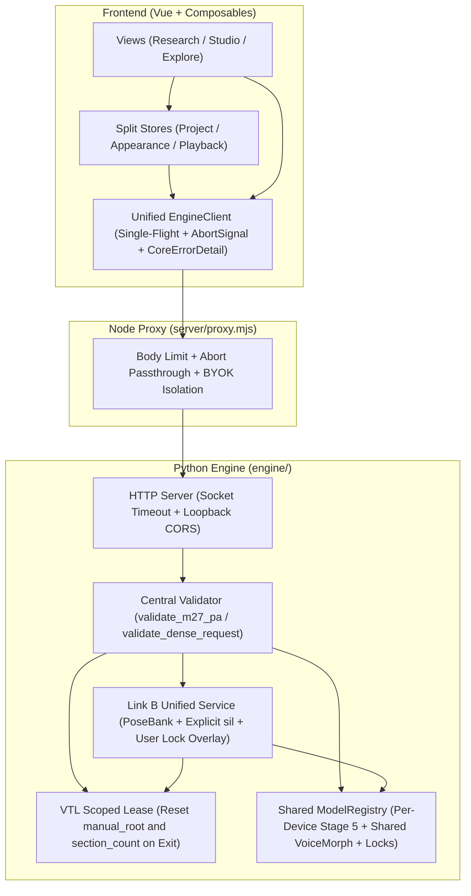

# VocalCut Studio（声道剪辑台）只读代码审查报告

- 审查日期：2026-11-23（本地时间 2026-11-24 凌晨完成第 2–4 节）；2026-11-24 11:21–11:40 接续审阅完成第 1 节与第 5–12 节，并修正第 2–4 节勘误与闭环待查项。
- 审查方式：只读核查仓库与外部基线后汇总写入本报告文件。未修改仓库业务源码、测试、配置、schema 和资源；未写入 `F:\TensorTract3_Train` 与 `D:\PhoneticToolbox\PhoneticToolbox_v3`；未读取 `.env.local`。
- 证据约定：`仓库:` 指本仓库（默认工作目录）的相对路径；`训练端:` 指 `F:\TensorTract3_Train` 下的相对路径；`PTB:` 指 `D:\PhoneticToolbox\PhoneticToolbox_v3`。行号为审查时的快照行号，格式 `L起-止`。
- 结论分级：已确认（有代码或哈希证据）/ 待验证（需要运行实验才能下结论）。
- 并发修改与基线核查说明：前序审查期间仓库仍有其他会话编辑，11-24 05:13–05:18 之间更新了 `engine/m27_bridge.py`（05:17:36）、`src/components/research/ResearchTimeline.vue`、`src/data/prosody-model.ts`、`packages/core-ts/src/qta.ts` 并新增 `src/components/research/f0-curve-paths.ts`，05:22 `m27_bridge.py` 再次更新（`_load_stage4` 与 `_load_stage5` 移至 L210、L221）。11-24 11:21 接续核查确认自 05:58 前序报告落盘后全仓业务源码无新变动（仅 `.cache/local-engine.stderr` 于 06:35 更新）。只读基线检查全部通过：`npm run typecheck` 退出码 0，`npm test` 共 9 个测试文件 28 项测试通过，`engine/tests/test_stage5_geometry.py` 4 项测试通过。
- `.cache/repro/` 下已有的诊断（`F0_CHAIN_DIAGNOSIS.md`、`REPRO_NOTES.md`、`STAGE5_COMPARISON.md`、`VERIFY_REPORT.md` 等）只作为线索，本报告的结论都重新对照了源码。

---

## 1. 执行摘要

### 1.1 总体结论

核心模型权重、网络架构与训练端保持一致（7 个运行模型张量差值为 0，仅 Stage 5 存在 FP16 导出舍入误差），当前质量、并发与合规风险集中在四类工程集成边界：

1. **VTL 2.4 单例跨请求状态污染与并发隐患（P1）**：每说话人共享的原生 `Engine` 单例在 `pose_snapshot` 中直接改写原生 DLL 的 `manual_root` 与 `section_count`，后续 `batch_contours`、`M27Bridge._extract_anim` 与 `_synthesize_vtl_from_m27` 均未复位该状态，用户拖动一次舌根或切换截面数即可污染后续所有反演动画与物理合成。`DenseEngineManager` 上跨说话人共享的 `_resonance_cache` 也仅受单说话人锁保护，并发访问不同说话人时存在竞争风险。
2. **链路 B（文本/标注合成）仍存在输入分布与后处理偏移（P1–P2）**：05:17–05:22 的修复已解决 F0 断续与 `stage5_geometry_extras` 400 报错，但链路 B 仍未复用训练端参考推理 `IPASynthEngine.synthesize`。主要偏差在于：`keyframe_lite.py` 用前端中点帧替代 `PoseBank` 标准构型与清音/送气声门预设，`prosody-model.ts` 丢弃 `sil` 帧使休止段在 `IPA2Tract` 中退化为无掩码缺口，送气塞音拆出 1 ms 虚拟 `release` 切片引发 50 Hz 网格错位，`Text2Prosody-Lite` 合法输出的 50–60 Hz 基频触发前端 60 Hz 守卫并回退规则编译，以及 0.85 峰值归一抹平气压响度动态。
3. **前后端异步竞态与取消链路断裂（P1–P2）**：`workbench.ts` 的 `synthesizeRange` 未递增 `audioGeneration` 且缺少 `AbortController` 与超时，慢请求会覆盖更新的音频；`proxy.mjs` 仅对全库 zip 下载流透传取消信号，常规推理请求无法随前端取消；引擎 `HTTP/1.1` 配无超时 `ThreadingHTTPServer` 易导致保活线程堆积及 `WinError 10054`；探索页与连续统页存在卸载后写回或重渲染竞态。
4. **越界即拒绝缺口与契约/披露文件漂移（P2–P3）**：`packages/core-ts/` 内核与密钥隔离规范执行良好，但 6 处引擎入口对声道 17/19 维、声门 8 维或微扰仍存在静默夹紧；`schema/project.schema.json` 与 `types.ts` 严重脱节导致导出 `.vcproj` 无法通过 schema 校验；`DISCLOSURE.md` 对 `kf2tract` 与本地权重的表述滞后；全仓检出 1 处 UI Emoji 残留（`packages/core-ts/src/textgrid.ts` L447 的 `⏸`）。

### 1.2 全报告问题统计（整合第 2 至 7 节）

| 级别 | 数量 | 核心议题分布 |
| --- | --- | --- |
| P0（崩溃 / 安全红线 / 数据损坏） | 0 | 未发现密钥泄露、外部基线写入或阻断性崩溃 |
| P1（高影响逻辑错误 / 状态污染 / 核心竞态） | 5 | VTL 单例 `manual_root`/`section_count` 跨请求污染（B-01）；`_resonance_cache` 跨线程无锁并发读写（B-02）；`synthesizeRange` 慢请求覆盖竞态（B-03）；`Text2Prosody` 50–60 Hz 合法基频触发前端退回规则编译（B-04）；链路 B `PoseBank`/`sil` 丢失导致训练分布偏移（B-05） |
| P2（中影响功能缺陷 / 规范违例 / 性能瓶颈） | 14 | 引擎多路由声道与声门静默夹紧（B-06）；Stage 5 单设备槽位抖动（B-07）；`HTTP/1.1` 无超时与代理缺取消/包体上限（B-08）；`project.schema.json` 与 `types.ts` 脱节（B-09）；Stage 4 F0 55–550 与 60 s 不分块（B-10）；1 ms 切片与后处理不对称（B-11）；0.85 峰值归一、重复 `prepare_tube` 与 DLL 按次重载（B-12）；锁过粗与双份模型常驻（B-13）；`playAudioBuffer` 回调与 `resume` 竞态（B-14）；探索/连续统竞态（B-15）；WebGL 异步卸载泄漏与 `sessionMedia` 只增不删（B-16）；WAV 40 字节硬编码偏移（B-17）；通配 CORS 与 500 映射缺失（B-18）；`device_effective` 误报（B-19） |
| P3（轻度不一致 / 体验与可维护性隐患） | 7 组（16 项） | `⏸` 残留与旧版 F0 夹紧（B-20）；`dPa` 死函数与 `DISCLOSURE.md`/`manifest`/`model_registry` 过时（B-21）；适配器错误码丢失与未启用传输层（B-22）；VTL `tube_hz` 调度、PR 均值降采样与 `<60 Hz` 静默替换（B-23）；10 ms 半帧偏差与地标未限位（B-24）；降噪缓存击穿、工具请求缺超时与非主路径重采样器差异（B-25）；分词脆弱性、硬编码韵律实参与形状反推超参（B-26） |

---

## 2. 调用链与对照索引

### 2.1 总体结论（索引阶段）

1. 推理端的全部模型代码集中在 `仓库:engine/`。其中 `engine/model_bundle/` 是训练端 `src/tt3`、`m27_voice_morph`、`m27_tract_studio`、`packages/kf_ipa_synth` 和 `models/` 的**本地副本**。`仓库:engine/m27_bridge.py` L27 把 `TT3_ROOT` 固定为 `engine/model_bundle`，推理时不会读取 `F:\TensorTract3_Train`。只有解释器使用训练端 `.venv`（见 AGENTS.md 第 1 节）。
2. 前端（`src/`、`packages/model-adapters/`）不做任何张量推理，只负责构造控制轨、发起 HTTP 请求和渲染结果。所有模型请求都经 `仓库:server/proxy.mjs` L72-114 去掉 `/api` 前缀，原样转发到 `127.0.0.1:8765`。
3. 副本与训练端逐文件哈希比对（只读，SHA-256）结果：

| 类别 | 一致 | 不一致 | 仅训练端有 | 仅副本有 |
| --- | --- | --- | --- | --- |
| `src/tt3/*.py`（副本中 35 个） | 29 | 6：`align_models.py`、`align_v2_infer.py`、`constants.py`、`glottis27_generator.py`、`model_registry.py`、`tract_anim.py` | 0 | 0 |
| `packages/kf_ipa_synth/kf_ipa_synth/*.py`（13 个） | 11 | 2：`text2ipa.py`、`tract_backend.py` | 0 | 4 个词典资源（`assets/lexicon/*`） |
| `packages/kf_ipa_synth/assets/*`（权重与姿态） | 全部一致（含 `assets/tract2vox_lite_fp16.pt`） | 0 | 0 | 0 |
| `m27_voice_morph`、`m27_tract_studio`（16 个） | 14 | 2：`m27_voice_morph/.../runtime.py`、`m27_tract_studio/.../config.py` | 0 | 0 |
| `models/*.pt` | 6：IPA2Tract-Lite、Text2Prosody-Lite、Vox2Align-Lite v1/v2、Vox2Spk-Lite、Vox2Tract-Lite（均为 fp16） | 2：`Tract2Vox-Lite/tract2vox_lite_fp16.pt`、`IPA2Tract-Lite/tract2area_proxy.pt` | 15：全部 int8、Large 系列、`Tract2Vox-Lite` WIP、`canonical_ipa_poses.json`、`Text2Prosody-Lite/INFERENCE_DEFAULTS.json` | 0 |
| `models/manifest.json` | — | 不一致（副本 7789 B，训练端 14617 B） | — | — |

   源码差异的性质（逐个 `git diff --no-index` 核对）：
   - 只改路径、去掉对 `F:\`、`D:\` 的硬编码：`constants.py`、`glottis27_generator.py`、`tract_anim.py` 的 PTB 路径、`tract_backend.py`、`m27_tract_studio/config.py`、`text2ipa.py` 的词典回退路径。
   - 改变行为：
     - `runtime.py` L186-249：Stage 4/Spk/Stage 5 的权重候选从 `runs/...` 改为 `models/...`。
     - `tract_anim.py` L206、L304：动画帧新增 `jx` 字段。
     - `align_models.py` L605-636：TextGrid 新增 `english_words` 层。
     - `align_v2_infer.py`：新增 `alignment_mode` 参数和 `_validate_guided_text`，L386-480 附近。
     - `text2ipa.py` L856-872：CMUdict 改从 `public/vocal-tract/assets/cmudict.dict` 读取。
     - `model_registry.py`：Vox2Align-Lite 注册项被**回退**为 v1（训练端为 v2），这一处属于配置倒退，在第 3 节核对。
   - 二进制权重差异：`tract2vox_lite_fp16.pt` 的副本 SHA 为 `A169CC18…`（mtime 11-24 01:54）。它既不同于训练端当前导出 `1AF300E6…`（11-24 03:12），也不同于 WIP `8D7B690C…` 和 `kf_ipa_synth/assets` 内的 `EB79C5DA…`。训练端 `scripts/export_named_models.py` L194-209 每次导出都把 `exported_at` 写进 meta，所以哈希不同并不说明张量不同。第 3.1 节已做张量级比对：两个文件的张量与训练端完全一致，只是元数据不同。
4. VTL 原生层：`仓库:engine/vtl_native/native/` 下 `VocalTractLabApi.dll`、`VocalTractLabAnalysis.dll`、`geometry_p2.dll`、`JD2/M01/W02.speaker` 与 `PTB:resources/vocal_tract/native/` **逐字节一致**。训练端生成数据和 `tract_anim` 用的就是 PTB 这套。`engine/vtl_native/phonetic_core/vocal_tract/` 的 35 个模块中，34 个与 `PTB:packages/phonetic_core/src/phonetic_core/vocal_tract/` 一致；只有 `engine.py` 不同（+64/-19 行），`root_drag.py` 为本仓库独有。`engine.py` 的差异是否影响几何与发声，在第 5 节核对。
5. 训练端有一份“参考推理”实现（即用户所说试听页里的推理），本仓库并没有直接复用它，而是在 `engine/keyframe_lite.py` 中自行重组了同一条链。这是 Train-Serve Skew 最集中的地方，见 2.4 和第 3 节。

### 2.2 推理端模型入口清单（仓库）

| 模型 / 功能 | HTTP 路由（engine/server.py） | 入口函数 | 加载位置与权重 | 前端调用点 |
| --- | --- | --- | --- | --- |
| Vox2Align-Lite v2（含冻结 Vox2Tract-Lite 先验），Stage 4 反演 + 对齐 | `POST /m27/reconstruct` L411-414；`POST /m27/align` L416-420 | `M27Bridge.reconstruct` L505-607；`M27Bridge.align` L485-503 | `_load_stage4` L185-194 → `tt3.align_v2_infer.Vox2AlignV2Engine(vox2align_v2_ckpt=models/Vox2Align-Lite/vox2align_lite_v2_fp16.pt)`（L31） | `packages/model-adapters/src/m27-adapter.ts` L169-241；`src/components/research/M27ReconstructView.vue` L438、L475；`src/components/research/continuum-media.ts` L123-131 |
| Tract2Vox-Lite（Stage 5 神经声码器）+ Vox2Spk-Lite | `/m27/reconstruct`、`/m27/resynthesize` L422-425、`/m27/hold-preview` L427-434、`/vtl/synthesize`（`synth_mode=neural`）L367-399 | `_synthesize_neural` L262-286；`synthesize_dense_neural` L300-387；`hold_preview` L389-416；`neural_reference_audio` L669-681 | `_load_stage5` L196-208 → `m27_voice_morph.runtime.VoiceMorphEngine._get_stage5_generator("stage5_lite")`（`model_bundle/.../runtime.py` L238-271，权重 `models/Tract2Vox-Lite/tract2vox_lite_fp16.pt`）；`_get_spk_encoder` L203（`models/Vox2Spk-Lite/vox2spk_lite_fp16.pt`）；默认声纹 `model_bundle/speakers/jingjing-lecture.spk.json`（L30、L288-298） | `src/stores/workbench.ts` L1792-1863；`src/components/research/ContinuumView.vue` L706、L716；`src/editions/hackathon/held-voice.ts` L32；`src/data/ipa-reference-library.ts` L20-30 |
| IPA2Tract-Lite（KF2Tract27 K2v2）+ Tract2Area-Proxy | `POST /models/kf2tract` L334-340；`/vtl/synthesize` 中 `predict_articulation` L375-378；`POST /models/ipa-default-poses` L324-332 | `keyframe_lite.predict` L64-90；`keyframe_lite.apply_annotation_trajectory` L98-227；`keyframe_lite.default_poses` L47-61 | `keyframe_lite.models` L16-31：`kf_ipa_synth.models.load_kf2tract_model(models/IPA2Tract-Lite/ipa2tract_lite_fp16.pt)` 与 `tt3.kf_models.TubeAreaProxy27`（`torch.load(..., weights_only=True)["model"]`） | `src/components/research/annotation-audio.ts` L45-189（构造 `articulation_spans`）；`src/data/ipa-pose-sets.ts` L91；`packages/model-adapters/src/reserved-slots.ts` L71-72 |
| Text2Prosody-Lite | `POST /models/text-prosody` L348-355 | `ProsodyBridge.predict`（`engine/prosody_bridge.py` L14-46） | `tt3.prosody_infer.ProsodyPredictor([models/Text2Prosody-Lite/text2prosody_lite_fp16.pt])` L25-28；另调 `kf_ipa_synth.text2ipa.convert_text_to_timeline(bpm=108, tone_sandhi=True)` L29-36 | `src/data/prosody-model.ts` L47-52（`predictSpeechProsody`，12 s 超时）；`src/components/research/ResearchMainView.vue` L543；`src/components/studio/arranger-edit.ts` L124 |
| Voice Morph（M27 双人迁移） | `POST /models/voice-transfer` L341-346 | `VoiceMorphBridge.render`（`engine/voice_morph_bridge.py` L106-166） | 单独再实例化一次 `VoiceMorphEngine(train_root=TT3_ROOT, device="cpu")` L29-42（与 `M27Bridge._load_stage5` 不共享实例） | `src/components/studio/VoiceTransferPanel.vue` L160；`src/components/studio/voice-transfer.ts` L56（组控制轨，调用 `buildAnnotationSynthesis`；请求由 `VoiceTransferPanel.vue` L160 发出） |
| SwiftF0 0.3.0（方言基频） | `POST /models/swift-f0` L357-360 | `swift_pitch.extract` L18-25 | `swift_pitch.detector` L10-15：`tt3.pitch.SwiftF0Extractor(fmin=60, fmax=600)` | `src/data/dialect-exchange.ts` L28 |
| DPDFNet（降噪） | `POST /models/dpdfnet` L272-283 | `dpdf_audio.denoise` L40-49 | `model_bundle/ptb/resources/neural/dpdfnet2_48khz_hr.onnx`（按 manifest 校验 SHA），ONNX Runtime CPU | `src/data/denoise.ts` L11 |
| 录音构型修订（Stage 5 回放） | `POST /models/ipa-recording-edits/render` L308-316 | `ipa_recording_edits.render_revision` → `bridge.resynthesize` L113 | 同 Stage 5 | `src/data/ipa-recording-edits.ts` L69-77 |
| IPA 参考库 Stage 5 重合成 | `GET /models/ipa-references/<id>/<resource>` L213-228 | `ipa_reference_library.load_resource` → `bridge.neural_reference_audio` L81 | 同 Stage 5 | `src/data/ipa-reference-library.ts`、`src/components/research/IpaPlusView.vue` L476 |
| VTL 2.4 物理合成（非神经网络） | `/vtl/synthesize`（physical）L367、`/vtl/pose` L362、`/vtl/batch-contours` L401、`/vtl/meta` L247、`/m27/extract-anim` L406 | `dense_channel.DenseEngineManager.synthesize_dense` 等；`M27Bridge._synthesize_vtl_from_m27` L234-260；`_extract_anim` L223-232；`extract_anim_from_pa` L418-483（F0 下限按 40 Hz 校验 L449-460，与项目 60 Hz 约定不一致，在第 4 节展开）。`/m27/extract-anim` 在前端没有找到调用点 | `engine/vtl_native/native/*.dll`、`*.speaker` | 实际调用方：`src/stores/workbench.ts` L1629-1648（`probeEngine`，GET `/api/vtl/meta`）、L1809（POST `/api/vtl/synthesize`）、L1668（经 `resolveVtlPose`）；`packages/model-adapters/src/engine-transport.ts` 的 `VocalEngineTransport` 在应用中没有被实例化（见 2.7）；`src/data/vtl-pose-client.ts` L21；`ContinuumView.vue` L534 |
| 预留槽位（未接模型） | `GET/POST /models/browser-light-m27`、`/models/speaker` 经 `RESERVED_MODEL_CONTRACTS` 返回 501（L262-264、L285-287） | — | — | `packages/model-adapters/src/reserved-slots.ts` L181-279 |
| 模型清单 | `GET /models/local` L153-158 | 读 `model_bundle/models/manifest.json` | — | `src/views/SettingsView.vue` L42 |

`engine/m27_bridge.py` 行号对照。上表和 2.5 节使用 05:15 快照的行号。该文件在 05:17 被并发修改，在 L43 新增了 `stage5_geometry_extras`：

| 符号 | 05:15 快照 | 05:18 快照 |
| --- | --- | --- |
| `_decode_input_audio` | L84 | L107 |
| `_m27_to_tract19`（tract17 `np.clip`） | L130 | L153（clip 在 L156） |
| `_load_stage4` / `_load_stage5` | L185 / L196 | L208 / L219 |
| `_interp_50_to_200` | L211 | L234 |
| `_extract_anim` / `_synthesize_vtl_from_m27` / `_synthesize_neural` | L223 / L234 / L262 | L246 / L257 / L285 |
| `synthesize_dense_neural`（组均值降采样 / `resample_poly(3,1)`） | L300 | L323（L381-382 / L406） |
| `hold_preview` / `extract_anim_from_pa`（F0 40 Hz 校验） | L389 / L418（L449） | L422 / L451（L482） |
| `align` / `reconstruct` / `resynthesize` / `neural_reference_audio` | L485 / L505 / L609 / L669 | L518 / L538 / L642 / L702 |

前端渲染端（消费模型输出）：

- 矢状面与声门绘制：`src/vendor/m27-tract-studio/tract-renderer.js`（`renderM27TractSvg`、`interpM27AnimState`、`drawM27GlottisCanvas`）。它是训练端 `m27_tract_studio/web/tract-renderer.js` 的修改副本：副本 90938 B，训练端 86194 B，哈希不同，在第 5 节比对。使用方为 `M27ReconstructView.vue` L9、`IpaPlusView.vue` L7、`ContinuumView.vue` L2、`VoqsReferencePanel.vue` L3、`src/data/reference-geometry.ts` L1。
- 高清渲染：`src/components/research/m27-hd-renderers.ts`（含另一份 `M27_AIR_DOTS`，L1169）。
- 声门参数边界的 TS 镜像：`packages/core-ts/src/phonation.ts` L41-54（`M27_GLOTTIS_BOUNDS`、`M27_GLOTTIS_DIM_NAMES`），注释声称与训练端 `m27_contract/glottis27_generator` 严格对齐。
- 曲线编辑器：`src/vendor/m27-voice-morph/curve-editor.js`。它是训练端 `m27_voice_morph/web/curve-editor.js` 的修改副本：副本 20299 B，训练端 20220 B。

### 2.3 训练端对照索引（只读）

| 主题 | 训练端位置 | 说明 |
| --- | --- | --- |
| M27 控制契约（名称、顺序、边界） | `src/tt3/glottis27_generator.py` L36-65 | 顺序为 `[HX,HY,JX,JA,LP,LD,VS,VO,TCX,TCY,TTX,TTY,TBX,TBY,TS1,TS2,TS3, F0, PR, XB,XT,CA,LAG,RA,PS,FL, SHIM]`。F0 取 40..600 Hz，PR 取 0..16000 **dPa**，SHIM 取 0..100 |
| M27 归一化（min-max 到 [-1,1]） | `src/tt3/m27_contract.py` L72-84（`normalize_m27` 先 `np.clip` 再线性映射）；`packages/kf_ipa_synth/kf_ipa_synth/m27_contract.py`（副本一致） | 推理端直接 import 同一函数，未另写 |
| 声学前端 PureLogMel50Hz | `src/tt3/distill_models.py` L41-60（Slaney mel，`n_fft=1024`，`f_min=40`，`f_max=7600`）；L69-130（`win_length=640`，`hop=320`，`center=False`，Hann 窗） | 由 Vox2Tract-Lite / Vox2Align-Lite v2 模型内部计算，推理端不另行实现 |
| 说话人编码前端 | `src/tt3/browser_m27_models.py` L277-400（`BrowserLightSpeakerEncoder`，对 log-mel 做逐句均值归一，L388-400） | 推理端经 `VoiceMorphEngine._get_spk_encoder` 使用 |
| 音频读取与 16 kHz 重采样 | `src/tt3/inference.py` L38-121（`extract_speech_mono`、`load_audio_16k`，`resample_poly` 按 gcd 取整比） | 推理端 `m27_bridge._decode_input_audio` L84-111 直接调用 |
| Stage 4（浏览器轻量反演）模型 | `src/tt3/browser_m27_models.py` L26-140（`BrowserLightM27Inverter`）；训练 `scripts/train_browser_m27_stage4.py`；产物 `runs/browser_m27_stage4/` → `models/Vox2Tract-Lite/` | 推理端未直接用，经 Vox2Align v2 引擎作为先验 |
| Vox2Align-Lite v2 | `src/tt3/align_v2_models.py` L122-260；`src/tt3/align_v2_infer.py` L295-660（`Vox2AlignV2Engine.analyze_waveform`）；训练 `scripts/train_vox2align_v2.py`；产物 `runs/vox2align_v2/` | 副本 `align_v2_infer.py` 有改动 |
| Stage 5 Tract2Vox-Lite | `src/tt3/neural_synth_models.py` L373（`ConditionalHiFiGenerator27`）；训练 `scripts/train_browser_m27_stage5.py`；导出 `scripts/export_named_models.py` L185-215（源为 `runs/browser_m27_stage5/best.pt`，先 `remove_weight_norm` 再导出 fp16/int8） | 训练端另有一份同名类 `packages/kf_ipa_synth/kf_ipa_synth/models.py` L599，供 `IPASynthEngine` 使用 |
| Vox2Spk-Lite | `browser_m27_models.py` L277；训练 `scripts/train_browser_speaker_enc.py`；导出 `export_named_models.py` L171-183 | — |
| IPA2Tract-Lite | `src/tt3/kf_models.py` L119（`KeyframeTractModel27`）、L97（`TubeAreaProxy27`）；`src/tt3/kf_baseline.py` L227（`build_condition_from_segments`）、L394（`kf26_and_f0_to_m27`）；训练 `scripts/train_kf_trajectory.py`、`scripts/train_tube_proxy.py`；导出 `export_named_models.py` L217-239 | 推理端用 `kf_ipa_synth` 包内同名实现 |
| Text2Prosody-Lite | `src/tt3/prosody_models.py`；`src/tt3/prosody_infer.py` L117-（`ProsodyPredictor.predict_timeline` L158）；训练 `scripts/train_text2prosody.py`；推理默认参数 `models/Text2Prosody-Lite/INFERENCE_DEFAULTS.json`（副本缺失） | — |
| 50→200 Hz 控制升频 | `packages/kf_ipa_synth/kf_ipa_synth/tract_backend.py` L78（`qta_filter_m27_50_to_200`）；`src/tt3/tract_anim.py` L98（同名）；`scripts/infer_m27_clip.py` L153-164（线性 `_interp_50_to_200`） | IPA 合成链用 qTA 滤波，录音反演链用线性插值 |
| M27 → VTL 19+9 映射 | `src/tt3/glottis27_generator.py` L133（`m27_to_vtl19_glottis9_shimmer`）；`kf_ipa_synth/m27_contract.py` L126（同名） | — |
| 动画几何抽取 | `src/tt3/tract_anim.py` L162（`extract_m27_animation`） | 副本新增 `jx` |
| 状态库 | `data/states/states_jd2_r21.npz`（训练端存在，28354 B） | 副本 `glottis27_generator.py` 的 `STATES_DEFAULT_PATH` 指向 `engine/model_bundle/data/states/…`，**该文件在仓库中不存在**。是否有调用路径会触发，在第 3 节核对 |
| 权重总清单 | `models/manifest.json`（含 SHA-256 与参数量）；`src/tt3/model_registry.py` | 副本 manifest 较旧 |
| Checkpoint 产出位置（训练 → 导出） | `runs/browser_m27_stage4/browser_m27_stage4_fp16.pt` → `models/Vox2Tract-Lite/vox2tract_lite_fp16.pt`；`runs/browser_spk_enc/browser_spk_enc_fp16.pt` → `models/Vox2Spk-Lite/`；`runs/browser_m27_stage5/best.pt` → `models/Tract2Vox-Lite/tract2vox_lite_fp16.pt`（重新导出）；`runs/kf2tract_v1/export/KF2Tract27_K2v2_Lite/kf2tract27_k2v2_fp16.pt` → `models/IPA2Tract-Lite/ipa2tract_lite_fp16.pt`；`runs/kf2tract_v1/tube_proxy/best.pt` → `models/IPA2Tract-Lite/tract2area_proxy.pt`；`runs/text2prosody_v1/text2prosody_lite_fp16.pt` → `models/Text2Prosody-Lite/`；`runs/vox2align_v2/vox2align_lite_v2_fp16.pt` → `models/Vox2Align-Lite/`。以上见 `scripts/export_named_models.py` L157-260 | 导出脚本对每个产物都用 `strict=True` 回读校验（如 L182、L189、L214、L228、L254）；各产物的 mtime 均为 11-24 03:10–03:12 |
| 预处理配置 | `configs/pilot_100h.yaml`（早期 M10 R21 闭环） | 与当前 Lite 系列无直接关系 |

### 2.4 训练端“参考推理”实现索引（试听与监控页）

| 页面 / 脚本 | 端口 | 推理入口 | 管线要点 | 本仓库对应实现 |
| --- | --- | --- | --- | --- |
| `scripts/serve_prosody_dashboard.py` | 18799 | `run_prosody_infer_api` L258-318 | `ProsodyPredictor().predict_timeline(text, lang, base_f0=165, speed_scale, pitch_scale=1.35, tone_sandhi=True)`，再把 `keyframes_neural` 和 `f0_knots_neural` **原样**交给 `kf_ipa_synth.IPASynthEngine(EngineConfig(device="cpu", enable_native_vtl=False)).synthesize({...,"use_neural_vocoder":True,"speaker_profile":...})`（L57-67、L286-296）。仅用 CPU（L28-29） | `engine/prosody_bridge.py` 只返回 keyframes 和 knots。前端在 `ResearchMainView.vue` L543 起把它们转成自己的音段、qTA 和 pin，再经 `annotation-audio.ts` 组 200 Hz 控制轨。服务端由 `keyframe_lite.apply_annotation_trajectory` 重建 IPA2Tract 条件后才进入 Stage 5。**没有复用 `IPASynthEngine.synthesize`** |
| `scripts/serve_vox2align_dashboard.py` | 18800 | `run_align_api` L328-362 | 读入后取第 0 声道，按 gcd `resample_poly` 到 16 kHz，截到 15 s，再调 `Vox2AlignV2Engine(device="cpu").analyze_waveform(w, text, lang, apply_silence_mask=True)`。演示素材在前后各补 0.25 s 的低幅噪声（L204-206） | `M27Bridge.align` / `reconstruct`：经 `tt3.inference.load_audio_16k` 解码，上限 60 s，`analyze_waveform(..., alignment_mode=...)`，`apply_silence_mask` 用默认值 True |
| `scripts/serve_kf_dashboard.py` | 18796 | `do_POST /api/infer` L2410-2452：以子进程调 `scripts/infer_kf_clip.py --device cpu` | `infer_kf_clip.py` 在 L289-310 用 `np.interp` 做 F0 knots 插值，在 L395-433 跑 KF2Tract（`model.eval()` + `no_grad`），并含 `_apply_soft_onset_200hz` L438、`_soft_limit` L461、`_apply_output_gain` L472、`_enforce_release_modes_50hz` L548、`_apply_unreleased_zero_pressure_200hz` L578 等后处理；Stage 5 使用 `runs/m27_v1/neural_synth/best.pt`（教师模型，L665-667） | `keyframe_lite.apply_annotation_trajectory` 只移植了 `_enforce_release_modes_50hz` 和 `_apply_unreleased_zero_pressure_200hz`（从 `kf_ipa_synth.engine` 导入）。soft onset、soft limit、output gain 是否等价，已在第 5.1 节核对（本仓未调用 `_apply_soft_onset_200hz`，且改用 0.85 峰值归一替代参考增益策略） |
| `packages/kf_ipa_synth/kf_ipa_synth/engine.py`（`IPASynthEngine`，独立 Web Studio 18798 的后端） | 18798 | `IPASynthEngine.synthesize` L495- | 训练端试听页正式使用的 IPA → M27 → Stage 5 全链 | 仓库内有完整副本（与训练端一致），但主合成链只调用其中两个私有函数 |
| `scripts/infer_m27_clip.py` | — | `main` L197- | WavLM + PressureEncoder27 + DualBranchMotor27（M27 大模型），线性 `_interp_50_to_200` 后进入 VTL；Stage 5 用 `neural_synth` 检查点 | 仓库 `_synthesize_vtl_from_m27` 仅 `_interp_50_to_200` 插值与它的实现逐行一致（`m27_bridge.py` L236-246 对比 `infer_m27_clip.py` L153-164），VTL 物理合成循环与调度不同，详见 4.4 节 |
| `m27_voice_morph/`（Web Studio） | — | `VoiceMorphEngine.analyze_audio` L292、`synthesize` L335 | — | 仓库通过 `VoiceMorphBridge` 和 `M27Bridge._load_stage5` 直接复用 |
| `scripts/serve_browser_m27_dashboard.py` | 18797 | 只做监控（`/api/status`），不含推理 | — | — |
| `scripts/serve_m27_dashboard.py`、`serve_dashboard.py` | 18795、18790 | M27 大模型与早期 M10 监控 | — | 仓库未接入 Large 系列 |

### 2.5 数据流（输入 → 预处理 → 模型 → 后处理 → 前端矢状面 / VTL 2.4）

**链路 A：录音声道重建（Stage 4 反演 + Stage 5 / VTL 重合成）**

```
前端 M27ReconstructView.vue L475 / continuum-media.ts L130
  └─ M27Adapter.reconstruct (m27-adapter.ts L169-218)  wav_base64 + device + synth_mode + text/lang
     └─ server/proxy.mjs L72-114  /api/m27/reconstruct → :8765/m27/reconstruct（整包缓冲，无取消透传）
        └─ engine/server.py L411 → M27Bridge.reconstruct (m27_bridge.py L505)
           ├─ 预处理：_decode_input_audio L84-111（L533 调用）：base64 → 临时 wav → tt3.inference.load_audio_16k（单声道、gcd 重采样到 16 kHz、≤60 s，L100）→ 截到 320 的整数倍 (L537-538)
           ├─ 模型：Vox2AlignV2Engine.analyze_waveform（PureLogMel50Hz 在模型内；冻结 Vox2Tract-Lite 先验）→ m27_phys (T@50Hz, 27, PR 为 dPa)
           ├─ 后处理：m27_pa = m27_phys，第 18 列 ÷10 → Pa (L552-553)
           ├─ 几何：_extract_anim → tt3.tract_anim.extract_m27_animation（VTL 几何，fps=25），pr→pr_pa ÷10 (L223-232)
           ├─ 物理：_synthesize_vtl_from_m27 → 50→200 Hz 线性插值 → m27_to_vtl19_glottis9_shimmer → VTL block_tube 240 smp/步 → 48 kHz (L234-260)
           └─ 神经：_synthesize_neural → normalize_m27 → Stage 5 gen(m27_norm, e_spk) → 16 kHz → finish_synthesis (L262-286)
  ← JSON：m27_50hz_pa、tract_glottis_anim、vtl_48k_wav_base64、neural_16k_wav_base64、alignment(TextGrid)
前端：tract-renderer.js renderM27TractSvg / interpM27AnimState 绘制矢状面与声门；波形 / 语谱在各视图中绘制
```

**链路 B：文字或标注合成（Text2Prosody → 前端编排 → IPA2Tract → Stage 5 或 VTL）**

```
前端 ResearchMainView.vue L543 predictSpeechProsody → prosody-model.ts L47-52 POST /models/text-prosody (12 s 超时)
  └─ engine/prosody_bridge.py L14-46：ProsodyPredictor.predict_timeline(base_f0=165, pitch_scale=1.35) + convert_text_to_timeline(bpm=108)
  ← keyframes_neural、f0_knots_neural、syllables
前端：compileG2pToTrack → 音段 / 构型（getFullPoseForIpa）/ F0 pin（qTA + knots）→ annotation-audio.ts buildAnnotationSynthesis（200 Hz，tract 19 维 + glottis 8 维 + f0_hz + pressure_pa + articulation_spans + predict_articulation）
  └─ workbench.ts L1792-1863 POST /api/vtl/synthesize (synth_mode = physical | neural)
     └─ engine/server.py L367-399
        ├─ predict_articulation：keyframe_lite.apply_annotation_trajectory L98-227
        │    200 Hz → 每 4 帧取中心帧 (centers = 4k+2) → normalize_m27 → build_condition_from_segments → KF2Tract (inference_mode) → kf26_and_f0_to_m27 → denormalize → _enforce_release_modes_50hz → 用户锁定混合
        │    physical：qta_filter_m27_50_to_200 → 200 Hz；neural：线性 np.interp → 200 Hz；predicted_rows(50 Hz) 另行返回
        ├─ physical：DenseEngineManager.synthesize_dense → VTL 2.4 48 kHz
        └─ neural：M27Bridge.synthesize_dense_neural L300-387：校验 → 组 27 维 → 200→50 Hz 分组均值 (L345-351)，若有 predicted_rows 则直接替换 → 首尾各补 4 帧 → normalize_m27 → Stage 5 (16 kHz) → resample_poly ×3 → 48 kHz → finish_synthesis
  ← wav_base64 (48 kHz)、m27_control_50hz_pa / tract_control_50hz（可选）
前端：时间轴 F0（ResearchTimeline.vue）、波形 / 语谱、矢状面（renderM27TractSvg 或 VTL /vtl/pose 几何）
```

**链路 C：单构型试听与几何**

```
输入：用户选择的 IPA / extIPA / VoQS 构型（前端姿态库，Pa 单位）
预处理：前端组 19 维 tract + 声门参数 → /vtl/pose（vtl-pose-client.ts L21，workbench.ts L237）
模型：无神经网络，VTL 2.4 DenseEngineManager.pose_snapshot（`/vtl/pose` 仅接收 19 维声道几何参数，不涉及气压；Pa→dPa 换算集中在 `synthesize_dense` 与 `M27Bridge` 入口，见 4.2、4.7 节）
后处理 → 渲染：几何轮廓 / 截面积函数 → 前端矢状面（VocalTractViewport、tract-renderer）
连续统 → /vtl/batch-contours（ContinuumView.vue L534）、/vtl/synthesize（L716）、M27Adapter.resynthesize（L706）
刘看山持音（参赛版）→ /m27/hold-preview（held-voice.ts L32）→ 27 维常量 × N 帧（25..150 帧，F0 60..600 Hz、PR 0..1600 Pa 越界拒绝，PR ×10 转 dPa）→ Stage 5（16 kHz，只做 normalize_for_playback，不经过 finish_synthesis；m27_bridge.py L389-416）
```

**链路 D：其他模型**

```
方言录音：输入音频 → 前端经 OfflineAudioContext 重采样到 16 kHz 并转为 PCM16（dialect-exchange.ts L22-28）→ /models/swift-f0 → SwiftF0Extractor.extract_50hz（60..600 Hz，20 ms 帧）→ F0 曲线 → DialectStudioView.vue L476/L499 写入方言词条 → 经链路 B 进入 VTL 2.4 或 Stage 5（降噪前置与空音频校验见 6.3 节）
降噪：输入音频 → 浏览器 studioAudioContext()（48 kHz）重采样并打包 WAV → denoise.ts L11 → /models/dpdfnet → DPDFNet ONNX（48 kHz）→ 增强后文件已接入链路 A（M27ReconstructView.vue L288/L326、ContinuumView.vue L165）、方言提取（DialectStudioView.vue L472/L492）、标注及剪辑轨（ResearchMainView.vue L254、StudioStageView.vue L893），详情见 3.2 与 6.3 节
声音迁移：两段 M27 控制轨（来自链路 A 或 B）→ VoiceTransferPanel.vue L160 → /models/voice-transfer → VoiceMorphBridge.render → apply_dual_speaker_morph → Stage 5（有参考音时）或 VTL 2.4 → 波形与矢状面动画
```

### 2.6 关键词复核（确认无遗漏调用点）

- 在 `engine/*.py`（不含 `model_bundle`、`vendor`、`vtl_native`）中检索 `torch.load|load_state_dict|.eval()|inference_mode|no_grad|.pt|normalize_m27|resample_poly|hop|mean|std|scaler`。命中只出现在 `m27_bridge.py`、`keyframe_lite.py`、`prosody_bridge.py`、`voice_morph_bridge.py`、`ipa_recording_edits.py`、`ipa_reference_library.py`、`ipa_materials.py`、`audio_transitions.py`、`dense_channel.py`、`voqs_reference.py`，都已列入上表。
- 在 `src/`、`packages/` 中检索 `/(m27|models|vtl)/` 路由字面量和 `new M27Adapter|predict_articulation|return_control_track|synth_mode`。命中均已列入 2.2 的“前端调用点”一列。前端没有 `onnxruntime-web` 或其他浏览器端推理代码（`/models/browser-light-m27` 为 501 预留槽位）。
- 全范围补扫（src、packages、server，排除 node_modules 和 three.js vendor）：检索 `checkpoint|state_dict|torch.load|.eval()|no_grad|inference_mode|sample_rate|n_fft|hop_length|scaler|cmvn`，只命中 8 处 `sample_rate_hz` 字段，均为 48000 元数据或类型声明：`workbench.ts` L305、`engine-transport.ts` L92、`core-ts/src/continuum.ts` L91/L304、`types.ts` L422、`tool-registry.ts` L499、`textgrid.ts` L531，另有 `reserved-slots.ts` L152 的 `input_sample_rate_hz: 16000` 预留声明。检索 `onnxruntime|InferenceSession|tfjs|.onnx` 只命中 `reserved-slots.ts` L6、L211-214 的预留钩子（`globalThis.ort` 不存在时回退）和 `src/data/references.ts` L1134 的文献链接。**结论：前端没有任何实际加载权重或计算声学特征的代码**，`model-adapters` 只是 HTTP 适配层。
- `engine/model_bundle` 内的权重加载点（`torch.load|load_state_dict`）：
  - 实际处在运行路径上的有：`align_v2_infer.py` L365、L375（strict=True）；`browser_m27_models.load_lite_state_dict` L530；`m27_voice_morph/runtime.py` L198、L219、L253（Stage 5 Lite，`remove_weight_norm` 之后再 load）；`kf_ipa_synth/models.py` L764、L786、L798、L815；`prosody_infer.py` L147（strict=True）。
  - 由 `_v1_fallback` 间接引用，或属于训练、旁路代码，不在本仓库运行路径上的有：`align_infer.py` L415/L425（v1 回退）、`m27_tract_studio/engine.py` L318-354、`inference.py` L299-433（M27 Large）、`selfplay_generator.py`、`speaker_dataset.py`、`train_utils.py`。
  - 声学特征参数（`n_fft|hop_length|win_length`）集中在 `distill_models.py`、`browser_m27_models.py`、`neural_synth_models.py`、`kf_ipa_synth/models.py` 和 `m27_tract_studio/denoise.py`。前三个与训练端逐字节一致（见 2.1），它们之间的参数一致性在第 3 节逐项核对。
- 训练端没有全局 CMVN 或 Scaler 统计量文件。声学前端的归一化在模型内部完成（`PureLogMel50Hz` 和说话人编码器的逐句均值归一）。控制量统一用 `M27_MIN/M27_MAX` 做 min-max 归一。这一点在第 3 节逐项确认。

### 2.7 公开版与参赛版调用链对比（前端 → 代理 → Python 引擎 → 模型 / VTL）

两个版本共用同一份 `src/` 业务代码、同一个代理实现和同一个 Python 引擎。差异只在三个地方：构建期别名、代理扩展路由，以及参赛版独有的几处前端直连调用。

```
                 公开版 (npm run dev :5173)                    参赛版 (npm run dev:hackathon :5174)
前端      @vocalcut/edition → src/editions/public.ts       @vocalcut/edition → src/editions/hackathon/index.ts
          (vite.config.ts L39；ExploreWorkspace = null)     (ExploreLabView 异步组件；initialWorkspace = 'explore')
          共用：workbench.ts / M27Adapter / prosody-model / annotation-audio / vtl-pose-client
          参赛版独有：held-voice.ts L32 → /api/m27/hold-preview
                      ExploreLabView.vue L252、ExploreExport.vue L65 → /api/vtl/pose（直接 fetch）
             │ vite proxy '/api'（vite.config.ts L51：VOCALCUT_PROXY_URL，或 3001 / 3002）
             ▼
代理      server/index.mjs L3 startProxy()  :3001          server/hackathon.mjs L6 startProxy(handleContestRequest, 3002)
          共用 server/proxy.mjs createProxyServer L116-132：
            /api/health L121 → /api/studio/* L122 → POST /api/ai/chat L123（BYOK 头只转成 Authorization，不写日志）
            → /^\/api\/(vtl|m27|models)\// L124 → handleEngineProxy L72-114（去掉 /api 前缀，整包缓冲转发）
            → extension L125（仅参赛版：contest-routes.mjs L302-309，/api/explore/card-encode、/api/zhihu/*）
             │ TENSORTRACT_API_URL，默认 http://127.0.0.1:8765（proxy.mjs L6）
             ▼
Python    engine/server.py（ThreadingHTTPServer L445，ENGINE_PORT 默认 8765 L444；scripts/start-engine.mjs 用 -B 启动）
引擎        GET  L125-264：/models/local、/models/ipa-references/*、/health、/vtl/meta、/models/kf2tract（契约）
            POST L272-434：/models/dpdfnet、/models/ipa-recording-edits/render、/models/ipa-default-poses、/models/kf2tract、
                 /models/voice-transfer、/models/text-prosody、/models/swift-f0、/vtl/pose、/vtl/synthesize、
                 /vtl/batch-contours、/m27/extract-anim、/m27/reconstruct、/m27/align、/m27/resynthesize、/m27/hold-preview
             ▼
模型/VTL  M27Bridge（m27_bridge.py）、keyframe_lite、ProsodyBridge、VoiceMorphBridge、swift_pitch、dpdf_audio
          → engine/model_bundle/{src/tt3, packages/kf_ipa_synth, m27_voice_morph, models/*.pt, ptb/resources/neural}
          → DenseEngineManager（dense_channel.py）→ engine/vtl_native/native/VocalTractLabApi.dll（VTL 2.4，48 kHz）
```

| 对比项 | 公开版 | 参赛版 | 证据 |
| --- | --- | --- | --- |
| 版本模块 | `public.ts` 只导出空值：`initialWorkspace='studio'`、`ExploreWorkspace=null`、`editionReferences=[]` | `hackathon/index.ts` 导出 `ExploreLabView` 异步组件和刘看山素材引用 | `src/editions/public.ts` L4-9；`src/editions/hackathon/index.ts` L4-6 |
| 版本模块的导入方 | `App.vue` L12、`workbench.ts` L9、`TopBar.vue` L5、`data/references.ts` L1，只经过 `@vocalcut/edition` 别名 | 同左 | `rg "@vocalcut/edition"`；`rg "editions/hackathon" src --glob '!editions/hackathon/**'` 无命中，公共入口没有直接导入参赛目录 |
| 开发期隔离 | `fs.deny` 包含 `**/editions/hackathon/**` | 不屏蔽 | `vite.config.ts` L50 |
| 产物目录与检查 | `dist-public/`，`check-edition.mjs public` 用品牌正则扫描残留 | `dist-hackathon/`，检查赛事接口和专用资源是否随包 | `vite.config.ts` L45；`scripts/check-edition.mjs` L9、L27-28、L35 |
| 代理端口与扩展 | 3001，无扩展 | 3002，挂载 `handleContestRequest` | `server/index.mjs` L3；`server/hackathon.mjs` L6 |
| 引擎路由优先级 | 引擎正则在扩展之前匹配 | 同左，因此赛事路由不能覆盖 `/api/(vtl|m27|models)/*` | `server/proxy.mjs` L124-125 |
| 模型 / VTL 调用 | 链路 A–D（2.5 节） | 链路 A–D，另加：`/m27/hold-preview`（刘看山持音，**仅参赛版调用**）；`/vtl/pose` 直连两处，不经过 `workbench.ts` 中带排队和防覆盖逻辑的 `resolveVtlPose`（L1650-1680） | `held-voice.ts` L32；`ExploreLabView.vue` L249-252；`ExploreExport.vue` L65。已确认两处直连存在竞态与取消缺失隐患，见 6.3 节 |
| 预渲染兜底 | `reference-geometry.ts` L29 读取 `/prewarm/<id>.json` | 另在 `ExploreLabView.vue` L853、L907 使用 `/prewarm/<id>.wav` | `public/prewarm/` 下有 15 个文件 |
| Python 引擎 | 共用 8765（`npm run engine`） | 同左 | `scripts/start-engine.mjs`；`engine/server.py` L444 |

**VTL“双传输”的实际状态（已确认）：**
- `packages/model-adapters/src/engine-transport.ts` L111-392 的 `VocalEngineTransport` 按 Wasm Worker（`/vocal-wasm/manifest.json`，L151-173）→ 本地 Python（`/api/vtl/meta`，L175-194）→ 预渲染兜底（L196-205）的顺序探测后端。`synthesizeDense` 在发出请求前对 `f0_hz`、`pressure_pa` 做越界拒绝（L295-303）。
- 但应用代码没有实例化这个类：`rg "new VocalEngineTransport"` 只命中 `tests/core.test.ts` L656。仓库中也不存在 `public/vocal-wasm/manifest.json`。
- 应用实际使用的是 `workbench.ts` 自己实现的 `probeEngine`（L1629-1648），它只区分 `python-vtl` 和 `prewarm-fallback`。类型里的 `'wasm-vtl'`（L76）只在 `App.vue` L43、L197 和 `SettingsView.vue` L434 被读取，没有任何地方赋值。
- 因此“双传输”在运行时实际只有“Python 引擎 + 预渲染兜底”两条路径，适配器层中的越界校验也没有被应用调用。已核实 `workbench.ts` L1744-1813 未在非标注路径执行等价的发送前越界校验（标注路径仅通过 `evaluateControlPitch` 校验基频），其余参数依赖后端拒绝，详见 5.4、6.1 与第 7 节。

### 2.8 推理侧采样率、特征参数、checkpoint 与统计量来源

| 项目 | 推理侧取值 | 来源（仓库） |
| --- | --- | --- |
| 引擎常量 | `SAMPLE_RATE_16K = 16000`，`SAMPLE_RATE_48K = 48000` | `engine/m27_bridge.py` L62-63 |
| Stage 4 / Vox2Align 输入 | 任意采样率的 base64 音频，经 `tt3.inference.load_audio_16k` 转为单声道 16 kHz（gcd 整数比 `resample_poly`），上限 60 s，截到 320 的整数倍 | `m27_bridge.py::_decode_input_audio` L109 起；`model_bundle/src/tt3/inference.py` L38-121 |
| 声学特征 | `PureLogMel50Hz`：Slaney mel，`n_mels=80`，`n_fft=1024`，`win_length=640`（40 ms），`hop=320`（20 ms → 50 Hz），`f_min=40`，`f_max=7600`，Hann 窗，`center=False`；无预加重。在模型内部计算，引擎和前端都不另行实现 | `model_bundle/src/tt3/distill_models.py` L41-130（与训练端 SHA 一致，见 3.1） |
| 说话人编码前端 | 16 kHz，`n_fft=1024`，`win=640`，`hop=320`，`n_mels=80`，逐句均值归一，输出 512 维并做 L2 归一 | `browser_m27_models.py` L277-437；加载入口 `m27_voice_morph/.../runtime.py::_get_spk_encoder` L203-222 |
| 控制轨帧率 | 模型侧 50 Hz（20 ms）；VTL 与前端控制轨 200 Hz（每步 `48000 // 200 = 240` 个采样） | `m27_bridge.py` L236（`_interp_50_to_200`）、L368；`keyframe_lite.py` L135、L154 |
| Stage 5 输出 | 16 kHz（每帧 320 个采样）。录音重建链经 `finish_synthesis` 后以 16 kHz 返回；文本 / 标注合成链用 `resample_poly(generated, 3, 1)` 升到 48 kHz；持音预览保持 16 kHz | `m27_bridge.py` L287-311、L408-411、L449 |
| VTL 物理合成 | 48 kHz | `m27_bridge.py` L285；`engine/dense_channel.py` |
| SwiftF0 | 输入 16 kHz PCM16（640 B 到 120 s），20 ms 步长，`fmin=60`，`fmax=600` | `engine/swift_pitch.py` L15、L20-24 |
| DPDFNet | 保持输入采样率，按声道处理，输出 PCM16 WAV；ONNX 权重按 `model_bundle/ptb/resources/neural/manifest.json` 校验 SHA-256，CPU 单线程 | `engine/dpdf_audio.py` L19-49 |
| checkpoint | `engine/model_bundle/models/` 下：`Vox2Align-Lite/vox2align_lite_v2_fp16.pt`（`m27_bridge.py` L31）、`Vox2Tract-Lite/vox2tract_lite_fp16.pt`（`align_v2_infer.py` L342；Vox2Align v2 候选路径在 L346-347）、`Tract2Vox-Lite/tract2vox_lite_fp16.pt`（`runtime.py` L226、L249）与 `Vox2Spk-Lite/vox2spk_lite_fp16.pt`（`runtime.py` L208）、`IPA2Tract-Lite/ipa2tract_lite_fp16.pt` 与 `tract2area_proxy.pt`（`keyframe_lite.py` L24-25）、`Text2Prosody-Lite/text2prosody_lite_fp16.pt`（`prosody_bridge.py` L27）；根目录 `TT3_ROOT = engine/model_bundle`（`m27_bridge.py` L27），运行时不读取 `F:\TensorTract3_Train` | 与训练端的对应关系见 2.3 节“Checkpoint 产出位置”和 3.1 节 |
| 统计量文件 | 无 CMVN 或 Scaler 文件。控制量用 `M27_MIN/M27_MAX` 做 min-max 归一（`normalize_m27` 先 `np.clip` 到边界再映射到 [-1,1]，`denormalize_m27` 反向映射）；声学特征在模型内部逐句归一 | 边界定义：`model_bundle/src/tt3/glottis27_generator.py` L36（`M27_NAMES`）、L47（`M27_MIN`）、L57（`M27_MAX`）；`m27_contract.py` L9-11 导入并在 L18-19 转为 float32；`normalize_m27` L72-78（clip 在 L74），`denormalize_m27` L80 起 |
| 默认声纹 | `model_bundle/speakers/jingjing-lecture.spk.json` | `m27_bridge.py` L30 |
| 解释器 | `VOCALCUT_PYTHON`，其次 `.venv`，其次 `F:/TensorTract3_Train/.venv`（只读使用），均以 `-B` 启动，不写字节码 | `scripts/start-engine.mjs` |

### 2.9 入口抽查记录

抽查方式：对 2.2 和 2.8 中列出的每个函数运行 `rg -n "def <name>\("` 或 `rg -n "<路由字面量>"`，对每个权重文件运行 `Test-Path`。行号为 05:38 快照。

| 类别 | 抽查结果（文件:行 符号） |
| --- | --- |
| `engine/m27_bridge.py` | L109 `_decode_input_audio`；L210 `_load_stage4`；L221 `_load_stage5`；L248 `_extract_anim`；L259 `_synthesize_vtl_from_m27`；L287 `_synthesize_neural`；L325 `synthesize_dense_neural`；L424 `hold_preview`；L453 `extract_anim_from_pa`；L520 `align`；L540 `reconstruct`；L644 `resynthesize`；L704 `neural_reference_audio` |
| 其他引擎模块 | `keyframe_lite.py` L16 `models`、L47 `default_poses`、L64 `predict`、L98 `apply_annotation_trajectory`；`prosody_bridge.py` L9 `ProsodyBridge`、L14 `predict`；`voice_morph_bridge.py` L22 `VoiceMorphBridge`、L106 `render`；`swift_pitch.py` L10 `detector`、L18 `extract`；`dpdf_audio.py` L19 `runtime`、L40 `denoise`；`ipa_recording_edits.py` L87 `render_revision`；`ipa_reference_library.py` L89 `load_resource`；`dense_channel.py` L78 `DenseEngineManager`、L113 `pose_snapshot`、L174 `synthesize_dense`；`server.py` L37 `RESERVED_MODEL_CONTRACTS`、L262-263（返回 501）、L444-445（端口与 `ThreadingHTTPServer`） |
| `engine/model_bundle` 加载器 | `m27_voice_morph/runtime.py` L182 `_get_inverter`、L203 `_get_spk_encoder`、L238 `_get_stage5_generator`；`src/tt3/align_v2_infer.py` L328 `Vox2AlignV2Engine`、L358 `_ensure_v2_loaded`、L386 `analyze_waveform`；`kf_ipa_synth/models.py` L776 `load_kf2tract_model`、L805 `load_neural_vocoder`；`src/tt3/prosody_infer.py` L117 `ProsodyPredictor`、L158 `predict_timeline`；`src/tt3/inference.py` L69 `load_audio_16k`、L307 `select_inference_device`；`src/tt3/pitch.py` L40 `SwiftF0Extractor` |
| 前端调用点 | `m27-adapter.ts` L169 `reconstruct`、L220 `align`、L243 `resynthesize`；`prosody-model.ts` L47 `predictSpeechProsody`（L50 POST `/api/models/text-prosody`）；`annotation-audio.ts` L45 `buildAnnotationSynthesis`（L189 `predict_articulation` / `articulation_spans`）；`vtl-pose-client.ts` L15 `resolveVtlPose`（L21）；`workbench.ts` L1629 `probeEngine`、L1809 `/api/vtl/synthesize`；`dialect-exchange.ts` L28 `/api/models/swift-f0`；`denoise.ts` L11 `/api/models/dpdfnet`；`VoiceTransferPanel.vue` L160 `/api/models/voice-transfer`；`ipa-recording-edits.ts` L77 `/api/models/ipa-recording-edits/render`；`SettingsView.vue` L42 `/api/models/local`；`ContinuumView.vue` L534 `/api/vtl/batch-contours`；`tract-renderer.js` L120 `interpM27AnimState`、L566 `renderM27TractSvg`、L926 `drawM27GlottisCanvas`（IIFE 内部函数，不是 ES export） |
| 参赛版独有 | `held-voice.ts` L32 `/api/m27/hold-preview`；`ExploreLabView.vue` L252、`ExploreExport.vue` L65 `/api/vtl/pose`；`contest-routes.mjs` L302-309 |
| 权重与资源（`Test-Path` 均为 True，字节数） | `models/Vox2Align-Lite/vox2align_lite_v2_fp16.pt` 8,805,004；`models/Vox2Tract-Lite/vox2tract_lite_fp16.pt` 15,465,481；`models/Tract2Vox-Lite/tract2vox_lite_fp16.pt` 7,504,335；`models/Vox2Spk-Lite/vox2spk_lite_fp16.pt` 5,952,341；`models/IPA2Tract-Lite/ipa2tract_lite_fp16.pt` 8,513,560；`models/IPA2Tract-Lite/tract2area_proxy.pt` 922,465；`models/Text2Prosody-Lite/text2prosody_lite_fp16.pt` 4,017,587；`speakers/jingjing-lecture.spk.json` 1,682；`ptb/resources/neural/manifest.json` 730；`ptb/resources/neural/dpdfnet2_48khz_hr.onnx` 10,493,337；`ptb/resources/neural/swift-f0-0.3.0.onnx` 135,090（以上路径均相对于 `engine/model_bundle/`） |
| 版本与代理 | `server/index.mjs` L3；`server/hackathon.mjs` L6；`server/proxy.mjs` L6、L31-32、L72-77、L116-126；`vite.config.ts` L31、L39、L45、L50、L51；`src/editions/public.ts` L4-9；`src/editions/hackathon/index.ts` L4-6；`scripts/check-edition.mjs` L9、L27-28、L35；`rg "editions/hackathon" src --glob '!editions/hackathon/**'` 退出码 1（无命中） |

2.2 表中有两处按抽查结果做了修正：VTL 行的前端调用点不再列 `engine-transport.ts`（应用未使用，见 2.7）；Voice Morph 行的 `voice-transfer.ts` L56 是组控制轨的调用，实际请求由 `VoiceTransferPanel.vue` L160 发出。

整个过程没有读取 `.env.local`；代理层只核对了 BYOK 请求头的键名（`x-llm-byok-key`、`x-llm-byok-base-url`，`proxy.mjs` L31-32）和使用方式。

### 2.10 训练侧基准参数表（`F:\TensorTract3_Train`，只读）

本节是第 3 节对照的训练侧基准。下文路径都相对于 `F:\TensorTract3_Train\`，行号取自 2026-11-24 05:43 的只读快照。查阅方式只有 `rg`、`text_file` 读取和 `Get-ChildItem` 列目录，没有在该目录下运行任何 Python 脚本，也没有写入文件（基线对比见本节末尾）。

#### 2.10.1 音频前端

| 参数 | 训练侧取值 | 来源 |
| --- | --- | --- |
| 采样率常量 | 模型输入 16 kHz，VTL 物理合成 48 kHz；控制轨分 50 Hz（模型）和 200 Hz（VTL）两种；`WAVLM_HOP_SAMPLES = 320`（16 kHz 下 20 ms），`R21_STEP_SAMPLES_48K = 240`（48 kHz 下 5 ms） | `src/tt3/constants.py` L28-33；`src/tt3/glottis27_generator.py` L24-29 |
| 读入与重采样 | `extract_speech_mono` 取单声道（双声道时自动剔除 EGG 声道）；非 16 kHz 输入用 gcd 整数比 `resample_poly(x, 16000//g, sr//g)` 重采样；截断到 320 的整数倍 | `src/tt3/inference.py` L38-56、L69-81；Stage 4 评测 `scripts/train_browser_m27_stage4.py` L796-800；Stage 5 评测 `scripts/train_browser_m27_stage5.py` L636-641；参考推理 `m27_voice_morph/src/m27_voice_morph/runtime.py` L273-289（上限 `max_sec=15.0`） |
| 训练数据读入 | 分片中存 16 kHz 的 int16 PCM，读取时 `/ 32767.0`；每段 125 帧（2.5 s） | `train_browser_m27_stage4.py` L444-454、L503 |
| 波形归一化 | 在有效区间内做零均值、单位方差（`std > 1e-4` 时才缩放），属于模型内部的逐句处理 | `src/tt3/models.py` L15-37 `normalize_waveform_for_wavlm` |
| 预加重 | **无**。`rg -i "pre_?emph\|preemph\|lfilter"` 覆盖 `src scripts packages m27_voice_morph`，只命中 `kf_baseline.py` L12-114 和 `packages/kf_ipa_synth/kf_ipa_synth/baseline.py` L12-114 中 qTA 的 ZOH IIR 平滑，二者不作用于音频 | 检索命令见本节末尾 |
| 声学特征 `PureLogMel50Hz` | Slaney mel 滤波器组：`n_mels=80`，`f_min=40`，`f_max=7600`；`n_fft=1024`，`win_length=640`（40 ms），`hop=320`（20 ms，50 Hz），Hann 窗；左右各反射填充 `(1024-320)//2 = 352` 个采样后做 `center=False` 的 STFT，使第 k 帧中心落在 `(k+0.5)·20 ms`；功率谱经 mel 后取 `log(clamp(1e-6))`；对每句在有效帧上做均值方差标准化；一阶差分（`0.5·(x[t+1]-x[t-1])`）；另有 3 维能量特征（相对 95 分位峰值的 dB 映射到 [-1,1]、能量差分、HF/LF 比）。输出维度 `80+80+3 = 163` | `src/tt3/distill_models.py` L41-66（滤波器组）、L69-97（参数与 `out_dim`，L90）、L111-140（填充、STFT、log）、L142-154（逐句标准化）、L156-160（差分）、L165-193（能量特征） |
| 发声态前端 | `VoiceQualityFrontend50Hz` 输出 3 维（含频谱倾斜等），参数与上面相同（16 kHz，`n_fft=1024`，`win=640`，`hop=320`，Hann） | `src/tt3/m27_models.py` L24-46 |
| F0 | SwiftF0 0.3.0 ONNX（读取 `D:\PhoneticToolbox\...\swift-f0-0.3.0.onnx`），CPU 单线程；帧中心 `(k+0.5)·20 ms`；对清音帧在浊音点之间线性插值、两端外推，并 `clip` 到 `[fmin,fmax]`；整句清音时填 120 Hz。M27 链路的 Stage 4/5 训练和评测都使用 `fmin=F0_MIN_M27=40`、`fmax=600` | `src/tt3/pitch.py` L40-89；`train_browser_m27_stage4.py` L247、L786；`train_browser_m27_stage5.py` L629；`src/tt3/constants.py` L15 |
| 说话人编码前端 | 与 `PureLogMel50Hz` 使用相同的 STFT 和 mel 参数，但**只做逐句均值减除（CMN），不除方差**，也没有差分和能量特征；80 维输入 | `src/tt3/browser_m27_models.py` L285-308、L355-400 |

#### 2.10.2 M27 契约、归一化与统计量

| 参数 | 训练侧取值 | 来源 |
| --- | --- | --- |
| 维度顺序（27） | `0..16` 声道 `HX HY JX JA LP LD VS VO TCX TCY TTX TTY TBX TBY TS1 TS2 TS3`；`17` F0；`18` PR；`19..25` `XB XT CA LAG RA PS FL`；`26` SHIM。`SCHEMA_VERSION = "m27_native_v1"` | `src/tt3/glottis27_generator.py` L34-44；`src/tt3/m27_contract.py` L21-26（`TRACT_SLICE`、`F0_IDX=17`、`PR_IDX=18`、`GLOTTIS8_SLICE=19:27`） |
| 物理边界 | `M27_MIN` / `M27_MAX`：F0 为 `40..600 Hz`，PR 为 `0..16000 dPa`（即 `0..1600 Pa`），SHIM 为 `0..100`，其余按 JD2.speaker 原生边界 | `glottis27_generator.py` L46-65；`m27_contract.py` L18-19、L28-34 |
| 归一化 | `normalize_m27`：先 `np.clip` 到 `[M27_MIN, M27_MAX]`，再线性映射到 `[-1,1]`；F0 列改用对数映射 `2·(ln f − ln 40)/(ln 600 − ln 40) − 1`。`denormalize_m27` 先 clip 到 `[-1,1]` 再反映射。PR 线性映射，单位为 dPa | `m27_contract.py` L52-85 |
| 组装顺序 | `assemble_m27_norm = cat[tract17, f0, pr, glottis8]`，与上面的维度顺序一致 | `m27_contract.py` L93-104 |
| CMVN / Scaler | **无统计量文件**。控制量只用上面的固定常量做 min-max；声学特征在模型内部逐句标准化（2.10.1）。Stage 4 训练时，物理合成数据在线调用 `normalize_m27`，自然语音缓存中已是归一化值，只再 `clip(-1,1)` | `train_browser_m27_stage4.py` L504-509 |
| 静音填充行 | `DEFAULT_M27_PAD_ROW`（物理单位，F0 为 120 Hz，PR 为 0） | `m27_contract.py` L36-44 |

#### 2.10.3 各 Stage 的结构、训练配置与输出

| Stage / 模型 | 结构与维度 | 输出与缩放 | 训练配置 / eval / 梯度 | 来源 |
| --- | --- | --- | --- | --- |
| Stage 4 · Vox2Tract-Lite（`BrowserLightM27Inverter`） | 输入为 `wav_16k (B, T·320)` 加 `f0_norm (B,T,1)`；特征 163 + VQ 3 + F0 1 = 167 维；两层 Conv1d stem（k=5、3）加 LayerNorm；6 个 ConformerBlock（dim 192、4 头、卷积核 31、ff×4）；PR 头为三层 Conv1d（输入 `192+6`）；声道头为 BiLSTM(192) 加 1×1 Conv 输出 17 维；声门头为 1×1 Conv（`192+5`→128）、2 个 ConvNeXt（k=15）、BiLSTM(128)，输出 8 维 | 三个头都过 `tanh`，范围 `[-1,1]`；F0 不由模型预测，原样回填 `f0_norm` 后经 `assemble_m27_norm` 得到 27 维归一化值，再用 `denormalize_m27` 还原物理量 | `--steps 55000`，`--batch-size 96`，`--lr 1e-3`，`--synth-ratio 0.35`；训练结束后加载 `best_fp32.pt` 并 `model.eval()`，再导出 FP16/INT8；评测在 `torch.inference_mode()` 下进行 | `src/tt3/browser_m27_models.py` L26-219；`train_browser_m27_stage4.py` L922-939、L1147-1161、L605-611、L810-828 |
| Stage 5 · Tract2Vox-Lite（`ConditionalHiFiGenerator27`） | `in_channels=27`，`spk_dim=512`，`cond_dim=128`，`upsample_initial_channel=256`，`upsample_rates=(8,5,4,2)`（乘积 320，即 50 Hz → 16 kHz），resblock 核 `(3,7,11)`；NSF 源模块（`harmonic_num=11`，`source_mode="glottis_v3"`），带 Glottis FiLM `(1,2,3)` 和 Speaker FiLM `(0,1)` | 输入是**归一化后**的 27 维 `m27_norm`，源模块在内部按对数映射把 F0 列还原成 Hz（`neural_synth_models.py` L223-228、L304-314）；输出 16 kHz 波形，训练侧不再上采样；评测时截断或补零到输入长度，之后做 `normalize_playback`（去直流，目标 RMS 0.12，峰值 0.92，clip ±0.98） | 导出前先 `remove_weight_norm()`，再 `.eval()`；正式文件由 `export_named_models.py` 从 `runs/browser_m27_stage5/best.pt`（step 17000，“21000/21000，best step=17000”）导出；参考推理 `synthesize_stage5_timevarying` 带 `@torch.inference_mode()` | `train_browser_m27_stage5.py` L851-865、L667-684、L1091-1110；`src/tt3/neural_synth_models.py` L373-407；`src/tt3/playback.py` L7-22；`scripts/export_named_models.py` L185-215；`runtime.py` L71-72、L335-379 |
| 说话人编码 · Vox2Spk-Lite（`BrowserLightSpeakerEncoder`） | 80 维 CMN log-mel；输入 Conv(k=5)+BN+SiLU 到 384 通道；3 个 SE-Res2Block（扩张率 2/3/4）；MFA 512；注意力统计池化；FC 输出 512 维，接 BN | `F.normalize(p=2)`，输出 512 维单位向量，对齐 WavLM-SV 空间（训练损失为与教师的余弦距离） | `--steps 30000`，`--channels 384`，`--lr 1.5e-3`；训练裁剪 1.2–3.8 s | `browser_m27_models.py` L277-437；`scripts/train_browser_speaker_enc.py` L60-72、L250-260、L283、L348 |
| IPA2Tract-Lite（`KeyframeTractModel27`） | 条件 `cond` 111 维（`26+26+26+1+5+4+PHON_FEAT_DIM+1`）；基线 `x_base` 是 26 维 qTA 轨迹；4 层 Conformer(192) 加 BiGRU | 输出 26 维 `KF26_NAMES` = 声道 17 + `PR XB XT CA LAG RA PS FL SHIM`，**不含 F0**；按 `KF26_TO_M27_IDX = [0..16, 18..26]` 映射回 M27；`x_hat = clamp(x_base + alpha·delta, -1, 1)`，`delta = tanh(·)·max_res`（默认 0.85，JA 为 0.35）；50 Hz 帧中心 `(k+0.5)·0.02 s`；qTA 基线先在 200 Hz 上做三阶临界阻尼滤波并补偿群延迟，再按帧中心采样到 50 Hz | `--segment-frames 150`，`--k2-steps 25000`，`--out-root runs/kf2tract_v1`；数据先 `normalize_m27` | `src/tt3/kf_models.py` L119-231；`src/tt3/kf_baseline.py` L38-39、L189-220、L262-263；`src/tt3/kf_phonetics.py` L19-25；`src/tt3/kf_dataset.py` L73、L304；`scripts/train_kf_trajectory.py` L411-422 |
| Tract2Area-Proxy（`TubeAreaProxy27`） | 输入声道 17 维，ResMLP(192)×3 | 6 维 `log1p(area_cm2)`：`min_oral/labial/coronal/dorsal/pharynx`、`nasal_port` | 只作训练时的冻结守卫 | `kf_models.py` L23-38、L97-105 |
| Text2Prosody-Lite | Conformer(128)×4 加 BiGRU(64×2) | `log_dur = log(dur_ms/80)`；`f0_st3` 为每个音素起、中、止三点相对半音（clamp 在 `-14..16`）；另有停顿门控和 `log(pause_ms/120)`。推理时时长 `clip 25..750 ms`，停顿 `clip 55..480 ms`，半音转 Hz 时 `clip 50..550 Hz` | 默认 `base_f0=165`，`speed_scale=1.0`，`pitch_scale=1.35`，`pause_prob_threshold=0.88`；推理用 `torch.inference_mode()`；`INFERENCE_DEFAULTS.json` 列出 5 条适配规则（如 21 调映射到 ID 3，二合元音合并） | `src/tt3/prosody_models.py` L5-8、L60-78、L81-133；`src/tt3/prosody_infer.py` L146、L163-175、L314-343；`models/Text2Prosody-Lite/INFERENCE_DEFAULTS.json` |
| Vox2Align-Lite v2（`Vox2AlignLiteV2`） | 音频流为 `PureLogMel50Hz` 163 维加二阶差分 80 维，共 243 维；可选声道先验 `[h_backbone 192, m27_norm 27]`，经 tanh 门控相加；4 层 Conformer（192、4 头、核 15）加 BiGRU(144) | 50 Hz 帧（`hop_sec=0.02`）上输出 `zh_syl_ctc`（415）、`phone_frame`/`phone_ctc`（65）、`boundary`（2）、`speech_mask`、`tone`（8）、`lang`（3）；由 Viterbi 强制对齐 | 产物在 `runs/vox2align_v2` | `src/tt3/align_v2_models.py` L122-172、L245-287、L293-305 |

#### 2.10.4 平滑、帧率插值与物理合成

| 参数 | 训练侧取值 | 来源 |
| --- | --- | --- |
| 50 → 200 Hz | 逐维 `np.interp`，时间轴取帧中心：`t50 = (k+0.5)/50`，`t200 = (j+0.5)/200`；`n200 = 4·n50`；只有一帧时直接重复 | `train_browser_m27_stage4.py` L653-663；`src/tt3/vtl_synth.py` L24-38；参考推理 `runtime.py` L348-355 |
| qTA 平滑（可选） | `qta_filter_m27_50_to_200`：声道、声门快变量、音质量三组分别用 `tau`（0.018 / 0.008 / 0.020 s）做三阶滤波并补偿群延迟；F0 只做线性插值 | `src/tt3/tract_anim.py` L99-155 |
| VTL 物理合成 | `M27Synthesizer`：JD2 65 截面，48 kHz，每 200 Hz 步 `block_tube` 输出 240 个采样；`tube_hz=100`（每两步求解一次声管，中间线性插值）；PR 以 **dPa** 直接送入原生 glottis9，没有单位换算；合成前对 tract19 和 glottis9 按引擎 `minimum/maximum/gmin/gmax` **clip**；输出出现非有限值或峰值大于 10 时返回 None；16 kHz 版本为 `resample_poly(1,3)` | `glottis27_generator.py` L133-145、L555-685 |

说明：训练侧在 `normalize_m27`、`m27_to_vtl19_glottis9_shimmer` 和 `M27Synthesizer` 中都做了静默 clip。这属于训练和数据生成内部的做法，不受本项目“越界即拒绝”铁律约束。推理侧是否必须在 clip 之前先拒绝越界输入，在第 3 节和第 4 节核对。

#### 2.10.5 最新 checkpoint 与正式导出位置

| 正式文件（`models/`） | 大小（字节） | 来源 run 文件（`runs/`） | step | `models/manifest.json` 中的 SHA-256（前 16 位） |
| --- | --- | --- | --- | --- |
| `Vox2Tract-Lite/vox2tract_lite_fp16.pt` | 15,465,481 | `browser_m27_stage4/browser_m27_stage4_fp16.pt`（2026-11-23 04:50；同目录 `best_fp32.pt`、`latest.pt`） | 55000 | `ca63ec325ea60a82` |
| `Tract2Vox-Lite/tract2vox_lite_fp16.pt` | 7,504,335 | `browser_m27_stage5/best.pt`（2026-11-23 19:44）经 `export_named_models.py` 导出。同目录的 `browser_m27_stage5_fp16.pt`（7,505,031，20:13）由训练脚本直接导出，二者不是同一个文件 | 17000 | `1af300e6221ddf59` |
| `Tract2Vox-Lite/tract2vox_lite_wip_step15000_fp16.pt` | 7,507,219 | 训练中的预览版本，manifest 未登记 | 15000 | — |
| `Vox2Spk-Lite/vox2spk_lite_fp16.pt` | 5,952,341 | `browser_spk_enc/browser_spk_enc_fp16.pt`（2026-11-23 11:44） | 30000 | `8bc6b6d9750e5efc` |
| `IPA2Tract-Lite/ipa2tract_lite_fp16.pt` | 8,513,560 | `kf2tract_v1/export/KF2Tract27_K2v2_Lite/kf2tract27_k2v2_fp16.pt`（2026-11-22 23:39） | 15000 | `dedb5f0548ffb7d5` |
| `IPA2Tract-Lite/tract2area_proxy.pt` | 922,465 | `kf2tract_v1/tube_proxy/best.pt`（2,770,435，2026-11-22 20:30），重新序列化 | 25 | `b4bf9972628e3545` |
| `Text2Prosody-Lite/text2prosody_lite_fp16.pt` | 4,017,587 | `text2prosody_v1/text2prosody_lite_fp16.pt`（2026-11-23 22:36） | 7500 | `cdf3169c3238bbc8` |
| `Vox2Align-Lite/vox2align_lite_v2_fp16.pt` | 8,805,004 | `vox2align_v2/vox2align_lite_v2_fp16.pt`（2026-11-24 03:10；同目录 `best_fp32.pt` 03:09） | 20000 | `0d3dac8c60246f04` |
| Large 系列（`Vox2Tract-Large/*`、`Tract2Vox-Large/*`） | 12.9–90.7 MB | `m27_v1/{motor_natural,pr_encoder,acoustic_decoder,neural_synth}/best.pt` | 26500 / 43500 / 29000 | 见 manifest L17-84 |

- 正式文件和 SHA 的清单见 `models/manifest.json`（`generated_at 2026-11-24 03:12:41`，19 个文件，L1-347）。导出映射见 `scripts/export_named_models.py` L122-244。
- 训练侧的声纹档案只有 `packages/kf_ipa_synth/assets/speakers/demo_mandarin.spk.json` 和 `demo_english.spk.json`（schema `kf_spk_profile_v1`，`space=wavlm_sv_512`，FP16 base64，见 `kf_ipa_synth/speaker_store.py` L3、L28、L122-126）。推理侧默认的 `engine/model_bundle/speakers/jingjing-lecture.spk.json` 不在训练仓库中（`rg -l -i "jingjing"` 只命中 `kf_ipa_synth` 的文档和 `speaker_store.py`）。核查该文件头与 `DISCLOSURE.md` L58 已确认：schema 为 `kf_spk_profile_v1`、`space=wavlm_sv_512`、`source_duration_sec=98.0`，由 `Vox2Spk-Lite` 对《14.音系归纳（已剪辑）》的 14 段各 7 s 讲解音频分别编码并做单位向量质心归一化生成。

#### 2.10.6 只读核查记录

- 基线：05:43:07 记录了各目录的文件数和最新 mtime，即 `src` 41 个（最新 03:12:07）、`scripts` 48（03:20:12）、`configs` 1、`packages` 35（03:10:07）、`models` 24（03:12:41）、`m27_voice_morph` 40、`m27_tract_studio` 31、`data` 269,921（03:20:08）、`runs` 1,579（03:10:10）。05:50:30 复核时，上述各项的文件数和最新 mtime 与基线完全相同。另外对 `F:\TensorTract3_Train` 全目录（排除 `.venv`，包含 `cache`、`logs`、`docs`、`dashboard` 和根目录文件）递归检查了 05:40 之后修改过的条目，结果为 `count=0`。
- 本阶段对该目录只执行过：`rg`（只读检索）、`text_file` 读取、`Get-ChildItem` 和 `Get-Content`。没有运行 Python，也没有导入任何模块，因此不会生成 `__pycache__`。

---

## 3. 训练端 vs 推理端对齐核查表

### 3.1 权重与架构对齐

核查方法（只读）：
- 用训练端解释器 `python -B` 运行一个临时脚本（放在 `仓库:.cache/review/`，运行后已删除），关闭字节码写入。脚本只对两端的 `.pt` 做 `torch.load(map_location="cpu")`，然后比对以下几项：
  - 顶层键、`schema`、`config`、`meta`；
  - state_dict 的键集合、形状、dtype，以及逐张量最大绝对差；
  - 用仓库内的模型类按引擎相同的方式构造模型，以 `strict=False` 加载，统计缺失键和多余键，并列出对 train/eval 模式敏感的模块（BatchNorm、Dropout）；
  - 对 Stage 5，用同一组随机输入做两端前向比对。
- 复核脚本 `wcheck_short.py`（同样是只读临时脚本，已删除）严格按引擎实际的调用方式加载：`from_arch_config(config)` → `.eval()` →（Stage 5 加 `remove_weight_norm()`）→ `load_state_dict(strict=True)`。每个模型输出一行，内容包括超参数、参数量、missing/unexpected、前缀数、两端 max_abs、对 train/eval 模式敏感的模块。结果：7 个模型都以 strict=True 加载成功，missing=unexpected=0，prefix=0，仓库与训练端的 max_abs=0。第一版脚本用 `strict=False` 统计键差异，只作补充。表中“strict”一列写的是推理代码实际传入的值。
- 训练端没有写入，仓库源码没有修改。
- 模型定义源码的 SHA-256 两端一致：`browser_m27_models.py` 635A38E4、`neural_synth_models.py` 9A1C2D3F、`align_v2_models.py` CA92A2DC、`prosody_models.py` 5B8FBA55、`kf_models.py` 3EED73C9、`distill_models.py` FB2C2D58、`m27_contract.py` 86773D8F、`prosody_infer.py` 11F7BF3E、`kf_ipa_synth/models.py` 5C6B188B、`kf_ipa_synth/m27_contract.py` E6C4C2EF。所有模型源码中只有 `align_v2_infer.py` 不同（C050BE43 与 FC837DA7）。逐块 diff 后确认，差异全部在对齐后处理：guided 文本校验、`alignment_error`、英语词层。前向调用段（仓库 L414-437：`forward_with_features` → `pack_m27_norm` → `v2(...)` → softmax/sigmoid）与训练端相同。

| Stage / 模型 | 训练端定义与产物（步数） | 推理端加载代码 | 架构超参数（两端 `config` 完全相等） | 张量级比对 | strict / 键名 | eval 与梯度 | dtype / device | 结论 |
| --- | --- | --- | --- | --- | --- | --- | --- | --- |
| Stage 4 Vox2Tract-Lite（`BrowserLightM27Inverter`） | 类定义：训练端 `F:/TensorTract3_Train/src/tt3/browser_m27_models.py` L26 与仓库 `engine/model_bundle/src/tt3/browser_m27_models.py` L26，源码 SHA 相同。产物：`runs/browser_m27_stage4/best_fp32.pt`（step 55000，best_val 0.43482）导出为 `models/Vox2Tract-Lite/vox2tract_lite_fp16.pt`（11-23 04:50） | 调用链：`engine/m27_bridge.py::_load_stage4` L210-219 → `select_inference_device(requested)`（L215）→ `Vox2AlignV2Engine(device, vox2align_v2_ckpt=VOX2ALIGN_V2)`（L217，按 device 缓存）。首次分析时惰性加载：`align_v2_infer._ensure_v2_loaded` L360-366，权重路径取 `vt_candidates` L340-343，即 `ROOT/models/Vox2Tract-Lite/vox2tract_lite_fp16.pt`（`ROOT`=`engine/model_bundle`，L32）。声音迁移另经 `m27_voice_morph/runtime.py::_get_inverter` L182-201 加载同一文件 | config 实际取值：`n_mels=80`，`hidden_dim=192`，`num_layers=6`，`num_heads=4`，`conv_kernel_size=31`，`glottis_dim=128`，`glottis_blocks=2`，`dropout=0.05`；参数量 7,642,458。输出维度：`forward_with_features` 输出 tract `(B,T,17)`、pr `(B,T,1)`、glottis `(B,T,8)`，经 `pack_m27_norm` 与输入 f0 合并为 27 维（17+1+1+8），帧率 50 Hz（1 s 音频对应 T=50） | 仓库与训练端 `models/` 的张量完全一致（max_abs=0），meta 相同。与 fp32 的 `runs/.../best_fp32.pt` 比较，max_abs=0.015，出现在 `blocks.5.conv.bn.running_var`，相对该张量最大值为 2.4e-4，属于 fp16 舍入 | 实际 strict 设置：`vt.load_state_dict(sd_vt, strict=True)`（align_v2_infer L365）；`_get_inverter` 中为 `model.load_state_dict(sd)`（runtime L198，未传参，即默认 `strict=True`）。按引擎方式以 strict=True 加载成功：missing 0，unexpected 0。前缀处理：引擎各加载器（browser_m27_models、align_v2_infer、runtime、m27_bridge）中没有任何 `module.`/`_orig_mod.` 剥离代码（rg 无匹配）。权重键中这两种前缀的数量都是 0，若将来混入，strict 加载会直接报错，不会静默错载 | `.eval()` 在 align_v2_infer L364 的构造链上，先于 load 调用；runtime 路径为 L197。`m27_bridge._load_stage4` 本身没有调用 eval，而是交给上述两处。前向在 `torch.inference_mode()` 内（align_v2_infer L418-437）。模型含 BatchNorm1d 和 Dropout，所以 eval 是必需的，已正确设置 | fp16 存储，`load_lite_state_dict`（browser_m27_models L533-534）对 `state_dict` 分支做 `.float()`，推理为 fp32。先在 CPU 上 load（L363），再 `.to(self.device)`（L364）；device 由 `select_inference_device` 决定（inference.py L307-321：请求 cuda 但 CUDA 不可用时静默回退到 CPU） | **一致** |
| Vox2Align-Lite v2（`Vox2AlignLiteV2`） | `src/tt3/align_v2_models.py` L122-260；`runs/vox2align_v2/best_fp32.pt` step 20000，best 0.91699 → fp16 | `_ensure_v2_loaded` L368-384；文件按 mtime 热重载 | version 2，n_mels 80，backbone 192，hidden 192，4 层，4 头，ff_mult 3，conv 15，gru 144，vocab 65，zh_syl 415，tones 8，langs 3，dropout 0.1；4,328,527 参数 | fp16 文件三方字节一致：仓库、训练端 `models/` 与 `runs/` 的 SHA 都是 0D3DAC8C6024 | `strict=True`（L375）；缺失 0，多余 0 | `.eval()`（L374）；`inference_mode`（L418）；含 BN 和 Dropout，已处理 | 同上 | **一致**。只有 v2 文件缺失且 `alignment_mode is None` 时才会回退到 v1（L398-405），当前文件存在，不会触发 |
| Stage 5 Tract2Vox-Lite（`ConditionalHiFiGenerator27`） | 类定义：训练端 `F:/TensorTract3_Train/src/tt3/neural_synth_models.py` L373 与仓库 `engine/model_bundle/src/tt3/neural_synth_models.py` L373，源码 SHA 相同。产物：`runs/browser_m27_stage5/best.pt`（step 17000；共训练 21000 步，`latest.pt` 不是 best；best 0.06264）经 `scripts/export_named_models.py` L185-215 导出，导出时先 `remove_weight_norm`，再存 fp16 | 调用链：`engine/m27_bridge.py::_load_stage5` L221-233 → `select_inference_device`（L226）→ `VoiceMorphEngine(train_root=TT3_ROOT, device)`（L228，`TT3_ROOT`=`engine/model_bundle`，L27）→ `sdk._get_stage5_generator("stage5_lite")`（L229）。实际加载在 `runtime.py::_get_stage5_generator` L238-254：L249 路径 `models/Tract2Vox-Lite/tract2vox_lite_fp16.pt` → L250 `load_lite_state_dict(map_location=device)` → L251 `from_arch_config(raw.config).to(device).eval()` → L252 `remove_weight_norm()` → L253 `load_state_dict(sd)`。L230 同时取 `_get_spk_encoder()`（runtime L203-222）。另一调用方是 `VoiceMorphBridge`（`synth_id="stage5_lite"`，L157，固定使用 CPU） | config 实际取值：`in_channels=27`，`spk_dim=512`，`cond_dim=128`，`upsample_initial_channel=256`，`upsample_rates=[8,5,4,2]`（乘积 320，即 50 Hz 帧对应 16 kHz 的 320 个采样），`upsample_kernel_sizes=[16,11,8,4]`，resblock k [3,7,11] × dil [1,3,5]，`film_stage_indices=[0,1]`，`use_nsf=true`，`harmonic_num=11`，`source_mode=glottis_v3`，`glottis_film_indices=[1,2,3]`；参数量 3,719,666，与 best.pt 的 `generator_config` 相等。输入为 `(B,T,27)` 的 m27_norm 和 `(B,512)` 的 L2 归一化声纹，输出 `(B,T·320)` 16 kHz 波形（实测 100 帧输出 32000 个采样） | 仓库与训练端当前导出的张量完全一致（max_abs=0）。SHA 不同只是因为 `meta.exported_at` 不同（00:25:42 与 03:12:40）。与 `best.pt` 在 `remove_weight_norm` 后比较：200 个张量有 fp16 舍入差，max_abs 8.9e-4，相对差 4.7e-4。随机输入前向：仓库与训练端输出完全相同；与 fp32 best.pt 的最大差为 3.4e-4 到 4.9e-4（两组随机种子），输出 RMS 约 0.059 | 实际 strict 设置：runtime L253 `gen.load_state_dict(sd)` 未传参，即默认 `strict=True`（两端 `runtime.py` 的 SHA 不同：仓库 9EB8A1D9，训练端 CA1A4323。但 rg 显示加载与推理模式相关的行完全相同：L71、L197-198、L218-219、L251-253、L291。差异段留待 3.2 节核对；`kf_ipa_synth.load_neural_vocoder` L805-821 则显式写了 `strict=True`）。按引擎方式先 remove_weight_norm 再以 strict=True 加载：missing 0，unexpected 0。前缀处理：同样没有剥离代码，权重中 `module.`/`_orig_mod.` 前缀数量为 0。隐患 P3：L252 的 `remove_weight_norm()` 是硬编码的，如果以后导出时保留 weight norm，strict 会报错（不会静默错载），但会导致服务不可用。建议改用 `load_neural_vocoder`，它依据 `meta.weight_norm_removed` 判断是否移除 | `.eval()` 在 runtime L251，先于 load；`m27_bridge._load_stage5` 本身没有调用 eval。生成器中没有 BN 或 Dropout（实测对 train/eval 敏感的模块为空），所以 eval 不影响数值。梯度关闭：`m27_bridge._synthesize_neural` L299、`synthesize_dense_neural` L404、`hold_preview` L444 都使用 `torch.inference_mode()`；`runtime.synthesize_stage5_timevarying` 有 `@torch.inference_mode()` 装饰器（L71） | fp16 存储，权重文件 schema 为 `state_dict` 分支。`load_lite_state_dict` L533-534 先做 `.float()`，推理时为 fp32。与 Stage 4 不同，这里 `map_location=device`，张量直接加载到目标 device。M27Bridge 使用请求的 device，cuda 不可用时静默回退；VoiceMorphBridge 固定用 CPU | **一致**（只有 fp16 量化误差） |
| Vox2Spk-Lite（`BrowserLightSpeakerEncoder`） | `browser_m27_models.py` L277-437；`runs/browser_spk_enc/best_fp32.pt` step 30000，teacher cos 0.9172 | `runtime.py::_get_spk_encoder` L203-222（由 `m27_bridge._load_stage5` L230 调用） | sr 16000，n_fft 1024，win 640，hop 320，n_mels 80，channels 384，mfa 512，emb 512；2,901,440 参数 | 所有张量差值为 0 | `model.load_state_dict(sd)`（L219，默认 `strict=True`）；缺失 0，多余 0，前缀 0 | 加载前 `.eval()`（L218）；含 BatchNorm1d，必须 eval，已设置；在 `_synthesize_neural` 的 `inference_mode` 内调用（L299-306）；输出做 L2 归一（L437） | fp32 | **权重一致**。另有一处设计层面的差异：Stage 5 训练时的条件是冻结的 WavLM 教师 `FrozenSpeakerEncoder` 的嵌入（训练端 `scripts/train_browser_m27_stage5.py` L302-323、L610），推理时改用蒸馏后的 Lite 编码器（与教师的余弦相似度 0.917）。训练脚本在 L432-435 也评估了 Lite 路径，说明这是有意的取舍。默认声纹 `speakers/jingjing-lecture.spk.json` 已确认符合 `kf_spk_profile_v1` 契约（`space=wavlm_sv_512`，`source_duration_sec=98.0`），按 `DISCLOSURE.md` L58 由本地 `Vox2Spk-Lite` 编码器生成 |
| IPA2Tract-Lite（KF2Tract27 K2v2，`KeyframeTractModel27`） | `src/tt3/kf_models.py` L119；`runs/kf2tract_v1/export/KF2Tract27_K2v2_Lite/kf2tract27_k2v2_fp16.pt` step 15000，best_val 0.24201（`k2_natural/latest.pt` 已到 16000 步，但导出的是 best） | `engine/keyframe_lite.py::models` L15-29 → `kf_ipa_synth.models.load_kf2tract_model` L776-791 | cond 111，out 26，hidden 192，4 层，max_residual 0.85；4,228,826 参数 | 所有张量差值为 0（SHA 也相同） | 默认 strict；同一份权重分别加载进 `kf_ipa_synth` 和 `tt3.kf_models` 的两个类定义，缺失和多余都为 0，两份类定义的键名一致 | load 后 `.eval()`（L787）；`inference_mode`（keyframe_lite L86、L204）；含 BN 和 Dropout，已处理 | fp32，固定 CPU | **一致** |
| Tract2Area-Proxy（`TubeAreaProxy27`） | `kf_models.py` L97；`runs/kf2tract_v1/tube_proxy/best.pt` step 25，best_val 0.04776 | `keyframe_lite.models` L25-29：`torch.load(weights_only=True)["model"]`。`hidden_dim` 从 `in_proj.weight` 的形状反推，`num_blocks` 通过数 `.fc1.weight` 键得到 | 文件中**没有** `config`（顶层键为 best_val、exported_at、extra、legacy_source、model、official_name、schema、step）。复核实测 `in_proj.weight` 形状为 (192, 17)，即 hidden 192、输入 17 维；`.fc1.weight` 共 3 个，即 3 个 block；228,486 参数；前缀 0 | 与训练端 `models/` 和 `runs/.../best.pt` 的张量差都为 0。SHA 不同只因 `exported_at` 不同 | 默认 strict；缺失 0，多余 0 | `.eval()`（L29）；在 `predict` 的 `inference_mode` 内（L86） | fp32，CPU | **一致**。隐患 P3：超参数靠形状反推，日后训练端如果改了激活函数或 dropout 等不体现在形状上的超参数，加载不会报错 |
| Text2Prosody-Lite（`Text2ProsodyLite`） | `src/tt3/prosody_models.py`；`runs/text2prosody_v1/best_fp32.pt` step 7500，best 2.0858 | `prosody_infer.ProsodyPredictor.ensure_loaded` L132-156（经 `engine/prosody_bridge.py` L25-28） | hidden 128，4 层，4 头，conv 7，dropout 0.1；1,980,455 参数 | 所有张量差值为 0 | `strict=True`（L147）；缺失 0，多余 0 | `.cpu().eval()`（L146）；`inference_mode`（L314）；含 BN 和 Dropout，已处理 | fp32，固定 CPU | **一致**。推理参数与训练端 `models/Text2Prosody-Lite/INFERENCE_DEFAULTS.json` 一致：base_f0 165、speed 1.0、pitch_scale 1.35、tone_sandhi true（prosody_bridge L31-33），pause 阈值 0.88 硬编码在 prosody_infer L400。只有声纹不同：训练端看板默认 `demo_mandarin`，本项目用 `jingjing-lecture`，这属于音色选择，不是架构问题 |

结论要点：

1. **权重与架构层面不存在 Train-Serve Skew。** 7 个运行中的模型与训练端当前产物在张量级完全一致，Stage 5 只有导出时 fp16 的舍入误差。模型类源码两端字节一致，`config` 相等，strict 加载时缺失键和多余键都是 0，也没有 DataParallel 或 `torch.compile` 留下的键名前缀。第 2.1 节表格中的“不一致 2”（`tract2vox_lite_fp16.pt`、`tract2area_proxy.pt`）应读作：元数据 `exported_at` 不同，张量相同。
2. **产物版本都是最新的 best。** Stage 4 为 55000 步，Spk 30000 步，Stage 5 17000/21000 步，KF2Tract 15000/16000 步，Proxy 25 步，Prosody 7500 步，Vox2Align v2 20000 步。所有被引用的 `runs/*` 目录中，都没有比已导出 best 更好的新检查点。
3. **eval 与梯度没有遗漏。** 含 BatchNorm 或 Dropout 的 5 个模型都在加载前后调用了 `.eval()`：Vox2Tract、Vox2Align v2、IPA2Tract、Text2Prosody 同时含 BN 和 Dropout，Vox2Spk 只含 BN。IPA2Tract 加载后实测 `training=False`。`m27_bridge._load_stage4/_load_stage5` 自己不调用 eval，交给 `align_v2_infer` L364/L374 和 `runtime` L197/L218/L251 完成。所有前向都包在 `torch.inference_mode()` 中（位置见表）。Stage 5 生成器不含对 train/eval 模式敏感的模块。
4. **配置副本过旧，但不影响推理。** 仓库的 `src/tt3/model_registry.py` 中 Vox2Align-Lite 条目仍是 v1（`python_class=tt3.align_models.Vox2AlignLite`，`default=vox2align_lite_fp16.pt`），训练端已更新为 v2。这是副本过旧，不是有意回退。不过 `engine/` 内没有任何地方读取注册表（只在 `tt3/__init__.py` 导出），运行路径固定使用 `m27_bridge.VOX2ALIGN_V2`，所以不影响推理。`models/manifest.json` 副本同样过旧（7789 B 与 14617 B），影响设置页展示的模型信息，属 P3。
5. **`states_jd2_r21.npz` 缺失不影响推理。** 它只被 `StateBankLoader` 使用，而该类只在语料生成的多进程 worker 中实例化（`glottis27_generator.py` L713-714、`synth_generator.py` L275）。推理路径不会实例化，所以缺失不影响任何接口。
6. **device 处理不一致（P3，具体在第 5 节展开）。** 前端默认请求 `cuda`（`m27-adapter.ts` L182、L221、L244）。`select_inference_device("cuda")` 在没有 CUDA 时会静默回退到 CPU（`inference.py` L307-321）。不同接口的处理方式不同：
   - `synthesize_dense_neural` 显式拒绝不可用的 CUDA（L399-402）；
   - `reconstruct` 和 `resynthesize` 静默回退；
   - `resynthesize` 的 `device_effective` 按请求值上报（L672），而不是实际使用的设备，可能误报。
   
   另外，训练端的参考推理脚本都只用 CPU（`infer_kf_clip.py` L9、L196；`serve_prosody_dashboard.py` L28-29），以免和正在进行的训练争用 GPU。本项目默认使用 cuda，在与训练同机时存在显存争用风险。
7. **对用户“效果差”问题的含义。** 本项目的模型本身与 Gemini 看板加载的是同一批权重，类定义也相同：prosody 看板的 `IPASynthEngine` 默认声码器 `kf_ipa_synth/assets/tract2vox_lite_fp16.pt`，与本仓库张量一致。唯一的例外是 kf 看板的 Stage 5 用的是 14.35M 的教师模型 `runs/m27_v1/neural_synth/best.pt`（`infer_kf_clip.py` L664-667），比本项目的 Lite 版更大。因此，听感差异应当到这些层面去找：控制轨构造、前端特征、后处理和帧率对齐，以及没有复用 `IPASynthEngine.synthesize`（见 2.4）。这些在 3.2 节以后、第 4 节及第 5.1 节核查。

### 3.2 前端特征工程对齐

核查方法（只读）：
- 两端特征相关源码按 SHA-256 前 8 位比对（`Get-FileHash`）：`distill_models.py` FB2C2D58、`m27_models.py` E85299BD、`models.py` D4FD30B9、`inference.py` 34BCAF79、`m27_contract.py` 86773D8F、`pitch.py` 0DD26DAC、`align_v2_models.py` CA92A2DC、`browser_m27_models.py` 635A38E4F53E（含 Stage 4 反演器与 Vox2Spk 前端、`_extract_cmn_logmel`；`git diff --no-index --stat` 退出码 0，无差异块），两端都相同。
- 构造实参（训练端 → 推理端）：
  - Stage 4：训练 `BrowserLightM27Inverter()` 全默认参数（`train_browser_m27_stage4.py` L981），`get_arch_config()` 写入 checkpoint（L1118、L1127、L1160）；推理 `BrowserLightM27Inverter.from_arch_config(config)`（`align_v2_infer.py` L364；`runtime.py` L197），与训练端评估及 v2 训练的加载写法相同（`train_browser_m27_stage4.py` L779；`train_vox2align_v2.py` L487）。反演器内部的 `PureLogMel50Hz(n_mels=self.n_mels, use_energy_feats=True)` 在两端 `browser_m27_models.py` 都是 L59，其余梅尔参数取默认值。
  - Vox2Spk：训练 `BrowserLightSpeakerEncoder(channels=args.channels)`，`--channels` 默认 384（`train_browser_speaker_enc.py` L283、L253），前端参数取默认值，`get_arch_config()` 写入 checkpoint（L403、L412、L431）；推理 `BrowserLightSpeakerEncoder.from_arch_config(config)`（`runtime.py` L218），`from_arch_config` 只取 `sr/n_fft/win_length/hop_length/n_mels/channels/mfa_dim/emb_dim`（`browser_m27_models.py` L345-350）。3.1 节实测 config 为 16000 / 1024 / 640 / 320 / 80 / 384 / 512 / 512，等于类默认值，因此两端构造出的前端参数相同。`constants.py`、`glottis27_generator.py`、`align_v2_infer.py`、`runtime.py` 四个文件不同，逐块 `git diff --no-index` 后结论如下：
  - `constants.py`：只有 `PTB_ROOT`、`TRAIN_ROOT`、`VTL_NATIVE_DIR`、`SWIFTF0_ONNX` 的路径写法不同（仓库 L11-17）；
  - `glottis27_generator.py`：只有 L21 的 `TRAIN_ROOT` 不同；
  - `align_v2_infer.py`：特征与前向段相同（训练端 L414 以前、仓库 L450 以前只多出 `alignment_mode` 参数与 v2 缺失时报错），差异全部在其后的对齐后处理；
  - `runtime.py`：共 5 处差异（L155、L187、L208、L226、L249），都是 `train_root` 与 checkpoint 路径（`runs/...` 改为 `models/...`），**3.1 节留下的待核对项至此关闭**。
- SwiftF0 依赖：`swift-f0-0.3.0.onnx` 在仓库 `engine/model_bundle/ptb/resources/neural/` 与 `D:/PhoneticToolbox/PhoneticToolbox_v3/resources/neural/` 的 SHA 都是 6385E8C2EBC3；`phonetic_core/acoustic/neural.py`（`swift_pitch`、`dpdfnet`、`resample`）两份的 SHA 都是 D61C892CCB67。
- 对照训练端 `scripts/train_browser_m27_stage4.py`、`train_browser_m27_stage5.py`、`train_browser_speaker_enc.py`、`train_vox2align_v2.py`、`prepare_vox2align_v2_dataset.py`，以及数据集 `src/tt3/speaker_dataset.py`、语料生成 `glottis27_generator.py` 的调用实参，并与仓库引擎和前端的调用点逐项比对。Gemini 写的参考推理 `serve_vox2align_dashboard.py` 同时作为对照。

参数表（行号为 11-23 本轮读取时的快照；`m27_bridge.py` 被并发修改，引用时请以符号名为准）：

| 项 | 训练端取值与位置 | 推理端取值与位置 | 结论 |
| --- | --- | --- | --- |
| 模型目标采样率 | 16 kHz：`constants.py` L26 `SAMPLE_RATE_16K = 16000`，帧移 `WAVLM_HOP_SAMPLES = 320`（L30） | 同一常量（仓库 `constants.py` L26、L30），`m27_bridge.py` L62-63 再定义一次，值相同 | **一致** |
| 录音转 16 kHz 的算法 | `scipy.signal.resample_poly`，按 gcd 取整数比：Stage 4 评估 `train_browser_m27_stage4.py` L796-798；`train_browser_full.py` L94、L576；`speaker_dataset.py` L76；对齐语料 `prepare_vox2align_v2_dataset.py` L316。VTL 合成语料由 48 kHz 降到 16 kHz：`glottis27_generator.py` L680 `resample_poly(wav_48k, 1, 3)` | 主路径相同：`inference.py::load_audio_16k` L79-81 `resample_poly(arr, 16000//g, sr//g)`，由 `m27_bridge.py::_decode_input_audio` L109-136 调用。soundfile 读不了的格式回退到 `ffmpeg -ac 1 -ar 16000`（L84-109），使用的是 ffmpeg 自己的重采样器 | 主路径**一致**；ffmpeg 回退路径的算法与训练端不同，属 P3，影响**待验证** |
| 多声道下混 | 训练数据集的下混方式本轮没有逐一核对。Gemini 参考看板直接取第 0 声道（`serve_vox2align_dashboard.py` L340-341） | `extract_speech_mono`（`inference.py` L38-66）：两声道相关性低时识别 EGG 声道并丢弃，否则取平均 | **待验证**（只影响双声道输入） |
| 浏览器侧预处理：文件导入 | 无（训练直接读文件） | 原始文件字节直接 base64 上传，前端不解码也不重采样：`M27ReconstructView.vue` L469、L475（`blobToBase64(sourceFile)`）；`continuum-media.ts` L130 | **一致**：只在引擎内重采样一次 |
| 浏览器侧预处理：麦克风录音 | 无 | `new AudioContext({ sampleRate: 16000 }).decodeAudioData(...)`（`M27ReconstructView.vue` L390-392）由浏览器重采样到 16 kHz，再用 `encodeMonoWavBase64` 量化为 PCM16（`research-utils.ts` L484-509）。引擎收到时 `sr == 16000`，不再重采样 | 只重采样一次，没有重复。但算法换成了浏览器内置重采样器，且多一次 16 bit 量化，与训练端的 `resample_poly` 不同，属 P3，影响**待验证** |
| 浏览器侧预处理：DPDFNet 降噪 | 无（训练不降噪） | `denoise.ts` L9-11：`studioAudioContext()`（`studio-media.ts` L13-14，固定 48 kHz）解码，由浏览器把源音频重采样到 48 kHz，再 POST 到 `/api/models/dpdfnet`。`dpdf_audio.py` L41-48 保持该采样率；`neural.dpdfnet` L63 的 `resample(x, rate, 48000)` 在 48 kHz 时直接返回副本。输出 48 kHz PCM16 WAV，上传后由 `load_audio_16k` 降到 16 kHz | 链路为“源采样率 → 48k（浏览器）→ 48k→16k（引擎 `resample_poly`）”，**两次重采样**。DPDFNet 只在 48 kHz 工作，这一次重采样有其必要，不属于错误的重复。建议改为在引擎内统一解码，只用 `resample_poly`（P3） |
| SwiftF0 内部重采样 | `swift_pitch` 先调用 `resample(x, rate, 16000)`（`neural.py` L38、L22-26），训练输入已是 16 kHz，实为直接复制 | 同一份函数，输入同为 16 kHz，同样直接复制 | **一致**，没有重复 |
| Stage 5 输出重采样 | 训练目标是 16 kHz（VTL 合成语料由 48k 经 `resample_poly(1,3)` 降采样，`glottis27_generator.py` L680） | 文本与标注合成链：`resample_poly(generated, 3, 1)` 升到 48 kHz（`m27_bridge.py` L408，`synthesize_dense_neural`）。录音重建与重合成链以 16 kHz 直接返回（`_synthesize_neural` L309-311），播放时交给浏览器重采样 | 同一族算法，方向互逆，**一致**，没有缺失。16 kHz 与 48 kHz 两种返回路径并存，在第 4、5 节继续核对 |
| 帧对齐截断 | `_crop_or_trim_16k` 截到 `n_frames * 320`（`train_browser_m27_stage4.py` L135-138）；评估 L800 | `align_v2_infer.py` L407-411 截到 `n_f * 320`；`runtime.analyze_audio` L297 用 `len // 320` 定帧数，`PureLogMel50Hz` L112、L134-137 再按 `target_frames` 截齐 | **一致** |
| 预加重 | 无：`rg -i "pre.?emph\|lfilter\(\[1"` 在 tt3 源码中 0 处命中 | 同一份源码，0 处命中 | **一致**（两端都没有预加重） |
| 波形归一化 | `normalize_waveform_for_wavlm`（`models.py` L15-27）：在有效样本上逐句零均值、单位方差，`std <= 1e-4` 时不放大。训练按 padding 掩码传入 `valid_samples` | 同一函数。`B = 1` 且无 padding 时不传掩码（`align_v2_infer.py` L424）或传全 1 掩码（`runtime.py` L309），统计范围都是整段 | **一致**（统计窗口长度的差异见“输入时长”一行） |
| 窗函数 / 窗长 / 帧移 / FFT 点数 | `PureLogMel50Hz`（`distill_models.py` L72-132）：Hann，`win_length = 640`（40 ms），`hop = 320`（20 ms），`n_fft = 1024`，`center = False`，左右各反射填充 352 个采样，使第 k 帧中心落在 `(k + 0.5) * 320` | 同一份源码。`mel_fb`、`window`、`lf_mask`、`hf_mask` 都以 `persistent=True` 注册为 buffer（L93-97），随权重以 strict=True 加载（3.1 节），所以实际取值来自 checkpoint 而不是代码默认值 | **一致** |
| 梅尔参数与幅度压缩 | Slaney 梅尔，80 带，40–7600 Hz（`build_mel_filterbank` L41-66）；功率谱 `re^2 + im^2`（L133）；`log(clamp(min = 1e-6))`（L140） | 同上 | **一致** |
| 声学特征 CMVN | 没有全局统计量文件。Stage 4 反演器在 `browser_m27_models.py` L59 构造 `PureLogMel50Hz`（训练端同文件同行，SHA 635A38E4F53E 相同；训练构造见 `train_browser_m27_stage4.py` L981）。`PureLogMel50Hz` 在有效帧上做逐句标准化（`distill_models.py` L142-154，两端 SHA FB2C2D58 相同），再算一阶差分（L156-160），并附 3 维相对能量与 HF/LF 比，合计 163 维；`VoiceQualityFrontend50Hz`（`m27_models.py` L24-45：Hann 640 / 1024 / 320，LF 60–1000 Hz，HF 2000–7600 Hz）另给 3 维；加上 f0 共 167 维（`browser_m27_models.py` L59-61） | 同一份源码，在模型内部计算，引擎与前端都不另行实现 | **一致**，统计量逐句现算，不存在“统计量文件不同源”的可能 |
| 声纹编码前端 | 训练端 `F:/TensorTract3_Train/src/tt3/browser_m27_models.py`：默认参数 `n_fft=1024`、`win_length=640`、`hop_length=320`、`n_mels=80`（L288-291），`build_mel_filterbank(f_min=40.0, f_max=7600.0)`（L306），`torch.hann_window(640)`（L308），`_extract_cmn_logmel`（L355 起）中 `log(clamp(min=1e-6))`（L388），并做逐句均值归一（CMN，L392-396）。构造实参：`BrowserLightSpeakerEncoder(channels=384)`（`train_browser_speaker_enc.py` L283、L253） | 仓库 `engine/model_bundle/src/tt3/browser_m27_models.py` 同样位于 L288-291、L306、L308、L355-396；文件 SHA 635A38E4F53E 与训练端相同，`git diff --no-index` 无差异。构造为 `from_arch_config(config)`（`runtime.py` L218），config 等于类默认值（3.1 节） | **一致**（源码字节一致，构造实参等价） |
| 控制量归一化统计量（27 维） | `M27_MIN` / `M27_MAX` 定义在 `glottis27_generator.py` L47、L57，由 `m27_contract.py` L9-19 导入并转为 float32。`normalize_m27` 先 clip 再线性映射到 [-1, 1]（L72-77）；F0 列（`F0_IDX = 17`）按对数映射，范围 40–600 Hz（L28-31、L52-54）。训练脚本直接导入同一模块（`train_browser_m27_stage4.py` L71；`train_browser_m27_stage5.py` L56-57） | 同一模块：`align_v2_infer.py` L65（`denormalize_m27`、`normalize_f0_m27`）；`m27_bridge.py` L296-298、L406（`normalize_m27`） | **同源**：`m27_contract.py` 字节一致，`glottis27_generator.py` 只在 L21 有路径差异，`M27_MIN` / `M27_MAX` 两端相同，维度都是 27 |
| F0 提取范围（Stage 4 的 f0 输入） | Stage 4 训练和验证：`SwiftF0Extractor(fmin = F0_MIN_M27, fmax = F0_MAX_M27)`，即 40–600 Hz（`train_browser_m27_stage4.py` L247、L359、L786）。自然语音分片同样是 40–600（`speaker_dataset.py` L406、L488、L608）。Vox2Align v2 训练时，冻结的 Stage 4 接收数据集中的 `f0_q16`（`train_vox2align_v2.py` L372-379、L543），这些 F0 按 55–500 Hz（AISHELL，`prepare_vox2align_v2_dataset.py` L629）或 55–650 Hz（GTSinger，L288）提取 | **录音重建与对齐链**：`Vox2AlignV2Engine` 的 `self.pitch = SwiftF0Extractor(fmin = 55.0, fmax = 550.0)`（仓库 `align_v2_infer.py` L355；训练端同文件 L322 的写法相同，属于 Gemini 自己的对齐引擎）。`extract_50hz` 的结果被 clip 到 [55, 550]（`pitch.py` L85），再经 `normalize_f0_m27` 送入 Stage 4（L414-424），并由 `pack_m27_norm` 原样写回 m27 第 17 列。**声音迁移链**：`runtime._get_pitch` 为 40–600（L175-180） | 声音迁移链**一致**。录音重建链对 Vox2Align v2 头**一致**（落在训练时 55–500 与 55–650 之间），但对 Stage 4 自身的 m27 输出**不一致**：f0_norm 的值域从 [-1, 1] 收窄到 [-0.765, 0.936]，低于 55 Hz（气泡音、低沉男声）或高于 550 Hz 的帧被截平，m27 的 F0 列也随之被限在 55–550 Hz。列为 **P2**，听感影响**待验证** |
| 界面 F0 曲线 | 不适用 | `engine/swift_pitch.py` L9-15 的 `detector()` 带 `@lru_cache(maxsize=1)`，内部 `SwiftF0Extractor(fmin = 60, fmax = 600)` 仅初始化一次 `self.session`（`tt3/pitch.py` L43-53），只服务于 `server.py` L358 的 F0 显示接口，不进入模型 | 与模型的 40–600 不同，低频段的界面 F0 曲线与 m27 F0 列可能对不上，属 P3。另勘误：`detector()` 已缓存会话，不会按次重建 ONNX Session；实际隐患为缺少线程锁保护并发冷启动/推理以及路由未捕获入参异常，见 5.3 节 |
| 输入时长与上下文 | Stage 4 训练随机裁剪 1.4–4.8 s（`_crop_or_trim_16k` L121-138、L369），即 70–240 帧；验证 1.5–4.5 s（L332）。Vox2Align v2 `max_frames = 480`，即 9.6 s（`train_vox2align_v2.py` L98、L205-206）。Gemini 参考看板截到 15 s（`serve_vox2align_dashboard.py` L345-346）；`runtime.decode_audio_16k` 默认 `max_sec = 15.0`（L273） | 录音重建链最多 60 s（`m27_bridge.py` L33 `MAX_INPUT_DURATION_S`），整段一次前向，最多 3000 帧，不分块（`align_v2_infer.py` L407-427）。`inference.py` 里有 `plan_silence_chunks`（L151-166，按静音切成不超过 10 s 的块），但只有旧的 `run_vtl_inference` 调用它 | **不一致**：逐句 CMVN 的统计窗口和 Conformer 自注意力的上下文，比训练时长 12.5 倍（Stage 4）或 6.25 倍（v2），存在长度外推风险。列为 **P2**，影响**待验证** |
| 声纹参考长度 | Vox2Spk 训练随机裁剪 1.2–3.8 s（`train_browser_speaker_enc.py` L60-61、L151-155）。Stage 5 的预览均值声纹用 3 s 片段（`train_browser_m27_stage5.py` L320） | `m27_bridge._synthesize_neural` 取中间 10 s（L303-306）；`runtime.analyze_audio` 整段输入，最长 15 s（L296、L315） | 轻度不一致。逐句 CMN 加全局池化对长度不太敏感，属 P3，**待验证** |
| 增益与噪声增强 | 只在训练时使用：Stage 4 增益 0.45–1.55，SNR 14–32 dB，概率 0.30（L1053-1054）；Vox2Spk 增益 0.40–1.60，SNR 12–32 dB，概率 0.35（L340-341） | 推理没有任何增强 | **一致**（推理本来就应该关闭增强） |
| valid_mask | 批内有 padding，所以传掩码 | `B = 1` 无 padding，不传掩码（v2 链）或传全 1 掩码（runtime 链） | **一致**（两种写法数值等价） |

结论：

1. **重采样：没有缺失，也没有同方向的错误重复。**
   - 文件导入是主路径，只在引擎内用 `resample_poly` 重采样一次，与训练端算法相同。
   - 麦克风录音也只重采样一次，但由浏览器完成。
   - DPDFNet 降噪链经过“源采样率 → 48k → 16k”两次重采样，这是 DPDFNet 只能在 48 kHz 工作所致。
   - SwiftF0 内部的重采样在 16 kHz 输入下直接返回副本。
   - Stage 5 输出升到 48 kHz 用的是 `resample_poly(3, 1)`，与训练语料降采样的 `resample_poly(1, 3)` 互逆。
   - 剩余差异集中在非主路径的重采样器（浏览器、ffmpeg），均为 P3、待验证。
2. **统计量：同源，维度一致。** 两端都没有外部 CMVN 或 Scaler 文件。声学特征在模型内部逐句标准化，`mel_fb` 与 `window` 等作为持久 buffer 随 checkpoint 以 strict=True 加载。27 维控制量的 `M27_MIN` / `M27_MAX` 和 F0 的对数映射来自同一份源码（`m27_contract.py` 字节一致；`glottis27_generator.py` 只在 L21 有路径差异）。
3. **特征参数本身完全一致。** 预加重（两端都没有）、Hann 窗、640 / 320 / 1024、80 带 Slaney 40–7600 Hz、log(1e-6)、逐句 CMVN 加差分、VQ 3 维，两端的源码和 buffer 都相同，不构成 Skew。
4. **前端层面确认的两处真实 Skew 都在调用实参上，不在特征实现上：**
   - **F0 范围（P2）**：录音重建链给 Stage 4 的 f0 用的是 55–550 Hz，而 Stage 4 训练时是 40–600 Hz。这一写法沿用自 Gemini 的对齐引擎，不是本项目接入时引入的。
   - **输入长度（P2，待验证）**：最长 60 s 整段一次前向，而 Stage 4 训练最长 4.8 s，Gemini 看板也截到 15 s。

   修复建议：
   - F0：用 40–600 跑一次 SwiftF0，把结果直接送给 Stage 4 并写入 m27；另把它 clip 到 [55, 550] 后作为 v2 头的输入。这样只多一次 clip，不多一次提取。由于搜索范围会影响检测结果，与“55–550 单独提取”的等价性**待验证**。
   - 长度：复用 `plan_silence_chunks` 按不超过 4.8 s（Stage 4）或 9.6 s（v2）的块推理，再按 50 Hz 帧拼接；或者像 Gemini 看板那样先限制在 15 s。
5. **对“效果差”的解释力。** 前端特征实现不能解释听感差异；上述两处调用实参是候选原因。建议的验证实验（第 11 节汇总）：
   - (a) 用低沉男声或气泡音样本，比较 f0 用 40–600 与 55–550 时 m27 第 17–26 列（从 0 起计：F0、PR、声门 8 维）和 Stage 5 重合成的差异；
   - (b) 取 30–60 s 长录音，比较整段前向与按 4.8 s 分块前向得到的 m27 轨迹逐帧误差，以及 Vox2Align 的边界误差；
   - (c) 同一录音分别走“文件导入”和“麦克风录音”两条预处理，比较 f0 与 m27 的差异，用来量化浏览器重采样的影响。

## 4. 输出映射到矢状面渲染与 VTL 2.4

### 4.1 核查方法与同源性

- 行号为 11-23 本轮读取时的快照。`m27_bridge.py` 被并发修改，引用时以符号名为准。
- 两端源码 SHA-256 前 8 位（`Get-FileHash`）与 `git diff --no-index` 结果：
  - `vtl_synth.py` FEA281B1、`playback.py` 3CDD4E24：两端相同。
  - `align_models.py`（仓库 881F93B5 / 训练端 E67941A0）：差异只有 TextGrid 导出多出的 `english_words` 层（仓库 L606、L634-635）。`pack_m27_norm`、`REST_M27_PHYS`、`apply_speech_mask_to_m27` 两端相同。
  - `glottis27_generator.py`：只有 L21 的 `TRAIN_ROOT` 不同（见 3.2），因此 `M27_NAMES`、`M27_MIN/MAX`、`m27_to_vtl19_glottis9_shimmer`、`M27Synthesizer.synthesize_200hz` 与语料生成代码两端相同。
  - `tract_anim.py`（仓库 CC25BE26 / 训练端 719BB7A6）：差异为原生库路径（仓库 L10-11），以及动画帧多输出一个 `jx` 字段（仓库 L207、L305）。几何计算相同。
  - VTL 原生资源：`JD2.speaker` FC118B8150E6、`geometry_p2.dll` 3154C6A0673E、`VocalTractLabApi.dll` 2D3F928B8FA3，与 `D:/PhoneticToolbox/PhoneticToolbox_v3/resources/vocal_tract/native/` 相同。
  - Python 封装 `vocal_tract/engine.py`（仓库 C6F68D3C4588 / PTB C788A3964FF2）：增 64 行、删 19 行。差异是：每个实例复制一份私有 DLL、截面数一致性检查（`_current_sections`）、传递函数分析上限从 6 kHz 提到 12 kHz、`close` 加锁。几何限位与碰撞代码未改动：TTX/TBX 上限改写在仓库 L104-105 / PTB L80-81，`validated` 的 clip 在仓库 L225 / PTB L194，碰撞支撑在仓库 L232 / PTB L201。训练端 `tract_anim.py` 从 PTB 导入这个封装，因此 VTL 映射**同源**。
  - 前端渲染器 `src/vendor/m27-tract-studio/tract-renderer.js`（AEB1FC87D59C）与训练端 `m27_tract_studio/web/tract-renderer.js`（CB47717C753C）：增 54 行、删 30 行。抽查了视口附近的差异块（`@@ -567,4 +577,4`），是把调色板改为读 CSS 变量。其余差异行用 `-p[1]`、`viewBox`、`vbX` 过滤，没有命中，坐标变换未改动。
- 原生参数表：从 `JD2.speaker` 逐行读取。声道参数在 L47-65，名称顺序为 HX…TS3 共 19 项；其中 `TTX` 原生上限 5.5、`TBX` 原生上限 4.0，引擎封装把两者放宽到 7.5 / 6.5。被选用的声门模型 "Geometric glottis 2025" 在 L1499，控制参数在 L1508-1516：f0、Subglottal pressure、Lower/Upper displacement、Chink area、Phase lag、Relative amplitude、Pulse shape、Flutter。

### 4.2 逐维映射链（训练标签 → 模型输出 → VTL 2.4 → 矢状面渲染）

公共链路：
- 训练标签：语料以 200 Hz 生成，每 4 帧取均值降到 50 Hz，PR 列改取中位数（`glottis27_generator.py` L771-773），按 float16 存储（L777）。训练时用 `normalize_m27` 归一化到 [-1, 1]（`train_browser_m27_stage4.py` L507）。
- 推理输出：三个头都是 `tanh`，tract17 在 `browser_m27_models.py` L180，PR 在 L176，glot8 在 L192。按 `[tract17, F0, PR, glot8]` 拼接：仓库 `pack_m27_norm` 在 `align_models.py` L132-140，训练端 `assemble_m27_norm` 在 `m27_contract.py` L93-104，两者顺序相同。随后 `denormalize_m27`（`m27_contract.py` L80-85）先 clip 到 [-1, 1]，再线性反映射；F0 列用对数反映射。
- VTL 2.4：`m27_to_vtl19_glottis9_shimmer` 把 27 维拆成三部分（`glottis27_generator.py` L133-145）：
  - 第 0–16 维经 `TRACT_17_TO_19_IDX = [0..13, 16, 17, 18]`（L32）放入 tract19，TRX/TRY 置 0；
  - 第 17–25 维按原生声门参数顺序组成 glottis9；
  - 第 26 维作为 shimmer 送入 `configure_perturbation`。
- 渲染：`extract_m27_animation`（`tract_anim.py` L162-240）调用 `eng.inversion_profile(tract19)`，按 `PARTS_ORDER` 展平轮廓点，坐标单位为 cm，原样输出。

| 维 | 名称 | 训练标签单位与边界（`M27_MIN/MAX`，L47-65） | 推理输出来源 | VTL 2.4 去向 | 前端与渲染消费 | 结论 |
| --- | --- | --- | --- | --- | --- | --- |
| 0 | HX | 舌骨前后，[0, 1] | tract17 头 | tract19[0]（`JD2.speaker` L47） | 轮廓 `pts`；前端 `params[0]` | 一致 |
| 1 | HY | 舌骨高低，[-6, -3.5] cm | 同上 | tract19[1]（L48） | 轮廓 | 一致 |
| 2 | JX | 下颌前后，[-0.5, 0] cm | 同上 | tract19[2]（L49） | 帧字段 `jx`（仓库 `tract_anim.py` L207，取碰撞限位后的值）；`paintReferenceFrame` 用 `params[2]`（`reference-geometry.ts` L51） | 一致 |
| 3 | JA | 下颌开合，[-7, 0] | 同上 | tract19[3]（L50） | 帧字段 `ja`（L206）；渲染用 `params[3]`（L50） | 一致 |
| 4 | LP | 唇前突，[-1, 1] | 同上 | tract19[4]（L51） | 帧字段 `lp` | 一致 |
| 5 | LD | 唇开度，[-2, 4] cm | 同上 | tract19[5]（L52） | 帧字段 `ld` | 一致 |
| 6 | VS | 软腭形态，[0, 1] | 同上 | tract19[6]（L53） | 轮廓 | 一致 |
| 7 | VO | 腭咽开口，[-0.1, 1.5] | 同上 | tract19[7]（L54） | 帧字段 `vo`、`nasal`（cm²，L205） | 一致 |
| 8 | TCX | 舌背前后，[-3, 4] cm | 同上 | tract19[8]（L55）；`validated` 中 `TCX = max(TCX, 后壁切点)`（`engine.py` L232） | `lm[0]`（L212）；渲染 `params.slice(8,16)` | 一致（碰撞支撑两端相同） |
| 9 | TCY | 舌背高低，[-3, 1] cm | 同上 | tract19[9]（L56） | `lm[1]` | 一致 |
| 10 | TTX | 舌尖前后，[1.5, 7.5] cm | 同上 | tract19[10]（L57，原生上限 5.5，引擎放宽到 7.5，`engine.py` L104） | `lm[2]` | 一致（M27 上限与引擎放宽后的值相同） |
| 11 | TTY | 舌尖高低，[-3, 2.5] cm | 同上 | tract19[11]（L58） | `lm[3]` | 一致 |
| 12 | TBX | 舌叶前后，[-3, 6.5] cm | 同上 | tract19[12]（L59，原生上限 4.0，引擎放宽到 6.5，`engine.py` L105） | `lm[4]` | 一致 |
| 13 | TBY | 舌叶高低，[-3, 5] cm | 同上 | tract19[13]（L60） | `lm[5]` | 一致 |
| — | TRX / TRY | 不进入 M27（舌根由引擎推算） | 置 0 | tract19[14] / [15]（L61-62，范围 [-4, 2] / [-6, 0]）；`validated` 中 `TRX = max(TRX, back(TRY))`（L232） | `lm[6]`、`lm[7]` | 一致（训练语料同样置 0，`glottis27_generator.py` L141） |
| 14 | TS1 | 舌后部侧缘，[0, 1] | tract17 头 | tract19[16]（L63） | 轮廓 | 一致 |
| 15 | TS2 | 舌中部侧缘，[0, 1] | 同上 | tract19[17]（L64） | 轮廓 | 一致 |
| 16 | TS3 | 舌尖侧缘，[-1, 1] | 同上 | tract19[18]（L65） | 轮廓 | 一致 |
| 17 | F0 | Hz，[40, 600]，对数归一化 | **不由模型预测**：`pack_m27_norm(tr17, f0_t, …)` 直接回填输入的 SwiftF0 值（`align_v2_infer.py` L425）；训练端参考链 `assemble_m27_norm(tract_hat, f0_t, …)` 写法相同（`infer_m27_clip.py` L280） | glottis9[0]，原生 f0 [40, 600]（`JD2.speaker` L1508） | 帧字段 `f0`（Hz）；前端 `m27_50hz_pa[:,17]` | 映射一致；数值范围受 3.2 所述 55–550 实参影响 |
| 18 | PR | **dPa**，[0, 16000]，线性归一化 | PR 头 | glottis9[1]，原生 dPa [0, 16000]（L1509），不做换算 | 引擎出口换算为 Pa：`m27_pa[:,18] = dPa/10`（`m27_bridge.py` L588），动画帧 `pr_pa = pr/10`（L256）；入口 `resynthesize` / `extract_anim_from_pa` 做 `×10`（L659、L515）；`synthesize_dense_neural` 为 `pressure*10`（L377）；`hold_preview` 为 `*= 10`（L443） | 一致，并符合“只在 engine 边界换算 dPa = pa × 10”的约定 |
| 19 | XB | 下缘位移，cm，[-0.05, 0.30] | glot8 头 | glottis9[2]（L1510） | `xb`；参赛版字段名 `xb_cm`（`held-voice.ts` L14） | 一致 |
| 20 | XT | 上缘位移，cm，[-0.05, 0.30] | 同上 | glottis9[3]（L1511） | `xt` / `xt_cm` | 一致 |
| 21 | CA | 后部缝隙面积，cm²，[-0.25, 0.25] | 同上 | glottis9[4]（L1512） | `ca` / `ca_cm2` | 一致 |
| 22 | LAG | 相位差，rad，[0, 3.1415] | 同上 | glottis9[5]（L1513） | `lag` / `lag_rad` | 一致 |
| 23 | RA | 相对振幅，[-1, 1] | 同上 | glottis9[6]（L1514） | `ra` | 一致 |
| 24 | PS | 脉冲形状，[-1, 1] | 同上 | glottis9[7]（L1515） | `ps` | 一致 |
| 25 | FL | 颤动，%，[0, 100] | 同上 | glottis9[8]（L1516） | `fl` | 一致 |
| 26 | SHIM | 振幅微扰，[0, 100] | 同上 | 不属于 glottis9，送入 `configure_perturbation(shimmer)` | `shim` | 映射一致；更新阈值不同，见 4.4 |

结论：
- 27 维的名称顺序、物理单位、边界、归一化公式与 VTL 2.4 槽位，在训练标签、Stage 4 输出、Stage 5 输入、VTL 原生参数表与前端消费之间**逐维一致**。
- 两端没有维度错位，也没有 Pa/dPa 二次换算。
- 前端 19 维与 17 维之间的互转都按 `slice(0,14) + slice(16)` 去掉 TRX/TRY，与 `TRACT_17_TO_19_IDX` 等价（`ContinuumView.vue` L705、`held-voice.ts` L13）。

### 4.3 反归一化、平滑、帧率插值与 48 kHz 对齐

| 项 | 训练端 / Gemini 参考链 | 推理端 | 结论 |
| --- | --- | --- | --- |
| 反归一化 | `denormalize_m27`（`m27_contract.py` L80-85），先 clip 到 [-1, 1] | 录音重建链调用同一函数（`align_v2_infer.py` L439）；声音迁移链用 `morpher.denormalize_m27_norm`（`morpher.py` L61-66），这是一份自带常量的副本，`M27_MIN_PHYS`/`M27_MAX_PHYS`（L31-48）与 `M27_MIN/MAX` 逐项相同，对数 F0 范围也同为 40/600（L49-50） | 一致。副本存在漂移风险，建议改为直接 import（第 10 节） |
| 静音门控平滑 | 训练端 `align_v2_infer.py` L588 同样返回 `m27_masked`；Gemini 的 `infer_m27_clip.py` 不做门控（rg 未命中 `apply_speech_mask`） | `apply_speech_mask_to_m27`（`align_models.py` L308-346）：先软门限（0.22 到阈值），再用 5 点 Hann 平滑（`ramp_frames=2`），`p<0.15` 的帧再乘 0.25；tract（0–16）和 PR/声门（18–26）向 `REST_M27_PHYS`（L289-303）混合，F0（17）保留 | 与训练端推理代码一致。Stage 4 训练标签本身没有门控，这一步只是推理后处理，不构成 Skew。`REST_M27_PHYS` 各维都在 `M27_MIN/MAX` 内（例如 CA=0.12、PR=0），混合结果不会越界 |
| 其他平滑 | 训练语料：生成阶段用 qTA 目标滤波（`target_approximation_filter`，`glottis27_generator.py` L91 起）；参考链合成失败时改用 `_stabilize_m27` 做 [0.25, 0.5, 0.25] 平滑并把 PR 上限压到 14000 dPa（`infer_m27_clip.py` L167-173） | `extract_m27_animation(apply_qta=False)` 默认不做 qTA（`tract_anim.py` L166、L174）；物理合成失败时没有对应的平滑重试 | 动画一致。合成失败的兜底不一致，属 P3（第 8 节） |
| 50→200 Hz 插值 | `_interp_50_to_200`：帧中心为 `(k+0.5)/50` 与 `(j+0.5)/200`，线性插值，边界保持常值（`train_browser_m27_stage4.py` L653-663；`infer_m27_clip.py` L153） | `M27Bridge._interp_50_to_200`（`m27_bridge.py` L236-246），时间网格与算法相同；声音迁移链 `runtime.py` L349-355 内联了同样的实现 | 一致。帧中心约定与 50 Hz 标签的生成方式（4 帧均值，中心正好落在 `(k+0.5)/50`）相符 |
| 48 kHz 对齐 | `block_tube` 每 200 Hz 步输出 `R21_STEP_SAMPLES_48K = 240` 个采样（`glottis27_generator.py` L28），总长 `n200·240` | 输入先截到 `n_frames·320` 个 16 kHz 采样（`m27_bridge.py` L572-573），48 kHz 输出总长 `len(m27_200)·240 = n50·960`，正好是 16 kHz 输入长度的 3 倍；`finish_synthesis` 按 `[k·240, (k+1)·240)` 切分（`audio_transitions.py` L21-32） | 一致。全程整数采样、半开区间，没有取整误差 |
| 动画帧时间戳 | `tract_anim.py` L203：`t = idx·0.02`（帧起点），训练端相同 | 前端有两种写法：`annotation-audio.ts` L122 用 `index − 0.5` 校正到帧中心；`continuum-media.ts` L150 的 `sourceControls` 按 `t·50` 直接取索引，`M27ReconstructView.vue` L112 的 `activeRow` 按 `floor(t·50)` 取索引 | 两端一致，但前端内部有 **10 ms（半帧）的不一致**，属 P3：`sourceControls` 比帧中心约定晚半帧 |
| Stage 5 输出重采样 | 训练语料 `resample_poly(48k→16k, 1, 3)`（L680） | `synthesize_dense_neural` 用 `resample_poly(3, 1)` 回到 48 kHz（`m27_bridge.py` L408）；录音重建链和 `hold_preview` 以 16 kHz 返回（L311、L449） | 算法互逆；两种返回采样率的问题在第 5 节讨论 |
| 稠密控制轨降到 50 Hz | 标签：4 帧均值，PR 取中位数（L771-773） | `synthesize_dense_neural` 对所有列（包括 PR）按组取均值（`m27_bridge.py` L379-384）；连续统按隔帧抽取（`ContinuumView.vue` L705，`i % 2`） | **不一致**，属 P3：PR 在起止边沿被平均成斜坡；隔帧抽取没有做抗混叠 |

### 4.4 VTL 2.4 物理重合成：仓库实现与 Gemini 参考实现的差异

训练语料、Stage 4 训练评估（`train_browser_m27_stage4.py` L835-836）、Gemini 试听脚本（`infer_m27_clip.py` L303-312，`eval_kf_trajectory.py` L100），以及仓库声音迁移链的 `r21_physical`（`runtime.py` L356-357），都调用同一个 `M27Synthesizer.synthesize_200hz(tube_hz=100)`。录音重建链的 `_synthesize_vtl_from_m27`（`m27_bridge.py` L259-285）则是另写的循环，它仅在 `_interp_50_to_200` 插值部分与训练端一致（见 2.4 节），合成循环有以下差异：

| 项 | `M27Synthesizer.synthesize_200hz`（参考） | `M27Bridge._synthesize_vtl_from_m27`（仓库） | 影响 |
| --- | --- | --- | --- |
| 声管求解频率 | `tube_hz=100`：每 2 步求解一次，中间对 `lengths/areas/extras` 线性插值（L602-663） | 每步都 `prepare_tube`，相当于 `tube_hz=200`（L280） | 声学上更接近“真值”，但与训练语料的生成方式不同；CPU 开销约为 2 倍（第 5 节）。听感差异**待验证** |
| 合成前限位 | 先按 M27 边界 clip，再按 `engine.minimum/maximum`、`gmin/gmax` clip（L595-596） | 只按 M27 边界 clip（`m27_to_vtl19_glottis9_shimmer`），tract 再由 `prepare_tube → validated` clip（`engine.py` L297、L225）；glottis9 不再做原生 clip | M27 边界与原生边界相同（4.2），因此结果相同 |
| 首帧复位 | `reset_tube(first_tube, glottis9[0])`（L623） | `reset_tube` 前把 `initial[1]`（PR）置 0（L271-273） | 句首瞬态不同（仓库从零气压起步）。可以减轻爆音，但与训练语料不同，属 P3 |
| shimmer 更新阈值与种子 | 变化 `>= 2.0` 才重配；种子由调用方传入（参考链为 `700 + ci`） | 阈值 `> 1.0`，种子固定为 700（L277-278） | 微扰序列不同，影响很小，属 P3 |
| 失败处理 | `RuntimeError/ValueError`、非有限值、峰值大于 10 时返回 None（L671-678）；参考链遇到 None 时用 `_stabilize_m27` 重试 | 没有峰值检查和重试；异常直接抛出，由 `finish_synthesis` 检查有限性（`audio_transitions.py` L16-17） | 发散时直接报错而不降级，属 P3 |
| 后处理 | 只做 `normalize_playback` | 先 `finish_synthesis`：26 Hz 二阶高通，`PR == 0` 的帧硬置零，边沿加 5 ms 斜坡（L18-32）；再 `normalize_for_playback` | 仓库新增的听感处理。静音门控后 PR 只有在门值严格为 0 时才等于 0，所以硬置零只在深静音处触发 |
| 长输入 | Gemini 参考链先 `plan_silence_chunks` 分块；推理时左右各加 20 帧（0.4 s）上下文（L258-284）；合成时回看 2 帧，再做 30 ms Hann 交叉淡化（L289-293） | 整段一次前向、一次合成 | 与 3.2 中“输入时长”一行的结论相同，属 P2、待验证 |

结论：映射与单位**一致**；合成调度**不一致**，属 P3 级的 Train-Serve Skew。建议录音重建链直接复用 `M27Synthesizer.synthesize_200hz(tube_hz=100, return_48k=True)`，再接 `finish_synthesis`（第 10 节的架构约定）。

### 4.5 矢状面渲染：坐标轴、单位与视口

- 后端：轮廓点来自原生 `inversion_profile`，单位为 cm，原样输出（`tract_anim.py` L186-198，保留两位小数）。`bounds` 为 `x ∈ [-4.6, 8.2]`、`y ∈ [-8.4, 2.4]`（L236）。原生坐标的 y 轴向上为正。
- 前端：`renderM27TractSvg` 绘制路径时统一取 `(x, -y)`，即 y 轴取反，换成 SVG 向下为正的坐标（`tract-renderer.js` L233、L238-239、L850、L858）。视口为 `-5.85 -3.05 15.15 12.35`（L88、L584），对应 x ∈ [-5.85, 9.3]、SVG y ∈ [-3.05, 9.3]，可以完整包含取反后的 `[-2.4, 8.4]`。1 个 SVG 用户单位等于 1 cm，没有另外缩放。
- 消费顺序：`referenceFramesFromM27` 按 `animation.parts` 与 `part_sizes` 顺序切分扁平化的 `pts`（`continuum-media.ts` L156-164）；`splitM27TractParts`（`m27-hd-renderers.ts` L125 起）用法相同。这与后端 `PARTS_ORDER` 的展平顺序（`tract_anim.py` L195-198）一致。
- 地标：后端帧里的 `lm`、`ja`、`jx` 是经过碰撞限位的值（L206-212）。`paintReferenceFrame` 改用前端插值得到的未限位 `params.slice(8,16)`、`params[3]`、`params[2]`（`reference-geometry.ts` L48-51）。在舌背或舌根被后壁截住的帧上，控制柄会和轮廓错开，属 P3。
- 结论：坐标轴方向、单位（cm）与部件顺序**一致**。tract-renderer 与训练端副本的差异只在主题与 CSS（4.1）。

### 4.6 夹紧点全表与“越界即拒绝”判定

检索方式：后端用 `rg -n "np\.clip|clamp|max\(|min\("` 搜索 `engine/m27_bridge.py`、`engine/model_bundle/src/tt3/{m27_contract,glottis27_generator,tract_anim,align_models}.py`、`engine/vtl_native/phonetic_core/vocal_tract/engine.py`；前端用 `rg -n "clamp|Math\.min\(|Math\.max\("` 搜索 `packages/model-adapters/src` 与 `src/components/research` 中和 M27 相关的文件。

| # | 位置 | 夹紧内容 | 数据来源 | 判定 |
| --- | --- | --- | --- | --- |
| C1 | `m27_contract.py` L82（`denormalize_m27`）、L58、L68 | 模型输出 clip 到 [-1, 1] | 模型 `tanh` 输出，本来就在范围内 | 合规（内部数值保护，不接收用户输入） |
| C2 | `m27_contract.py` L53（`normalize_f0_m27`） | F0 clip 到 [40, 600] | SwiftF0 估计值（也是插值结果）；训练端相同 | 合规（模型内部，与训练一致） |
| C3 | `m27_contract.py` L74（`normalize_m27`）、`morpher.py` L55、L58 | 物理量 clip 到 `M27_MIN/MAX` 后再归一化 | Stage 5 输入。在 `resynthesize`、`synthesize_dense_neural`、`hold_preview` 中可能来自**用户编辑的轨迹** | **部分违规**：`resynthesize` 只校验 PR（`m27_bridge.py` L654-656），F0、声道 17 维、声门 8 维、SHIM 越界时都在这里被静默夹紧，属 P2 |
| C4 | `glottis27_generator.py` L140、L143-144 | tract17、glottis9、shimmer clip 到 M27 边界 | 同上，VTL 物理通道 | 与 C3 相同：用户输入未经校验即被夹紧，属 P2 |
| C5 | `m27_bridge.py` L158（`_m27_to_tract19`）、`tract_anim.py` L50（`m27_to_tract19`） | tract17 clip | 动画通道。`extract_anim_from_pa` 只校验 F0 与 PR（L484-512） | 声道 17 维静默夹紧，属 P2 |
| C6 | `engine.py` L225（`validated`）、L232 | tract19 clip 到原生边界，再做 TCX/TRX 后壁碰撞支撑 | 原生边界 | 碰撞支撑是几何约束，有意为之，合规（注释 L228-229 说明交互目标在接触处停止）。clip 本身应只作最后防线，前提是上游已经校验 |
| C7 | `engine.py` L255（`glottis()`） | glottis clip 到 `gmin/gmax` | 该函数在 L242-243 已对 F0（60–600）与 PR（0–16000 dPa）**抛错拒绝**，剩余维度来自预设 | 合规 |
| C8 | `glottis27_generator.py` L595-596 | 原生 clip | 训练语料与参考链 | 合规（离线生成） |
| C9 | `tract_anim.py` L177 | `fps` clamp 到 5–50 | 请求参数 `fps` | 轻微违规，属 P3：越界的 `fps` 被静默改写，只能从返回的 `fps` 字段看出 |
| C10 | `align_models.py` L329、L337 | 门控值 clip 到 [0, 1] | 内部计算 | 合规 |
| C11 | `infer_m27_clip.py` L172 | `PR ≤ 14000 dPa` | 训练端失败兜底 | 不在仓库，仅作参考 |
| C12 | `m27-hd-renderers.ts` L111、L114（`readFramePrPa`） | `Math.max(0, pr)` | 显示 | 只影响显示，属 P3；负值说明上游已有问题，建议显示异常而不是归零 |
| C13 | `continuum-media.ts` L150、`M27ReconstructView.vue` L112、L558 | 帧索引与播放头 clamp | 索引 | 合规（不是物理参数） |
| C14 | `ContinuumView.vue` L694-695 | `row[17] >= 60` 时才采用重建 F0，否则回退到端点 F0 | 重建 F0 可能落在 55–60 Hz | 是**静默替换**而不是报错，属 P3；这也说明作者已经知道 4.7 的 F0 下限问题 |

### 4.7 越界处理与边界不一致

1. **`resynthesize` 校验不完整（P2）。** `m27_bridge.py` L653 的注释写着 “Strict check on pressure (Pa) and F0 (Hz)”，但 L654-656 只校验 PR。
   - 其余问题：F0 与另外 25 维不校验；不检查 `NaN/Inf`（`NaN` 与 0、1600 比较都为 False，会直接通过）。
   - 后果：越界值进入 C3/C4 后被静默夹紧，`NaN` 则会在 `finish_synthesis` 或原生层报错。
   - 修复：复用 `extract_anim_from_pa` 的逐元素有限性检查（L470-481），再按 `M27_MIN/MAX` 对 27 维逐列返回 `out_of_range`（PR 用 Pa 边界）。
2. **F0 下限有三种口径（P3）。**
   - M27 契约与原生参数是 40–600 Hz（`m27_contract.py` L28-29；`JD2.speaker` L1508）。`extract_anim_from_pa` 也是 40–600（L484-495）。
   - 项目约定与交互接口是 60–600 Hz：`synthesize_dense_neural` L350、`hold_preview` L433、`engine.glottis` L242、前端 `F0_LIMIT_HZ`（`engine-transport.ts` L297）。
   - 录音重建出来的 F0 最低可到 55 Hz（3.2）。`annotation-audio.ts` L124 会把 `row[17]` 原样放进稠密合成请求（绕过了 L60 的 `evaluateControlPitch`）。由于应用并未实例化 `VocalEngineTransport`（见 2.7 节），请求由 `workbench.ts` L1809 直接发往 `/api/vtl/synthesize`，最终被后端 `dense_channel.py` L206、`m27_bridge.py` L350 或 `keyframe_lite.py` L114 以 `out_of_range` 拒绝（若未来启用 `VocalEngineTransport` 则会在 `engine-transport.ts` L296-299 提前拒绝）。低嗓音的参考轨可能因此无法合成，**待验证**。
   - 建议：契约层保留 40–600，作为模型的物理范围；在 UI 与交互入口统一使用 60–600，并在重建结果中把低于 60 Hz 的帧标为“超出可编辑范围”，交给用户处理。
3. **PR 单位换算（一致）。** 气压只在引擎边界换算。出口为 L256、L588、L420（`/10`）；入口为 L515、L659、L377、L443（`×10`）。前端与适配器层全部用 Pa（`m27-adapter.ts` L109 注释，`engine-transport.ts` L300-302 的 0–1600 Pa 校验）。项目约定 Pa 0..1600、引擎内 dPa = pa × 10，与 `M27_MAX[18] = 16000 dPa` 吻合。
4. **前端适配器丢失错误码（P3，详见第 6.2 节）。** 实际在线路上的 `m27-adapter.ts`（L204、L234、L262）与未启用的 `engine-transport.ts`（L275、L315）均将后端 `out_of_range` 一律改写成 `validation_error`，`allowed` 字段因此丢失，前端没法按越界展示。

### 4.8 小结

- **一致**：27 维顺序、物理单位、Pa/dPa 换算位置、50→200 Hz 插值、240 采样步长、48 kHz 对齐、VTL 参数槽位、矢状面坐标轴（y 取反）与 cm 单位、部件展平顺序。
- **不一致**：
  - 物理重合成调度，例如 `tube_hz` 200 与 100、首帧复位、shimmer 阈值，属 P3（4.4）；
  - 长输入不分块（P2，待验证）；
  - 稠密控制轨降到 50 Hz 时 PR 用均值或隔帧抽取，属 P3；
  - 前端帧时间有半帧偏差，属 P3。
- **违反“越界即拒绝”**：`resynthesize` 与 `extract_anim_from_pa` 只校验部分维度，其余维度在 `normalize_m27`、`m27_to_vtl19_glottis9_shimmer`、`_m27_to_tract19` 中被静默夹紧，属 P2；另有 `fps` 静默改写（P3）。
- 原生 `validated` 的碰撞支撑是几何约束，不计为违规。

## 5. 音频与物理引擎链路隐患

### 5.1 链路 B（Text2Prosody → IPA2Tract → Stage 5 / VTL）剩余 Train-Serve Skew

在核对 `仓库:engine/keyframe_lite.py`、`仓库:src/components/research/annotation-audio.ts`、`仓库:src/data/prosody-model.ts`、`仓库:src/components/research/ResearchMainView.vue`（L482-558）与副本内参考实现 `kf_ipa_synth/engine.py`（L495-637）、`kf_ipa_synth/pose_bank.py`（L140-280）、`kf_ipa_synth/baseline.py`（L227-330）后，确认以下 6 处现存差异：

1. **目标构型与声门源分布偏移（已确认，P1，听感影响待验证）**：
   - 参考推理 `IPASynthEngine.synthesize`（`kf_ipa_synth/engine.py` L517、L553-559）通过 `PoseBank.resolve_keyframe` 为每个音段查表提供训练同源的 `canonical_ipa_poses.json` 26 维目标，并对清音、送气、休止套用 `PHONATION_PRESETS_PHYS`（例如送气段强制 `xb=0.055`、`xt=0.055`、`ca=0.110`、`ra=0.0`，`pose_bank.py` L207-224），且对鼻腔与边音除阻施加几何覆写（L195-204）。
   - 本仓 `keyframe_lite.py`（L160-161）改取前端传入 `raw` 在音段中点的帧 `np.delete(normalized[mid], 17)` 作为 `IPA2Tract-Lite` 目标。默认构型源 `textPoseSource` 为 `'current'`（`ResearchMainView.vue` L482），实际送入的是录音反演构型集或 PTB 预设。即便切换为 `'model'`，`ResearchMainView.vue`（L496）对含 `stop_timing` 的塞音仅按 `closure: Boolean(segment.stop_timing)` 查询单一闭塞构型，释放与送气段仅作线性插值。
   - 同时 `prosody-model.ts`（L106-107）为所有音节写入固定四点气压 `[640, 840, 760, 500] Pa`，`annotation-audio.ts`（L133-161）除清音置 `ra=0` 外，将常态声门参数 `xb/xt/ca` 与常态气压一并写入清塞音、擦音与送气段，直接偏离 `IPA2Tract-Lite` 训练时的 `x_base` 与 `g_masked` 分布。
2. **`Text2Prosody` 休止段（`sil`）丢失导致模型条件退化（已确认，P1）**：
   - `prosody_infer.py`（L333-406）在句首（60 ms）、句间停顿（110–480 ms）与句尾（80 ms）均生成显式 `sil` 关键帧。
   - `prosody-model.ts`（L62）在转换阶段跳过所有 `frame.role === 'silence' || !frame.syl_id`，致使 `annotation-audio.ts`（L169-187）发往引擎的 `articulation_spans` 中完全缺少这些休止段。
   - 核查 `kf_ipa_synth/baseline.py`（L255-268）可知，未覆盖帧的 `w_mask` 全为 0 且 `phase[0..3]` 为 0，`compute_async_baseline_50hz` 会直接跨停顿线性桥接前后元音的气压和声道（与显式 `sil` 锁定 `PR=-1` 并提供真实停顿 `log_dur` 的训练分布不符），随后仅靠 `keyframe_lite.py`（L210）硬置零 `PR` 补救。
3. **送气塞音被拆出 1 ms 虚拟 `release` 切片导致 50 Hz 网格错位（已确认，P2）**：
   - `Text2Prosody` 对送气塞音输出 `closure` 与 `aspiration` 两段，而 `prosody-model.ts`（L88-91）硬拆出 `release_ms = 1`，`annotation-audio.ts`（L184-186）据此发送三段 `closure`、`1 ms release` 与 `aspiration`。
   - `baseline.py`（L274-278）对短于 20 ms 且未落中帧中心的音段执行最近帧吸附，该 1 ms 切片可能抢占闭塞末帧写入 `log_dur = -2.0` 与 `is_release=1`，或在落入后一帧时立刻被 `aspiration` 覆盖，与训练期两段式切分不一致。
4. **`Text2Prosody-Lite` 50–60 Hz 合法预测值触发前端异常回退（已确认，P1）**：
   - `prosody_models.py`（L74-78）中 `semitone_rel_to_hz` 将输出基频限制在 `[50.0, 550.0] Hz`（在 `base_f0=165`、`pitch_scale=1.35` 下，低音上声或句尾下降可低至 50–59 Hz）。
   - `prosody-model.ts`（L74-75）严格检查 `F0_LIMIT_HZ`（`60..600 Hz`），一旦任一节点低于 60 Hz 即抛错中止整句神经韵律预测，`ResearchMainView.vue`（L558-562）随之切回机械规则 G2P。
5. **神经路径与物理路径后处理不对称（已确认，P2）**：
   - `keyframe_lite.py`（L211-220）仅在 `physical` 模式下调用 `_apply_unreleased_zero_pressure_200hz`，且未调用参考推理的 `_apply_soft_onset_200hz`。在 `neural` 模式下，`rows_200` 仅对 50 Hz 输出做线性 `np.interp`，却被传入 `m27_bridge.py`（L410）作为 `finish_synthesis` 的气压门控掩码，未释放塞音边界可能出现 50 Hz 声码器输入气压为 0 而 200 Hz 门控掩码非零的错配。
   - `m27_bridge.py`（L444-450）的 `hold_preview` 完全跳过 `finish_synthesis`，缺少 26 Hz 高通与首尾 5 ms 斜坡，恒定持音起止容易产生阶跃咔嗒声。
6. **峰值归一化抹平动态响度（已确认，P2）**：
   - 引擎主合成路径（`dense_channel.py` L319、`m27_bridge.py` L282、L311、L411、L449）均对整段输出执行 `normalize_for_playback(..., target_peak=0.85)`。与参考推理的 RMS 目标归一或限幅策略不同，单次爆破尖峰会压低整句其余元音电平，极轻气压的耳语或弱力度乐句则会被强制抬升至 0.85 峰值，破坏声门下压与响度的物理对应关系。
   - 另外，`prosody_bridge.py`（L31-36）硬编码 `base_f0=165.0`、`speed_scale=1.0`、`pitch_scale=1.35`、`lang="auto"`，并重复调用 `convert_text_to_timeline` 两次（`prosody_infer.py` L171 内部已执行过一次）。

### 5.2 VTL 2.4 单例状态污染、线程安全与原生 DLL 生命周期

1. **原生 DLL 可变状态跨请求污染（已确认，P1）**：
   - `engine/vtl_native/phonetic_core/vocal_tract/engine.py`（L194-212）通过 `p5_sections` 与 `p3_manual_root` 将 `section_count` 和 `manual_root` 写入原生几何 DLL 的全局状态，而 `prepare_tube`（L296-305）与 `inversion_profile`（L436-445）均不重置这两项状态。
   - `dense_channel.py`（L142-155）在 `pose_snapshot` 中允许请求改写 `eng.set_section_count(sc)` 或打开 `eng.set_manual_root(True)`（含舌根拖拽 `tongue_root_drag`）。
   - 说话人 `Engine` 单例被 `batch_contours`（`dense_channel.py` L369-418）、`M27Bridge._extract_anim`（`m27_bridge.py` L252-254）与 `_synthesize_vtl_from_m27`（`m27_bridge.py` L265-281）共用，三者均未重置 `manual_root=False` 与 `section_count=65`。一旦用户在界面启用手动舌根或改动截面数，后续所有 M27 反演动画与物理合成（传入 `TRX=0, TRY=0` 并依赖自动舌根解算）的咽腔几何与声学结果都会发生静默畸变。
2. **跨说话人共享缓存 `_resonance_cache` 并发竞争（已确认，P1）**：
   - `dense_channel.py`（L86）在 `DenseEngineManager` 上维护单个跨说话人 `OrderedDict` 缓存 `_resonance_cache`，却仅在 `batch_contours`（L353、L378-393）的按说话人粒度 `lock` 内读写（含 `move_to_end` 与 `popitem`）。两个并发请求分别访问 `JD2` 与 `W02` 时会无锁并发修改同一 `OrderedDict`，存在迭代报错或内部结构破坏风险，同时缓存键未纳入 `section_count` 与 `manual_root`。
3. **`synthesize_dense` 重复求解几何（已确认，P2）**：
   - `dense_channel.py`（L276）判断 `if i > 0 and (include_geometry or pose != previous_pose):`，在 `include_geometry=True`（默认值）时，即便相邻 5 ms 帧构型完全不变且未到几何抽帧步长 `stride`，仍逐帧重算 `validated` 与 `prepare_tube`，令静态或慢变段的构型缓存完全失效。
4. **按次复制加载原生 DLL 与退出未释放（已确认，P2）**：
   - `vocal_tract/engine.py`（L73-162）每新建一个 `Engine` 都会在系统临时目录复制 3 份原生 DLL 并执行加载。
   - `vowel_response.py`（L204-231）的 `measure_saved_poses` 每次收到 `POST /models/ipa-references/vowel-poses` 都新建并销毁完整 `Engine` 实例，产生频繁磁盘复制与 DLL 装卸开销。`DenseEngineManager`（`dense_channel.py` L78-98）在服务退出时也未注册 `close()` 清理钩子。

### 5.3 模型与推理服务并发、设备与 HTTP 协议隐患

1. **`ThreadingHTTPServer` 配 `HTTP/1.1` 缺少 socket 超时与请求体上限（已确认，P2）**：
   - `engine/server.py`（L69）启用 `HTTP/1.1` 长连接，但未给请求 socket 设置超时，也未限制线程数。客户端空闲保活连接会长期占用线程，客户端进程退出时在服务端频繁产生 `ConnectionResetError [WinError 10054]`（`.cache/repro/VERIFY_REPORT.md` L79 日志已佐证）。
   - `engine/server.py`（L92-97）的 `_read_json()` 与（L275-278）的 `/models/dpdfnet` 均未校验 `Content-Length` 上限，畸形大包可直接消耗大量内存。
2. **Stage 5 单设备槽位抖动与双份权重常驻（已确认，P2）**：
   - `m27_bridge.py`（L221-233）仅缓存单一 `self._stage5_loaded` 设备。而 `hold_preview`（L445）与 `neural_reference_audio`（L716）硬编码请求 `"cpu"`，前端 M27 重建与合成默认请求 `"cuda"`。用户在 CUDA 模式下只要触发一次持音试听或参考库重合成，Stage 5 权重与默认声纹就会在 CUDA 与 CPU 之间被反复驱逐并从磁盘重载。
   - `voice_morph_bridge.py`（L39-41）独立维护另一份 `VoiceMorphEngine(device="cpu")`，与 `M27Bridge` 不共享 Stage 4/Spk/Stage 5 实例，内存占用翻倍。
3. **锁粒度失衡与无锁首次初始化（已确认，P2）**：
   - `m27_bridge.py`（L169）使用单一 `self._lock` 包裹解码、磁盘临时文件 I/O、Stage 4、VTL 几何、VTL 合成与 Stage 5 全流程，单次长音频 `reconstruct` 会阻塞所有轻量 `hold_preview` 与文本合成请求。
   - `keyframe_lite.py`（L15-44）的 `models()` / `default_pose_bank()` 与 `swift_pitch.py`（L9-25）的 `detector()` 仅依赖 `@lru_cache`，在多线程下无初始化锁与推理锁，Python 3.11 的 `lru_cache` 在首次加载期间不阻塞其他线程，并发冷启动会重复加载权重。
4. **路由异常处理与边界细节缺陷（已确认，P2–P3）**：
   - `engine/server.py`（L391-395）在 `mode == "physical"` 且 `return_control_track=True` 时直接读取 `payload["step_hz"]`，若请求按 `dense_channel.py` L180 仅传 `frame_step_ms` 则在合成完成后抛出未捕获 `KeyError` 返回 500。
   - `engine/server.py`（L357-360）未对 `/models/swift-f0` 捕获 `KeyError` 或 `ValueError`，非法入参直接返回 500。
   - `m27_bridge.py`（L601-609、L681-689）解码参考音 `speaker_ref_wav_base64` 时未剥离 `data:` 前缀，也未做 `validate=True` 与 `try/except`，坏数据直接返回 500。`resynthesize` 在 L672 按请求值而非实际设备回报 `device_effective`（纯 VTL 模式也可能误报 `cuda`）。
   - `engine/server.py`（L84）对大多数路由返回 `Access-Control-Allow-Origin: *`，允许浏览器内任意外部网页直接向本地 `127.0.0.1:8765` 发起重推理 POST 或读取带 CORS 的 GET 路由（如 `/health`、`/models/local`、`/models/ipa-references/vowel-formants`）。
   - 16 kHz 与 48 kHz 返回口径不统一：`synthesize_dense` 与 `synthesize_dense_neural` 返回 48 kHz WAV，而 `reconstruct`、`resynthesize`、`hold_preview` 及 `VoiceMorphBridge` 神经路径返回 16 kHz WAV，前端需按路由隐式区分采样率。

### 5.4 引擎侧越界拒绝缺口汇总

除 4.6–4.7 节已指出的 `resynthesize` 与 `extract_anim_from_pa` 之外，本次补查确认以下路由同样缺少完整边界校验，导致用户输入落入下游静默夹紧：

| 入口位置 | 已校验字段 | 缺失校验与静默夹紧去向 | 级别 |
| --- | --- | --- | --- |
| `engine/dense_channel.py::synthesize_dense` L204-280 | `f0_hz`、`pressure_pa`、`step_hz`、`sample_count` | 未检 `tract_frames` 数值边界与有限性、`glottis_frames` 边界、`lip_width_frames`、`larynx_height_frames`、`shimmer`、`flutter`、`n_frames` 上限。下游经 `eng.validated` 与 `np.clip(g, eng.gmin, eng.gmax)`（L262）静默夹紧，`fps` 于 L240 静默夹紧到 `1..60`，L129/L205 未排除 `bool` | P2 |
| `engine/keyframe_lite.py::apply_annotation_trajectory` L105-131 | `f0_hz`、`pressure_pa`、有限性 | 未检 `tract` 17 维与 `glot` 8 维物理边界，L131 经 `normalize_m27` 静默夹紧 | P2 |
| `engine/keyframe_lite.py::predict` L64-72 | 形状、有限性、`alpha` | `alpha` 越界仅抛 `ValueError` 返回普通 400 `hint`，不符合 `out_of_range` 契约 | P3 |
| `engine/m27_bridge.py::synthesize_dense_neural` L345-406 | `f0_hz`、`pressure_pa`、长度与有限性 | 未检 `tract` 19 维、`glottis` 8 维、`shimmer` 物理边界，L406 经 `normalize_m27` 静默夹紧 | P2 |
| `engine/m27_bridge.py::hold_preview` L428-447 | `f0_hz`、`pressure_pa`、`frames` | 未检其余 25 维物理边界，L447 经 `normalize_m27` 静默夹紧 | P2 |
| `engine/voice_morph_bridge.py::_controls` L45-53 | `PR` 气压、帧数与有限性 | 未检 `F0` 与其余 25 维边界，且越界抛普通 `ValueError` 而不返回 `out_of_range` 契约 | P2 |

---

## 6. 前端状态与异步竞态

### 6.1 核心工作台状态与播放竞态（`workbench.ts`）

1. **`synthesizeRange` 慢请求覆盖竞态与缺少取消/超时（已确认，P1）**：
   - `src/stores/workbench.ts`（L1723-1896）中 `audioGeneration` 仅在 `clearAnnotationAudio`（L1914）递增，每次调用 `synthesizeRange()` 本身并不递增 `audioGeneration`，且 L1809 的 `fetch('/api/vtl/synthesize')` 无 `AbortController`、无超时。
   - 连续触发两次合成（例如先触发慢速神经整句合成，再切换选区触发快速局部合成）时，两者共享同一 `generation`。先出发但后返回的旧请求会通过 L1851 校验，直接覆写 `lastAudioBuffer`、`annotationAudioBuffer` 与 `annotationAudioOffsetSmp`。若引擎挂起，`pendingSynthesisCount` 无法递减，`isSynthesizing` 将永久卡死为 `true`。
2. **`playAudioBuffer` 恢复上下文未等待与中断误触发回调（已确认，P2）**：
   - `ensureAudioContext`（`workbench.ts` L624-634）仅发起 `void audioCtx.resume()` 而未等待完成，`playAudioBuffer`（L1926-1970）紧接着记录 `playbackStartTime = ctx.currentTime` 并启动 `requestAnimationFrame`，在首次交互唤醒挂起上下文时可能造成播放头初段偏移或跳变。
   - `playAudioBuffer`（L1957-1965）中 `opts.onEnded?.()` 写在 `if (activeSourceNode === src)` 之外，调用 `stopPlayback()` 手动停止或切歌时，旧节点的 `onended` 异步触发后仍会错误调用外部 `onEnded` 回调。
3. **`probeEngine` 并发重入与缺少超时（已确认，P3）**：
   - `probeEngine`（`workbench.ts` L1629-1648）无进行中 Promise 复用且无请求超时。在 `engineStatus === 'checking'` 期间若 `synthesizeRange`（L1742）再次调用 `probeEngine()`，会并发发出重复的 `/api/vtl/meta` 与初始 `/api/vtl/pose` 请求。

### 6.2 代理层与模型适配器层

1. **Node 代理缺少取消透传与请求体大小上限（已确认，P2）**：
   - `server/proxy.mjs`（L72-102）仅对 `/api/models/ipa-references/library-bundle/download` 创建 `AbortController`。对所有 `/api/(vtl|m27|models)/*` 常规请求，客户端中断或触发超时后，代理不会取消发往 Python 8765 的 `fetch`，仍等待整包缓冲到内存才在写响应时丢弃。
   - `server/proxy.mjs`（L18-22）的 `readBody(req)` 无字节上限（对比 `studio-encoding.mjs` L11 与 `card-encoding.mjs` L5 均有明确上限与流式限流）。
2. **`M27Adapter` 与 `VocalEngineTransport` 契约缺陷（已确认，P3）**：
   - `packages/model-adapters/src/m27-adapter.ts`（L169-276）三个方法均不支持 `AbortSignal`，且全部将后端 `error.code`（如 `out_of_range`、`audio_too_long`、`model_unavailable`）压平为 `validation_error` 并丢弃 `allowed` 字段。L257 发送的 `tube_hz` 参数被后端完全忽略。
   - `packages/model-adapters/src/engine-transport.ts`（L275、L315）同样吞掉 `out_of_range` 错误码，L368-380 的 `callWasmWorker` 无 `error` 事件监听和超时机制（Worker 崩溃会永久挂起 Promise），且整个类在应用代码中未被实例化。

### 6.3 各功能视图竞态与内存/资源泄漏

1. **`ExploreLabView.vue` 直连 `/api/vtl/pose` 与卸载漏递增序号（已确认，P2）**：
   - `src/editions/hackathon/ExploreLabView.vue`（L245-288）绕过 `vtl-pose-client.ts`，每次对比状态同步并发发出 2 个无超时、无取消、无缓存的 `/api/vtl/pose` 请求，快速操作会在 Python JD2 锁上形成积压。
   - `ExploreLabView.vue`（L1007-1013）的 `onBeforeUnmount` 未递增 `compareFetchSeq`，在途请求在组件卸载后仍会写回全局 `store.exploreCompareStateA/B`。
   - `src/editions/hackathon/ExploreExport.vue`（L58-86）另建独立 `poseSnapshots` 缓存并带 2 次重试，但关闭弹窗时未取消在途请求。
2. **`ContinuumView.vue` 卸载竞态与缺少取消/超时（已确认，P2）**：
   - `src/components/research/ContinuumView.vue`（L528-574、L716-736）的 `fetch` 均无 `AbortController` 与超时。`onBeforeUnmount`（L630-632）仅清理防抖定时器，未递增 `batchReqSeq`，慢速 `/api/vtl/batch-contours` 返回后仍会更新状态并尝试绘制已卸载节点。
3. **`VocalTractViewport.vue` 异步挂载卸载竞态（已确认，P2）**：
   - `src/components/common/VocalTractViewport.vue`（L288-296）在 `await loadVocalTractEmbedModule()` 后检查了 `disposed`，但在 `embedHandle = await mod.mountVocalTract(...)` 返回后未再次检查 `disposed`。若用户在 Three.js 场景与网格 JSON 异步加载完成前切换工作区，新创建的 WebGL 上下文与 `embedHandle` 将无法被 `onBeforeUnmount` 销毁而产生显存泄漏。
4. **`StudioStageView.vue` / `studio-media.ts` 会话媒体只增不删（已确认，P2）**：
   - `src/components/studio/studio-media.ts`（L11）的全局 `sessionMedia` 与 `StudioStageView.vue`（L910、L1854）不断调用 `URL.createObjectURL` 并缓存完整解码 `AudioBuffer`，全仓无任何 `sessionMedia.delete` 或 `sessionMedia.clear` 回收点，长时间剪辑或多段迁移渲染会导致浏览器内存持续增长。
5. **`VoiceTransferPanel.vue` 硬编码 WAV 头部偏移（已确认，P2）**：
   - `src/components/studio/VoiceTransferPanel.vue`（L172-173）直接读取 `view.getUint32(40, true)` 作为 PCM 数据长度。该假设仅在标准 44 字节无扩展块 WAV 下成立，一旦上游编码器写入 `fact`、`LIST` 或 `JUNK` 块，计算出的 `durationSmp` 将严重失真。
6. **`M27ReconstructView.vue` 降噪缓存失效与工具请求无超时（已确认，P3）**：
   - `src/components/research/M27ReconstructView.vue`（L288）调用 `denoiseFile(new File([original], ...))`，每次构造新的 `File` 对象，导致 `denoise.ts`（L4）的 `WeakMap<File, Promise<File>>` 缓存无法命中。`denoise.ts`（L11）与 `dialect-exchange.ts`（L28）均缺少请求超时与取消信号，且 `dialect-exchange.ts` L22 在 `decoded.duration === 0` 时未拦截空音频。
7. **`ResearchMainView.vue` 分词对齐脆弱性（已确认，P3）**：
   - `src/components/research/ResearchMainView.vue`（L580-585）在 `applyDictionaryTranscription` 中要求 Python `text2ipa` 返回的音节序列与前端 `@vocalcut/g2p` 的 `reviewRows` 长度及词形逐项完全一致，任意中英混排或标点切分差异都会直接抛错并触发整句回退规则编译。

---

## 7. 工程规范合规

对照 `AGENTS.md` 六条核心工程铁律的核查结果如下：

| 铁律 | 合规结论 | 核查证据与偏差项 |
| --- | --- | --- |
| 1. 禁止修改外部基线目录与 `DISCLOSURE.md` 登记 | **运行合规，文档滞后（P3）** | 外部基线 `D:\PhoneticToolbox\PhoneticToolbox_v3` 与 `F:\TensorTract3_Train` 全仓无任何写操作代码，`scripts/start-engine.mjs`（L10-13）仅以 `-B` 只读调用训练端 `.venv`。但 `DISCLOSURE.md`（L22）第 10 项仍写未拷贝大体积权重至仓库，L33 仍写 `kf2tract` 保持 501 预留不随仓分发，与当前 `engine/model_bundle/models/` 本地权重和已接入 `IPA2Tract-Lite` 矛盾。 |
| 2. 密钥隔离 | **合规（附 1 项本地 CORS 加固建议）** | `.gitignore` 已忽略 `.env`、`.env.local`、`.env.*.local`、`*.secret`、`*.key`，`git ls-files` 零追踪 `.env`。前端 `workbench.ts`（L785 `aiToolsApiKey`）与 `session.ts`（L11 `accessSecret`）均仅存内存不写 `localStorage`。`server/proxy.mjs`（L31-64）与 `server/contest-routes.mjs`（L67-148）均不记录、不缓存 BYOK 密钥并启用 `redirect: 'error'`。建议收紧 `engine/server.py`（L84）的通配 CORS。 |
| 3. 单位与区间约定（48 kHz 整数采样、半开区间、单位后缀、Pa/dPa 边界） | **运行时主链合规，Schema 严重脱节（P2）** | 主链路全面使用 48 kHz 整数采样与半开区间 `[start_smp, end_smp)`，UI 与适配器气压均为 Pa，仅在 `engine/` 边界换算 `dPa = pa * 10`。检出两处偏差：<br>1. `schema/project.schema.json` 顶层启用 `additionalProperties: false`（L7），却与现行 `packages/core-ts/src/types.ts` 多处冲突：缺 `id`/`name`/`f0_pins`/`vibrato`/`perturbation`/`max_width_px`/`max_height_px`/`segments`，且字段名仍用无单位后缀或旧名 `sample_rate`/`size`/`nucleus`/`voice`/`active`/`time_smp`/`state`/`m`/`lambda`（实际为 `sample_rate_hz`/`size_px`/`nucleus_index`/`voice_id`/`active_variant`/`t_smp`/`regime`/`m_st_per_s`/`lambda_per_s`），导致导出的 `.vcproj` 全部无法通过 schema 校验。<br>2. `packages/core-ts/src/phonation.ts`（L330-343）残留未被引用的导出函数 `glottis10DToNativeDpaRow`，在 `core-ts` 层执行了 `g.pr_pa * 10`。 |
| 4. 越界即拒绝 | **内核合规，引擎与旧导入有缺口（P2）** | `packages/core-ts/`（`command-bus.ts`、`qta.ts`、`scheduler.ts`、`retime.ts`、`continuum.ts`、`dialect.ts`）对 F0、气压与塞音刚性下限（闭塞 10 ms、释放 1 ms）均通过 `assertInRange` 返回 `out_of_range`。违例项：5.4 节所列 6 处引擎入口存在静默夹紧或非标准错误码，`textgrid.ts`（L458）导入旧版 `.ptb-vocal.json` 时对越界 F0 静默回退 `fRefHz`，`M27Adapter`（L204）与 `VocalEngineTransport`（L315）吞掉了 `out_of_range` 码与 `allowed`。 |
| 5. 界面库禁用、零 UI Emoji 与术语统一 | **基本合规，检出 1 处 Emoji（P3）** | 零引入 Element Plus / Ant Design Vue / Naive UI。核心术语 `声道重建`、`刘看山`、`VoQS`、`extIPA`、`轻新拟态` 在用户可见文案中整体一致（仅代码常量名为 `VOQS_*`/`EXTIPA_*`）。全仓 Unicode Emoji 扫描命中 2 处：`AlignedPianoRoll.vue`（L44）的 `♯`（U+266F，合法音乐升号，合规），以及 `packages/core-ts/src/textgrid.ts`（L447）的 `ipa: silent ? '⏸' : name`（U+23F8 暂停 Emoji，违反零 Emoji 规范，应改为 `'sil'` 或 `''`）。 |
| 6. 显示基准与模型边界 | **合规** | `App.vue`（L22-34）、`skin-registry.ts`（L217-240）与 `workstation.css`（L2-3）实现了 2560×1600 密度自适应、`≥16:10` 完整展示与窄窗口横向滚动。`vite.config.ts`（L39-51）与 `scripts/check-edition.mjs` 双版隔离严谨，公共入口零导入 `src/editions/hackathon/`。`Text2Prosody` 支持开关持久化（`prosody-model.ts` L10-15），导入 TextGrid 原区间完整保留（`textgrid-alignment.ts` L17-60）。 |

---

## 8. Bug / 隐患清单（P0–P3）

下表汇总第 2 至 7 节全部已确认与待验证议题（无 P0 项）。

| 编号 | 级别 | 位置 | 问题与影响 | 状态 | 建议修复方向 |
| --- | --- | --- | --- | --- | --- |
| B-01 | **P1** | `engine/dense_channel.py` L142-155、`engine/m27_bridge.py` L252-281 | `pose_snapshot` 改写单例 DLL 的 `manual_root`/`section_count` 且后续 `batch_contours`/M27 动画与合成未复位，造成跨请求几何与声学畸变 | 已确认 | 每次进入 `prepare_tube`/`inversion_profile` 或上下文管理器显式设定并在 `finally` 复位默认 `manual_root=False` 与 `section_count=65` |
| B-02 | **P1** | `engine/dense_channel.py` L86、L378-393 | `_resonance_cache` 跨说话人共享却仅受单说话人锁保护，多说话人并发调用 `batch_contours` 时存在字典并发修改风险，且缓存键漏掉 `manual_root`/`section_count` | 已确认 | 为 `_resonance_cache` 增设独立锁或改为按说话人独立缓存，缓存键纳入完整几何模式 |
| B-03 | **P1** | `src/stores/workbench.ts` L1723-1896 | `synthesizeRange` 未递增 `audioGeneration` 且无 `AbortController`/超时，慢请求返回会覆盖更新音频，断连或挂起时 `isSynthesizing` 卡死 | 已确认 | 每次新合成递增序号并中止旧请求，增加合理超时并在 `finally` 精确按序号收尾 |
| B-04 | **P1** | `src/data/prosody-model.ts` L74-75、`prosody_models.py` L78 | `Text2Prosody-Lite` 合法输出 50–60 Hz 基频，触发前端 60 Hz 守卫抛错并导致整句回退机械规则编译 | 已确认 | 对齐 `Text2Prosody` 推理下限或显式提供基频区间适配选项，避免合法低音域整句回退 |
| B-05 | **P1** | `engine/keyframe_lite.py` L160-161、`src/data/prosody-model.ts` L62、`src/components/research/annotation-audio.ts` L133-187 | 链路 B 丢弃显式 `sil` 段且用前端中点帧与常态声门/气压替代 `PoseBank` 标准目标及清音/送气预设，直接偏离 `IPA2Tract-Lite` 训练分布 | 已确认（听感差值待验证） | 显式保留休止段进入 `articulation_spans`，未锁定音段改用 `PoseBank.resolve_keyframe` 生成 `kf26` 与掩码，用户仅通过锁定位覆写编辑项 |
| B-06 | **P2** | `engine/dense_channel.py` L204-280、`engine/m27_bridge.py` L345-450/L644-660、`engine/keyframe_lite.py` L114-131、`engine/voice_morph_bridge.py` L45-53 | 多条引擎入口未对声道 17/19 维、声门 8 维、唇宽/喉位做越界拒绝（`resynthesize` 未检 F0 与 NaN），落入下游静默夹紧 | 已确认 | 抽出统一 `validate_m27_pa` 与 `validate_dense_request` 校验器，统一返回标准 `out_of_range` 契约 |
| B-07 | **P2** | `engine/m27_bridge.py` L221-233、L445、L716 | Stage 5 仅缓存单设备槽位，在 CUDA 重建与硬编码 CPU 的 `hold_preview`/`neural_reference_audio` 间切换会反复卸载重载权重 | 已确认 | 按设备或统一服务配置缓存 Stage 5，或允许轻量预览复用已驻留设备 |
| B-08 | **P2** | `engine/server.py` L69/L92-97、`server/proxy.mjs` L18-22/L72-102 | 引擎 `HTTP/1.1` 无 socket 超时致保活线程堆积及 `WinError 10054`，代理与引擎均无常规包体上限，代理不透传客户端取消信号 | 已确认 | 引擎端设请求 socket 超时或关闭保活、限制最大包体，代理层统一绑定 `AbortController` 与包体上限 |
| B-09 | **P2** | `schema/project.schema.json` vs `packages/core-ts/src/types.ts` | JSON Schema 与运行时 `VcProject` 严重脱节且缺单位后缀，在 `additionalProperties: false` 下现行工程全部校验失败 | 已确认 | 以 `types.ts` 为真源重建 `project.schema.json` 并纳入 `vitest` 自动化校验 |
| B-10 | **P2** | `align_v2_infer.py` L355、`engine/m27_bridge.py` L33 | 录音重建传给 Stage 4 的 F0 范围为 55–550 Hz（训练为 40–600 Hz），最长 60 s 整段单次前向未分块（训练最长 4.8 s/9.6 s） | 已确认（影响待验证） | 40–600 Hz 提取供 Stage 4、clip 后供 v2 头，长录音复用 `plan_silence_chunks` 分块拼接 |
| B-11 | **P2** | `src/data/prosody-model.ts` L88-91、`src/components/research/annotation-audio.ts` L184-186、`engine/keyframe_lite.py` L211-220、`engine/m27_bridge.py` L444-450 | 送气塞音被拆出 1 ms 虚拟 `release` 切片干扰 50 Hz 网格，神经与物理分支对 `_apply_unreleased_zero_pressure_200hz` 处理不对称，`hold_preview` 缺首尾斜坡 | 已确认 | 仅在真实存在独立除阻段时发 `release` 切片，`neural` 模式同步生成一致气压门控，`hold_preview` 补首尾 5 ms 斜坡与高通 |
| B-12 | **P2** | `engine/dense_channel.py` L70-75/L276、`engine/vowel_response.py` L210 | 全局 0.85 峰值归一破坏气压响度动态，`synthesize_dense` 在 `include_geometry=True` 时逐帧重复 `prepare_tube`，`measure_saved_poses` 每次请求拷贝加载全新 DLL | 已确认 | 改为 RMS/限幅或保持参考增益策略，仅 `pose != previous_pose` 时调用 `prepare_tube`，复用 `DenseEngineManager` 引擎池 |
| B-13 | **P2** | `engine/m27_bridge.py` L169、`engine/voice_morph_bridge.py` L41、`engine/keyframe_lite.py` L15、`engine/swift_pitch.py` L9 | `M27Bridge._lock` 过粗阻塞轻量预览，`VoiceMorphBridge` 双份加载 Stage 4/5 权重，`keyframe_lite` 与 `swift_pitch` 无线程锁保护冷启动与推理 | 已确认 | 拆分 IO/Stage 4/Stage 5 锁，共享单一 `VoiceMorphEngine`，为 `lru_cache` 单例与 ONNX 推理加锁 |
| B-14 | **P2** | `src/stores/workbench.ts` L630-632、L1957-1965 | `playAudioBuffer` 未 `await ctx.resume()`，手动停止或切歌时旧节点仍误触外部 `opts.onEnded` 回调 | 已确认 | 启动前 `await ctx.resume()`，将 `opts.onEnded?.()` 移入 `if (activeSourceNode === src)` 块内 |
| B-15 | **P2** | `src/editions/hackathon/ExploreLabView.vue` L245-288/L1007-1013、`src/components/research/ContinuumView.vue` L528-632 | 探索页直连 `/api/vtl/pose` 无超时/取消/缓存且卸载漏增 `compareFetchSeq`，连续统页批量轮廓无超时/取消且卸载漏增 `batchReqSeq` | 已确认 | 统一收口至支持 `AbortSignal` 的 `vtl-pose-client.ts`，并在两组件卸载时递增序号并中止在途请求 |
| B-16 | **P2** | `src/components/common/VocalTractViewport.vue` L288-296、`src/components/studio/studio-media.ts` L11 | 异步 `mountVocalTract` 完成后未复检 `disposed` 可能泄漏 WebGL 上下文，`sessionMedia` 只增不删导致 Blob URL 与 `AudioBuffer` 整会话累积 | 已确认 | `mountVocalTract` 返回后若 `disposed` 立即 `destroy()`，在移除素材及替换工程时撤销 Blob URL 并清理 `sessionMedia` |
| B-17 | **P2** | `src/components/studio/VoiceTransferPanel.vue` L172-173 | 硬编码 WAV 第 40 字节读取 `data` 块长度，遇非 44 字节标准 WAV 头部时 `durationSmp` 错算 | 已确认 | 按 RIFF chunk 遍历定位 `fmt ` 与 `data` 子块或直接消费后端返回 `sample_count`/`duration_s` |
| B-18 | **P2** | `engine/server.py` L84/L357-360/L392、`engine/m27_bridge.py` L601-609 | 本地引擎通配 `CORS: *`，`/models/swift-f0`、`/vtl/synthesize` 缺 `step_hz` 与参考音 `spk_b64` 异常路径直接返回 500 | 已确认 | 限制 CORS 为本地回环源或走代理同源，补齐异常映射返回标准 400 JSON |
| B-19 | **P2** | `engine/m27_bridge.py` L672 | `resynthesize` 按请求值汇报 `device_effective`，未反映实际回退设备与纯 VTL 的 CPU 执行 | 已确认 | 取 `_load_stage5` 实际返回的 `actual` 设备，纯 VTL 模式固定返回 `"cpu"` |
| B-20 | **P3** | `packages/core-ts/src/textgrid.ts` L447、L458 | 残留 UI Emoji `⏸`（U+23F8），旧版 `.ptb-vocal.json` 导入对越界 F0 静默回退 `fRefHz` | 已确认 | 将 `⏸` 替换为 `'sil'`，越界 F0 返回显式错误或标注校验告警 |
| B-21 | **P3** | `packages/core-ts/src/phonation.ts` L330-343、`DISCLOSURE.md` L22-33、`engine/model_bundle/models/manifest.json`、`model_registry.py` | `core-ts` 残留未使用的 `glottis10DToNativeDpaRow`，`DISCLOSURE.md`、`manifest.json`、`model_registry.py` 副本过时 | 已确认 | 删除未用 `dPa` 转换函数，同步更新 `DISCLOSURE.md`、模型清单与注册表 |
| B-22 | **P3** | `packages/model-adapters/src/m27-adapter.ts` L204-267、`packages/model-adapters/src/engine-transport.ts` L275-380 | 适配器压平 `out_of_range` 错误码并丢弃 `allowed`，`M27Adapter` 缺 `AbortSignal` 并发送无效 `tube_hz`，`VocalEngineTransport` 未启用且 `callWasmWorker` 无错误/超时处理 | 已确认 | 透传完整 `CoreErrorDetail` 并接入 `AbortSignal`，决定收敛至 `VocalEngineTransport` 或移除死代码 |
| B-23 | **P3** | `engine/m27_bridge.py` L259-285/L379-384、`src/components/research/ContinuumView.vue` L694-705 | 物理重合成循环未复用 `M27Synthesizer.synthesize_200hz(tube_hz=100)`（2 倍 CPU 开销、无发散平滑重试），降采样至 50 Hz 时 PR 取均值或隔帧抽取，连续统静默替换 `<60 Hz` F0 | 已确认 | 录音物理重合成复用 `M27Synthesizer`，50 Hz 降采样对 PR 采用中位数对齐训练标签 |
| B-24 | **P3** | `src/components/research/continuum-media.ts` L150、`src/components/research/M27ReconstructView.vue` L112、`src/data/reference-geometry.ts` L48-51 | 前端动画采样存在 10 ms（半帧）时间口径差异，地标控制柄读取未限位参数在后壁碰撞帧与轮廓错位 | 已确认 | 统一采用帧中心 `(k+0.5)/50` 口径，地标优先读取后端碰撞限位后的 `lm`/`ja`/`jx` |
| B-25 | **P3** | `src/components/research/M27ReconstructView.vue` L288、`src/data/denoise.ts` L11、`src/data/dialect-exchange.ts` L22-28、`src/stores/workbench.ts` L1629 | `M27ReconstructView` 重建 `new File` 击穿降噪 `WeakMap` 缓存，`denoise`/`swiftPitchRecording`/`probeEngine` 缺超时或空音频拦截，非主路径重采样器差异（浏览器/ffmpeg） | 已确认 | 复用原 `File` 引用，补齐 `AbortSignal.timeout` 与 0 秒校验，引擎端统一完成解码与 `resample_poly` |
| B-26 | **P3** | `src/components/research/ResearchMainView.vue` L580-585、`engine/prosody_bridge.py` L31-36、`runtime.py` L252、`engine/keyframe_lite.py` L26-27 | 前后端分词不一致导致韵律整句回退，`prosody_bridge` 硬编码韵律参数并重复调 `convert_text_to_timeline`，`runtime.py` 硬编码 `remove_weight_norm`，`TubeAreaProxy27` 靠权重形状反推超参，`extract_anim_from_pa` 40 Hz 与项目 60 Hz 边界不一致 | 已确认 | `predict_timeline` 直接返回 `syllables` 避免二次解析并透传参数，使用 `load_neural_vocoder` 按元数据决定是否移除 weight norm，显式保存 proxy config |

---

## 9. 性能、架构与 UI 建议

1. **VTL 与推理性能热点优先治理**：
   - 修复 `engine/dense_channel.py`（L276）在 `include_geometry=True` 时无条件重算 `prepare_tube` 的逻辑，静态段或缓变段可直接节省大量原生几何求解耗时。
   - 录音物理重合成 `M27Bridge._synthesize_vtl_from_m27`（`m27_bridge.py` L259-285）切回与训练语料一致的 `M27Synthesizer.synthesize_200hz(tube_hz=100)`，可将 VTL 声管求解 CPU 开销减半并补齐发散平滑重试。
   - `vowel_response.py::measure_saved_poses`（L210）改为复用 `DenseEngineManager` 池化实例，避免单次请求复制加载 3 份原生 DLL。
   - 消除 `M27Bridge` 与 `VoiceMorphBridge` 双份 Stage 5 实例以及 CUDA/CPU 单槽抖动，预计可省去数百 MB 常驻内存与每次切换数秒的模型重载延迟。
2. **音频返回口径与响度标尺统一**：
   - 将所有神经合成输出统一明确返回 `sample_rate_hz`（或按工程规范统一升频交付 48 kHz），前端彻底移除类似 `VoiceTransferPanel.vue`（L173）对 WAV 字节偏移的硬编码猜测。
   - 用参考实现同源的 RMS 目标归一加软限幅替代整段 0.85 峰值拉满，使气压包络与发声态响度对比在听觉上真实可辨。
3. **超大单文件 Vue 组件治理**：
   - 当前单文件体量已进入维护预警区：`StudioStageView.vue`（159 KB / 3619 行）、`IpaPlusView.vue`（128 KB）、`ResearchMainView.vue`（125.5 KB / 3119 行）、`ResearchTimeline.vue`（92 KB）、`workbench.ts`（85.7 KB / 2211 行）、`ExploreLabView.vue`（73.7 KB / 1988 行）。建议按编排逻辑、渲染器、媒体与状态切片拆分为独立 composables 与纯函数模块，降低回归修改半径。
4. **UI 缩放与交互细节**：
   - `src/styles/workstation.css`（L3）使用非标准 CSS `zoom: var(--page-scale)` 实现 2560×1600 密度适配，在 Chromium 内核中与 `getBoundingClientRect()`、PointerEvent 坐标及 Canvas DPR 的换算容易产生亚像素偏移（如 `ResearchMainView.vue` L70 需手工引入 `getCurrentPageScale()` 修正），且在 Firefox 等浏览器下行为存在差异，建议逐步将全局 `zoom` 收敛至根字体与 CSS 布局 token，或在指针坐标工具层集中封装换算。

---

## 10. 建议的代码架构

为彻底根除前后端重复拼装控制轨、单例状态泄漏、设备抖动与取消断链，建议将当前耦合结构演进为以下分层架构：



关键落地原则：

1. **前端单一传输层（`EngineClient`）**：收拢 `workbench.ts`、`M27Adapter`、`ExploreLabView.vue`、`ContinuumView.vue`、`vtl-pose-client.ts` 的全部 `fetch` 调用。所有请求强制携带 `AbortSignal` 与超时，完整保留 `{ ok: false, error: { code, field, value, allowed, hint } }`，并删除未启用的死分支代码或正式启用 `VocalEngineTransport`。
2. **后端统一参数守卫（`engine/validation.py`）**：在进入 `normalize_m27` 与原生 VTL 前对全部 27 维物理边界、19 维声道、唇宽/喉位、有限性与布尔类型做一次集中拒绝，彻底杜绝隐式夹紧。`m27_voice_morph/morpher.py` 改为直接导入同源 `M27_MIN`/`M27_MAX` 消除副本漂移。
3. **VTL 作用域上下文管理器（`DenseEngineManager.lease(speaker, *, manual_root=False, section_count=65)`）**：在加锁获取说话人引擎时显式配置几何模式，在 `finally` 复位默认态，并将 `_resonance_cache` 改为按说话人实例持有。
4. **共享模型池与细粒度锁**：将 `M27Bridge`、`VoiceMorphBridge`、`keyframe_lite`、`ProsodyBridge`、`swift_pitch` 的权重加载统一到带线程锁的 `ModelPool`，解耦 IO 解码与模型推理锁，支持按需常驻避免 CUDA/CPU 互踢。
5. **链路 B 单一真源**：让 `keyframe_lite.apply_annotation_trajectory` 显式接收休止段，未锁定音段默认查 `PoseBank.resolve_keyframe` 获取训练同源 26 维目标与声门预设，仅对用户显式锁定的参数应用编辑覆写，并附带自动化参考等价回归测试接入 CI。

---

## 11. 待验证事项与后续验证实验

以下事项仅靠静态代码审查无法量化听感或数值影响，建议按顺序执行对照实验（均以只读方式复用模型，结果落盘 `.cache/repro/`）：

| 实验编号 | 对应问题 | 对照方案 | 量化观测指标 |
| --- | --- | --- | --- |
| E-01 | B-05（链路 B `PoseBank` vs 前端中点目标 + 缺失 `sil`） | 选同一组普通话/中英混排长句（含送气塞音 `pʰ/tʰ/kʰ` 与逗号停顿），对比现行前端链路、`PoseBank` + 显式 `sil` 链路、训练仓 `IPASynthEngine.synthesize` 原生链路 | 50 Hz 27 维轨迹逐维 MAE/RMSE（重点 `PR`、`CA`、`RA`、舌尖/舌背）、句间停顿底噪、清送气段 VOT 与爆破清晰度盲听 |
| E-02 | B-10（Stage 4 F0 范围 55–550 vs 40–600 Hz） | 选低沉男声与嘎裂声/气泡音录音（含 42–58 Hz 片段），对比 40–600 与 55–550 SwiftF0 送入 Stage 4 的反演与 Stage 5 重合成 | `m27[:, 17:27]` 逐维差异、低频段 F0 跟踪误差与 Stage 5 嘎裂音质听感 |
| E-03 | B-10（长音频 30–60 s 整段前向 vs 分块） | 取 30–60 s 连续朗读录音，对比整段一次前向与 `plan_silence_chunks`（≤4.8 s / ≤9.6 s）分块拼接 | 50 Hz `m27` 逐帧漂移、首尾/中段 CMVN 偏移与 `Vox2Align` 音素边界中位误差（ms） |
| E-04 | B-12（0.85 峰值归一 vs RMS 0.12 软限幅） | 构造同句不同声门下压（300 / 800 / 1300 Pa）与含强爆破音句，对比两种后处理输出 | LUFS / 短时 RMS 曲线、削波率、气压阶梯听感区分度 |
| E-05 | B-23（VTL `tube_hz=200` vs `tube_hz=100`） | 同一段 5 s M27 轨迹分别以 `tube_hz=200` 与 `M27Synthesizer(tube_hz=100)` 物理合成 | 端到端墙钟耗时比、频谱对数距离（LSD）与瞬态听感差异 |
| E-06 | 3.2 节非主路径重采样器差异 | 同一录音分别走文件导入（引擎 `resample_poly`）、麦克风录音（浏览器 16 kHz 重采样 + PCM16）与 DPDFNet 降噪后再反演 | F0 中位差（st）、M27 声道轨迹余弦相似度与重合成倒谱距离 |

---

## 12. 下一步行动建议（Roadmap）

### 阶段一：止血与稳定性修复（高优先级，1–2 天）

1. **消除 VTL 单例状态污染与缓存竞争（B-01、B-02）**：在 `engine/dense_channel.py` 引入作用域锁 `lease(...)`，显式管理与复位 `manual_root` 和 `section_count`，将 `_resonance_cache` 改为按说话人持有或加锁。
2. **修复核心前端合成与播放竞态（B-03、B-14）**：为 `src/stores/workbench.ts` 的 `synthesizeRange` 增加自增序号、`AbortController` 与超时，`playAudioBuffer` 改为 `await ctx.resume()` 并将 `opts.onEnded?.()` 移入当前节点判定块内。
3. **打通 `Text2Prosody` 低基频区间（B-04）**：解决 50–60 Hz 合法基频导致整句回退规则编译的问题。
4. **修复直接导致错误结果或 500 的边界缺陷（B-15、B-16、B-17、B-18、B-19）**：替换 `VoiceTransferPanel.vue` 硬编码 WAV 40 字节解析，补齐 `server.py` 与 `m27_bridge.py` 的异常映射与 `device_effective` 真实上报，修复 `ExploreLabView`/`ContinuumView`/`VocalTractViewport` 的卸载竞态。
- **验收标准**：并发压测多说话人 `pose_snapshot`（含 `manual_root=True`）+ `batch_contours` + `reconstruct` 零几何串扰与零并发报错，快速连续点击合成 5 次最终播放音频始终对应最后一次请求，`npm run typecheck`、`npm test` 与新增回归单测全绿。

### 阶段二：听感对齐与并发/边界治理（中优先级，3–5 天）

1. **对齐链路 B 与参考推理（B-05、B-11、E-01）**：保留 `sil` 休止段，未锁定音段接入 `PoseBank.resolve_keyframe`，消除 1 ms 虚拟 `release` 切片，对齐物理/神经后处理与 `hold_preview` 斜坡，并跑通实验 E-01 验证听感提升。
2. **补齐引擎全维度越界即拒绝（B-06、B-22）**：抽出统一 `validate_m27_pa` 与 `validate_dense_request`，覆盖全部 6 条引擎入口及前端适配器错误码透传。
3. **治理网络取消链与引擎并发（B-07、B-08、B-12、B-13）**：`server/proxy.mjs` 全路由透传 `AbortController` 并设包体上限，`engine/server.py` 配置 socket 超时、包体上限与回环 CORS，消除 Stage 5 CUDA/CPU 抖动与双份常驻，修复 `synthesize_dense` 重复 `prepare_tube` 与 `vowel_response` 重复拷 DLL。
- **验收标准**：针对 27 维每列注入越界与 `NaN` 均返回标准 400 `out_of_range`，CUDA 模式下交替触发 `hold_preview` 与 `reconstruct` 无二次权重加载日志，长录音与文本合成按 E-01 至 E-05 输出量化对比报告。

### 阶段三：规范同步与结构演进（持续优化）

1. **契约、清单与披露文档同步（B-09、B-20、B-21）**：按 `packages/core-ts/src/types.ts` 重建 `schema/project.schema.json` 并新增 schema 回归测试，移除 `textgrid.ts` 的 `⏸` 与 `phonation.ts` 未用 `glottis10DToNativeDpaRow`，同步更新 `DISCLOSURE.md`、`models/manifest.json` 与 `model_registry.py`。
2. **资源回收与超大组件拆分（B-16、第 9 节）**：为 `sessionMedia` 引入显式释放机制，将 `StudioStageView.vue`、`ResearchMainView.vue`、`IpaPlusView.vue`、`workbench.ts` 拆分为职责清晰的子模块，并建立与训练仓参考推理的自动化等价校验脚本。
